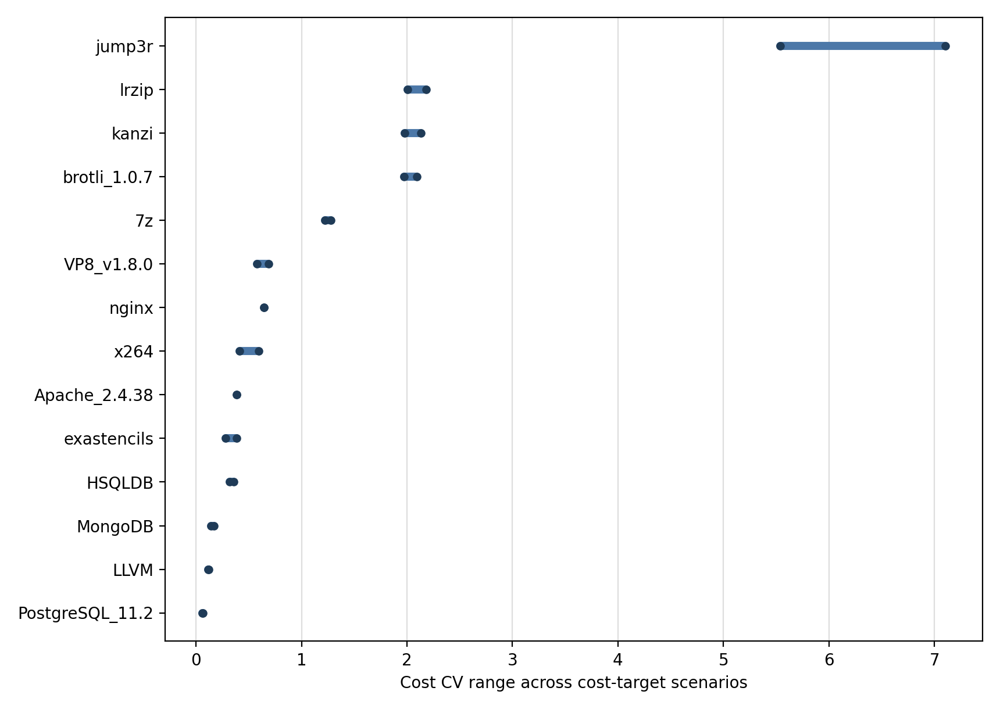
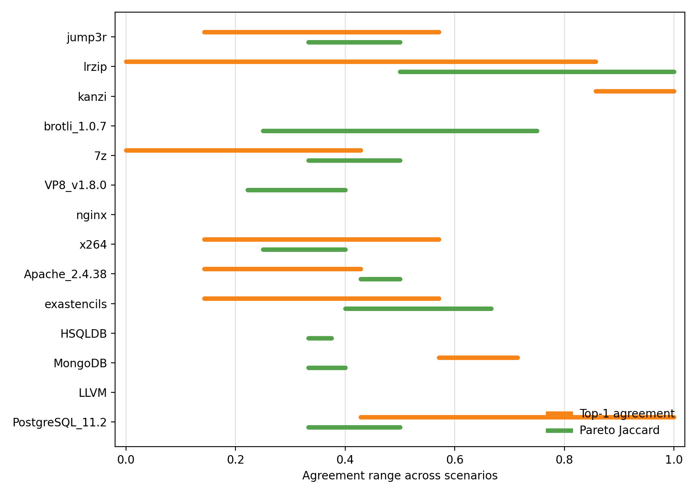

# TwinsOrFalseFriends Generated-Sampling Batch

## Scope

This is a broad generated-protocol pass with `2` seeds, max budget `16`, and row cap `5000`.

Revisioned systems are filtered to the latest revision unless the batch is run with `--keep-all-revisions`. Large systems may be row-capped, so this folder is exploratory unless rerun without a cap and with `--seeds 100`.

## System Coverage

| System | Filter | Rows used | Row cap | Report |
|---|---|---:|---:|---|
| `7z` | `none` | 5000 | 5000 | [7z/7z_generated_report.md](7z/7z_generated_report.md) |
| `Apache` | `revision=2.4.38` | 640 | none | [Apache_2_4_38/Apache_generated_report.md](Apache_2_4_38/Apache_generated_report.md) |
| `brotli` | `revision=1.0.7` | 180 | none | [brotli_1_0_7/brotli_generated_report.md](brotli_1_0_7/brotli_generated_report.md) |
| `exastencils` | `none` | 5000 | 5000 | [exastencils/exastencils_generated_report.md](exastencils/exastencils_generated_report.md) |
| `HSQLDB` | `none` | 864 | none | [HSQLDB/HSQLDB_generated_report.md](HSQLDB/HSQLDB_generated_report.md) |
| `jump3r` | `none` | 4296 | none | [jump3r/jump3r_generated_report.md](jump3r/jump3r_generated_report.md) |
| `kanzi` | `none` | 3202 | none | [kanzi/kanzi_generated_report.md](kanzi/kanzi_generated_report.md) |
| `LLVM` | `none` | 5000 | 5000 | [LLVM/LLVM_generated_report.md](LLVM/LLVM_generated_report.md) |
| `lrzip` | `none` | 5000 | 5000 | [lrzip/lrzip_generated_report.md](lrzip/lrzip_generated_report.md) |
| `MongoDB` | `none` | 5000 | 5000 | [MongoDB/MongoDB_generated_report.md](MongoDB/MongoDB_generated_report.md) |
| `nginx` | `none` | 4416 | none | [nginx/nginx_generated_report.md](nginx/nginx_generated_report.md) |
| `PostgreSQL` | `revision=11.2` | 864 | none | [PostgreSQL_11_2/PostgreSQL_generated_report.md](PostgreSQL_11_2/PostgreSQL_generated_report.md) |
| `VP8` | `revision=v1.8.0` | 2736 | none | [VP8_v1_8_0/VP8_generated_report.md](VP8_v1_8_0/VP8_generated_report.md) |
| `x264` | `none` | 4608 | none | [x264/x264_generated_report.md](x264/x264_generated_report.md) |

## Result Ranges

| System | Cost CV range | Top-1 agreement range | Pareto Jaccard range |
|---|---:|---:|---:|
| `7z` | 1.22-1.277 | 0-0.4286 | 0.3333-0.5 |
| `Apache_2.4.38` | 0.3825-0.3862 | 0.1429-0.4286 | 0.4286-0.5 |
| `brotli_1.0.7` | 1.974-2.092 | 0-0 | 0.25-0.75 |
| `exastencils` | 0.2812-0.3845 | 0.1429-0.5714 | 0.4-0.6667 |
| `HSQLDB` | 0.319-0.3584 | 0.4286-0.4286 | 0.3333-0.375 |
| `jump3r` | 5.538-7.104 | 0.1429-0.5714 | 0.3333-0.5 |
| `kanzi` | 1.978-2.132 | 0.8571-1 | 1-1 |
| `LLVM` | 0.117-0.1197 | 0.8571-0.8571 | 0.4-0.4 |
| `lrzip` | 2.005-2.182 | 0-0.8571 | 0.5-1 |
| `MongoDB` | 0.142-0.1672 | 0.5714-0.7143 | 0.3333-0.4 |
| `nginx` | 0.6412-0.6419 | 1-1 | 1-1 |
| `PostgreSQL_11.2` | 0.05751-0.06759 | 0.4286-1 | 0.3333-0.5 |
| `VP8_v1.8.0` | 0.5778-0.6863 | 0-0 | 0.2222-0.4 |
| `x264` | 0.4133-0.5945 | 0.1429-0.5714 | 0.25-0.4 |

## Interpretation

This batch is designed to maximize dataset coverage quickly. Use it to identify systems where empirical cost clearly matters, then rerun the strongest and weakest systems with `--seeds 100`, a larger `--max-budget`, and no row cap if feasible.
