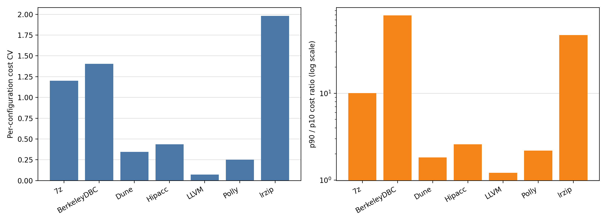
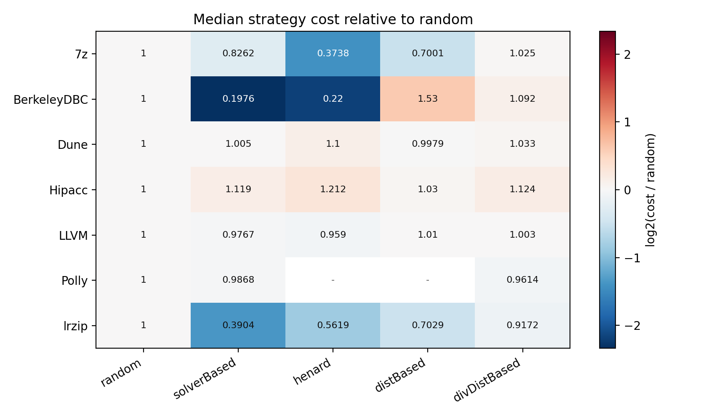
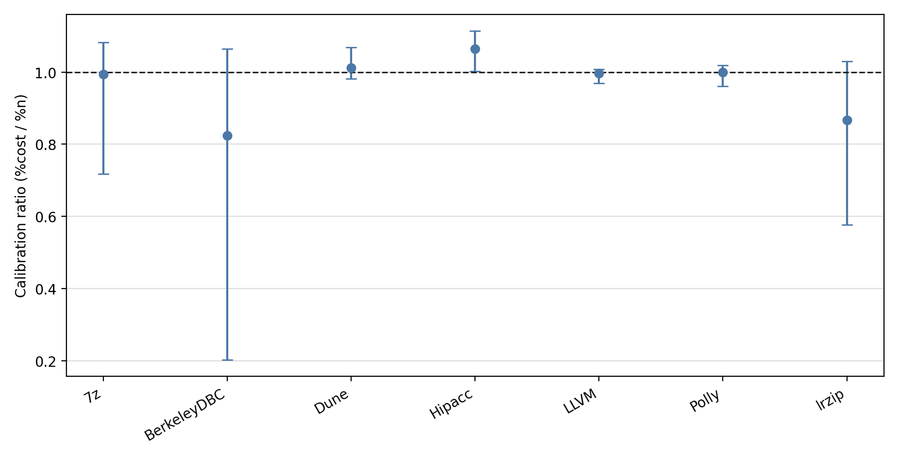
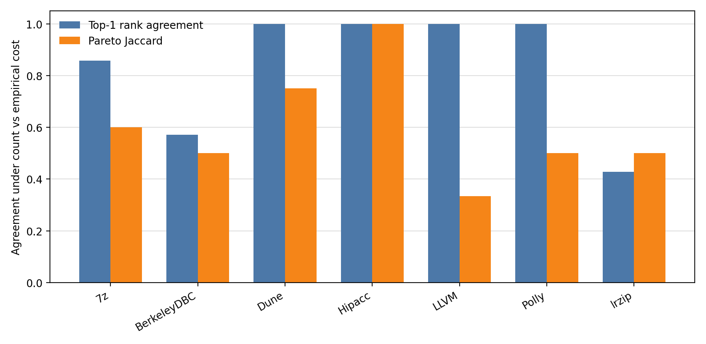

# NewRuns cross-system sampling-cost report

## Scope

This report systematizes the non-x264 `NewRuns.zip` systems that expose sampled configuration CSVs with a `Performance` column. Each system has one measured property, so every analysis is the diagonal scenario `cost=performance, target=performance`.

The cost model is the same as in the x264 infrastructure: empirical training cost is the sum of `Performance` over the configurations selected by a sampling run. The prediction target is also `Performance`, because these systems do not expose a separate size property in the sampled CSVs.

Included systems: 7z, BerkeleyDBC, Dune, Hipacc, LLVM, Polly, lrzip.

## Overall conclusion

The conclusion is stronger than for x264. On these NewRuns systems, empirical cost is often highly heterogeneous and strategy-dependent. Sample size remains a useful coarse axis, but it is not a calibrated cost model and it can change decision-level conclusions.

Across 7 systems, cost CV ranges from 0.07307 to 1.981 (median 0.4353), and p90/p10 cost ratio ranges from 1.216 to 79.05 (median 2.59). Median `%cost/%n` ranges from 0.8238 to 1.064. Pareto Jaccard ranges from 0.3333 to 1.

## RQ1: Empirical cost heterogeneity

| System | Reconstructed / expected configs | Cost CV | p90/p10 | Cost-over-random range | Strongest strategy-level bias |
|---|---:|---:|---:|---:|---|
| `7z` | 47072 / 68640 | 1.201 | 10.07 | 0.2739-1.141 | `solverBased_t1` = 0.2739 |
| `BerkeleyDBC` | 2235 / 2560 | 1.405 | 79.05 | 0.1211-2.01 | `henard_t1` = 0.1211 |
| `Dune` | 2304 / 2304 | 0.3438 | 1.827 | 0.9816-1.556 | `henard_t1` = 1.556 |
| `Hipacc` | 13472 / 13485 | 0.4353 | 2.59 | 1-1.696 | `solverBased_t1` = 1.696 |
| `LLVM` | 948 / 1024 | 0.07307 | 1.216 | 0.9161-1.026 | `solverBased_t1` = 0.9161 |
| `Polly` | 24183 / 60000 | 0.2508 | 2.182 | 0.861-1.016 | `divDistBased_t1` = 0.861 |
| `lrzip` | 432 / 432 | 1.981 | 47.04 | 0.2554-1.073 | `solverBased_t1` = 0.2554 |

Interpretation: the equal-cost assumption is weak for this batch. The issue is not only that configurations vary in cost; sampling strategies repeatedly select systematically cheaper or costlier regions at the same sample size.

## RQ2: Sample size as cost proxy

| System | Spearman rho | Median %cost/%n | IQR %cost/%n |
|---|---:|---:|---:|
| `7z` | 0.9429 | 0.9947 | 0.7178-1.082 |
| `BerkeleyDBC` | 0.8675 | 0.8238 | 0.2025-1.064 |
| `Dune` | 0.9429 | 1.013 | 0.9822-1.069 |
| `Hipacc` | 0.9429 | 1.064 | 1.002-1.114 |
| `LLVM` | 0.9432 | 0.9968 | 0.9698-1.007 |
| `Polly` | 0.943 | 0.9995 | 0.9612-1.019 |
| `lrzip` | 0.9421 | 0.8669 | 0.5771-1.03 |

Interpretation: high correlation does not imply calibration. Several systems have median ratios far from one or wide IQRs, so a count budget can overstate or understate empirical measurement cost depending on the strategy.

## RQ3: Ranking robustness

| System | Top-1 flips / 7 lambdas | Mean Kendall tau | Mean top-3 overlap |
|---|---:|---:|---:|
| `7z` | 1 / 7 | 0.831 | 0.8095 |
| `BerkeleyDBC` | 3 / 7 | 0.6049 | 0.5238 |
| `Dune` | 0 / 7 | 0.9619 | 1 |
| `Hipacc` | 0 / 7 | 0.9341 | 0.9048 |
| `LLVM` | 0 / 7 | 0.9619 | 1 |
| `Polly` | 0 / 7 | 0.9921 | 1 |
| `lrzip` | 4 / 7 | 0.7628 | 0.5714 |

Interpretation: replacing count by empirical cost can change the cost-sensitive ranking. The effect varies by system, which is exactly why systematizing beyond x264 matters.

## RQ4: Pareto-efficient sampling

| System | Jaccard | Count frontier size | Empirical frontier size | Best empirical simple pair |
|---|---:|---:|---:|---|
| `7z` | 0.6 | 3 | 5 | `random_t2` |
| `BerkeleyDBC` | 0.5 | 3 | 6 | `henard_t3` |
| `Dune` | 0.75 | 3 | 4 | `random_t1` |
| `Hipacc` | 1 | 2 | 2 | `random_t1` |
| `LLVM` | 0.3333 | 3 | 9 | `random_t1` |
| `Polly` | 0.5 | 3 | 6 | `random_t2` |
| `lrzip` | 0.5 | 3 | 6 | `solverBased_t2` |

Interpretation: the Pareto front is a compact decision-level witness. When Jaccard is below one, the empirical-cost view is not just a rescaled count-cost view; it changes which sampling choices are non-dominated.

## Per-system reports

- [`7z` report](7z/7z_performance_report.md)
- [`BerkeleyDBC` report](BerkeleyDBC/BerkeleyDBC_performance_report.md)
- [`Dune` report](Dune/Dune_performance_report.md)
- [`Hipacc` report](Hipacc/Hipacc_performance_report.md)
- [`LLVM` report](LLVM/LLVM_performance_report.md)
- [`Polly` report](Polly/Polly_performance_report.md)
- [`lrzip` report](lrzip/lrzip_performance_report.md)

## Paper-level takeaway

The NewRuns systems provide stronger evidence for the paper's main claim than x264 alone. x264 showed that sample size can be a strong but incomplete proxy. NewRuns shows that the incompleteness can be large enough to affect calibration, rankings, and Pareto-efficient recommendations across multiple configurable systems.
