# x264 2x2 cost-target matrix

## Scope and protocol

This report separates the property used as the cost axis from the property being predicted. For every x264 input `i`, it evaluates four scenarios:

- cost=time, target=time
- cost=time, target=size
- cost=size, target=time
- cost=size, target=size

Here `cost=size` means that the cost objective is the sum of selected configurations' measured output-size values. This is not elapsed acquisition time; it is a second empirical cost metric that can matter if the budget of interest is output footprint rather than measurement duration.

RQ1 and RQ2 are grouped by cost property because they only ask whether the selected configurations have heterogeneous empirical cost and whether `n` is calibrated against that cost. RQ3 and RQ4 are scenario-specific because rankings and Pareto frontiers combine the cost metric with target-specific prediction error.

The learner remains the current lightweight ridge/log-linear model, so this is an infrastructure and positioning result rather than the final modeling claim.

## Overall result

The correction matters. Cost-model validity is primarily a property of the cost axis, while strategy recommendation is a property of the cost-target pair. The same sampling run can be near-calibrated under time cost and differently calibrated under size cost, and the same cost model can produce different rankings depending on whether the target is time or size.

## RQ1: Empirical cost heterogeneity by cost property

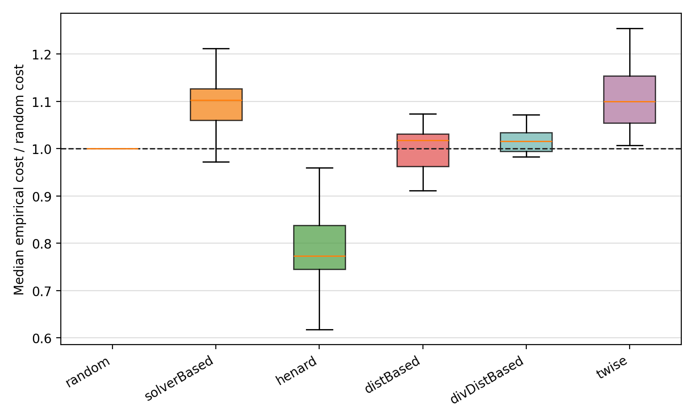

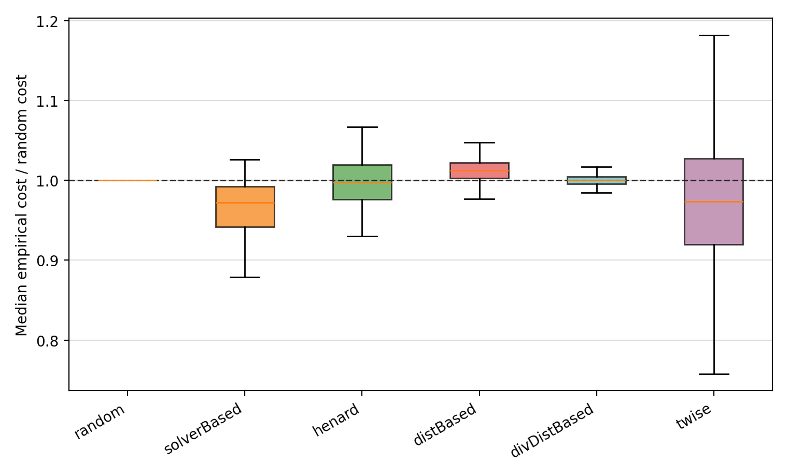

### Cost = time

Across 17 inputs, per-configuration cost CV ranges from 0.2116 to 0.3887 with median 0.2522. The p90/p10 cost ratio ranges from 1.774 to 2.976 with median 2.011.

At fixed sample size, median strategy overhead relative to random ranges from 0.6171 to 1.255.

Median cost-over-random by strategy: distBased=1.017; divDistBased=1.016; henard=0.7732; random=1; solverBased=1.102; twise=1.1.

### Cost = size

Across 17 inputs, per-configuration cost CV ranges from 0.04284 to 0.31 with median 0.1018. The p90/p10 cost ratio ranges from 1.118 to 2.212 with median 1.352.

At fixed sample size, median strategy overhead relative to random ranges from 0.6851 to 1.204.

Median cost-over-random by strategy: distBased=1.012; divDistBased=1; henard=0.9975; random=1; solverBased=0.9722; twise=0.9735.

Interpretation: RQ1 should not be tied to the prediction target. It asks whether the chosen cost metric itself is heterogeneous across configurations and sampling strategies. Both time and size show heterogeneity, but the magnitude and strategy bias should be reported separately.

## RQ2: Validity of sample size as cost proxy by cost property

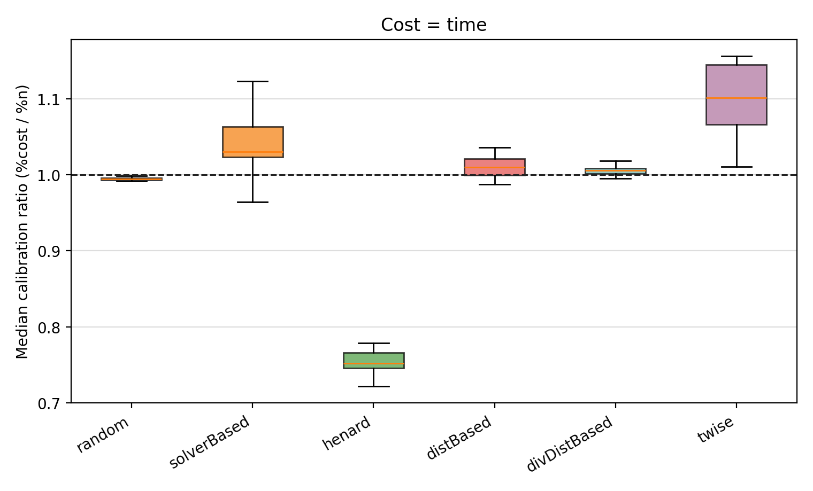

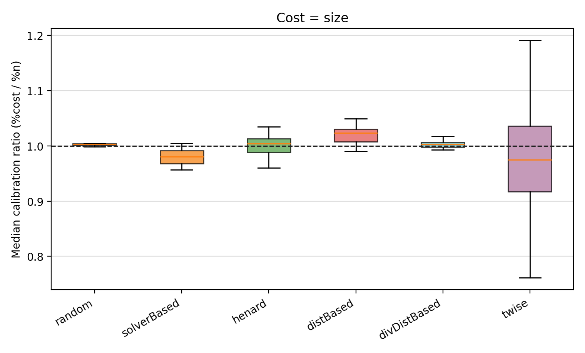

### Cost = time

Spearman rho between `n` and empirical cost ranges from 0.9431 to 0.9431, with median 0.9431. The context-level median calibration ratio `%cost/%n` ranges from 0.9942 to 1.021, with median 1.005. The lower quartile can drop to 0.9226, and the upper quartile can reach 1.113.

Median calibration ratio by strategy: distBased=1.01; divDistBased=1.006; henard=0.7524; random=0.9943; solverBased=1.03; twise=1.101.

### Cost = size

Spearman rho between `n` and empirical cost ranges from 0.9431 to 0.9431, with median 0.9431. The context-level median calibration ratio `%cost/%n` ranges from 0.9624 to 1.027, with median 0.9975. The lower quartile can drop to 0.836, and the upper quartile can reach 1.14.

Median calibration ratio by strategy: distBased=1.023; divDistBased=1.003; henard=1.004; random=1.003; solverBased=0.9806; twise=0.975.

Interpretation: `n` can remain highly correlated with a cost metric while still being miscalibrated for particular strategies. That statement should be made separately for time cost and size cost.

## RQ3: Robustness of conclusions by cost-target scenario

The figure below keeps the four scenarios separate. Each panel averages agreement across the 17 inputs only within one cost-target scenario.

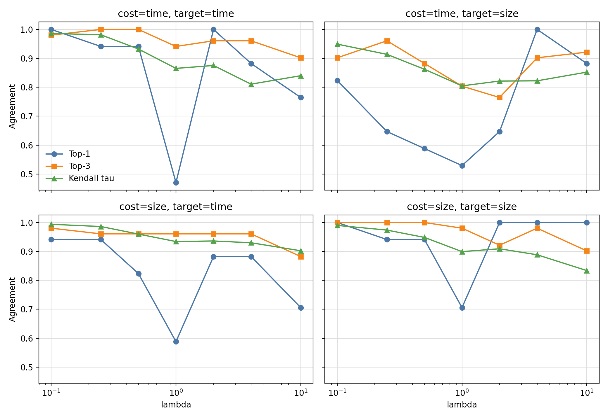

### cost=time, target=time

Across 119 `(input, lambda)` cases, top-1 rankings change 17 times, so top-1 agreement is 0.8571. Mean Kendall tau is 0.8988; the weakest lambda is 4 with tau 0.8108.

Most frequent simple best pairs: distBased_t1:10, random_t2:4, divDistBased_t1:3.

### cost=time, target=size

Across 119 `(input, lambda)` cases, top-1 rankings change 32 times, so top-1 agreement is 0.7311. Mean Kendall tau is 0.861; the weakest lambda is 1 with tau 0.805.

Most frequent simple best pairs: henard_t2:7, random_t1:5, henard_t1:2, twise_t1:2, random_t2:1.

### cost=size, target=time

Across 119 `(input, lambda)` cases, top-1 rankings change 21 times, so top-1 agreement is 0.8235. Mean Kendall tau is 0.949; the weakest lambda is 10 with tau 0.9023.

Most frequent simple best pairs: distBased_t1:8, divDistBased_t2:3, twise_t2:2, divDistBased_t1:2, distBased_t2:1, random_t2:1.

### cost=size, target=size

Across 119 `(input, lambda)` cases, top-1 rankings change 7 times, so top-1 agreement is 0.9412. Mean Kendall tau is 0.9205; the weakest lambda is 10 with tau 0.8339.

Most frequent simple best pairs: random_t2:5, random_t1:5, twise_t1:3, henard_t1:2, solverBased_t2:1, solverBased_t1:1.

Interpretation: RQ3 cannot be answered by cost alone. The ranking objective combines prediction error with the selected cost metric, so time-prediction and size-prediction can react differently to the same cost abstraction.

## RQ4: Pareto-efficient sampling by cost-target scenario

For each input and scenario, each point is a `(strategy, t-level)` choice summarized by median MRE and median cost over the 100 runs. A point is Pareto-efficient if no other point is at least as good on both axes, with a strict improvement on one axis. In other words, a dominated point is worse or equal in MRE and worse or equal in cost than another available choice.

The comparison asks whether the non-dominated choices change when the x-axis changes from count cost (`n / |C|`) to empirical cost (`TrainCost / FullCost`). Jaccard is the overlap between the two frontier sets:

`Jaccard = |frontier_count ∩ frontier_empirical| / |frontier_count ∪ frontier_empirical|`

A Jaccard value of `1` means both cost models identify exactly the same Pareto-efficient strategy-size pairs; `0` means they have no pair in common. Values around `0.4` mean that a substantial part of the decision frontier changes when measured cost replaces sample count.

The first figure summarizes frontier overlap per scenario. The tradeoff-plane figures show actual Pareto fronts with cost on the x-axis and MRE on the y-axis. These plane figures use median points across the 17 inputs for readability; the reported Jaccard values and pair frequencies are computed per input before summarization.

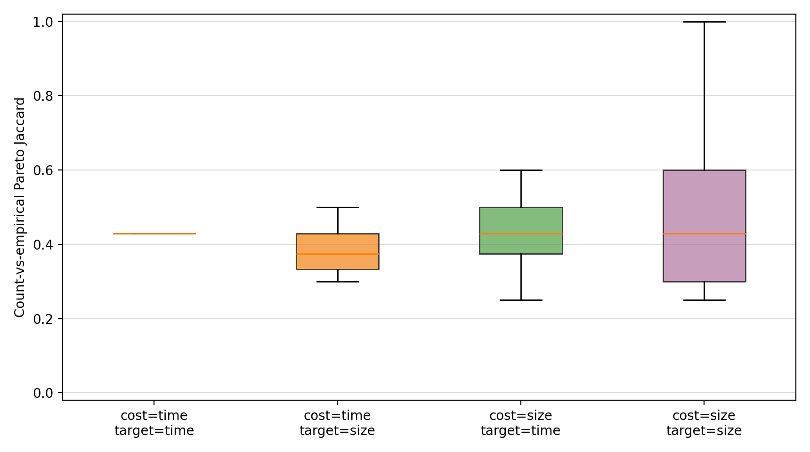

### cost=time, target=time

Median count-vs-empirical frontier Jaccard is 0.4286 (range 0.375-0.6).

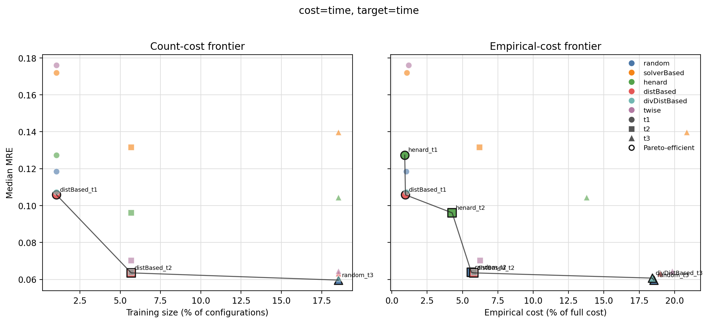

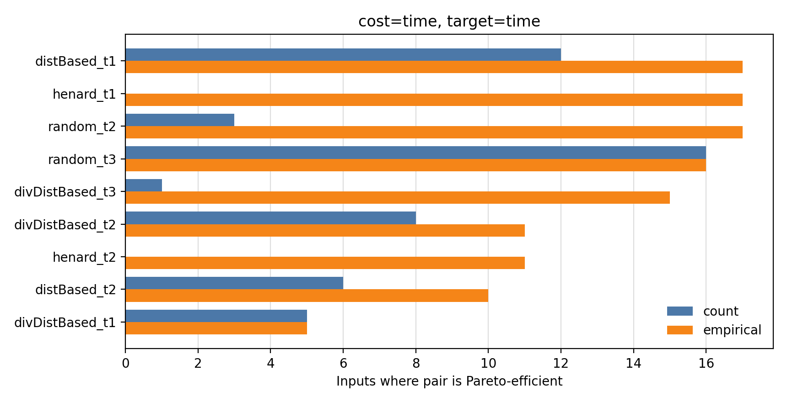

Count frontier concentration:

- `random_t3`: 16 / 17 contexts
- `distBased_t1`: 12 / 17 contexts
- `divDistBased_t2`: 8 / 17 contexts
- `distBased_t2`: 6 / 17 contexts
- `divDistBased_t1`: 5 / 17 contexts
- `random_t2`: 3 / 17 contexts
- `divDistBased_t3`: 1 / 17 contexts

Empirical frontier concentration:

- `distBased_t1`: 17 / 17 contexts
- `henard_t1`: 17 / 17 contexts
- `random_t2`: 17 / 17 contexts
- `random_t3`: 16 / 17 contexts
- `divDistBased_t3`: 15 / 17 contexts
- `divDistBased_t2`: 11 / 17 contexts
- `henard_t2`: 11 / 17 contexts
- `distBased_t2`: 10 / 17 contexts
- `divDistBased_t1`: 5 / 17 contexts

### cost=time, target=size

Median count-vs-empirical frontier Jaccard is 0.375 (range 0.3-0.6).

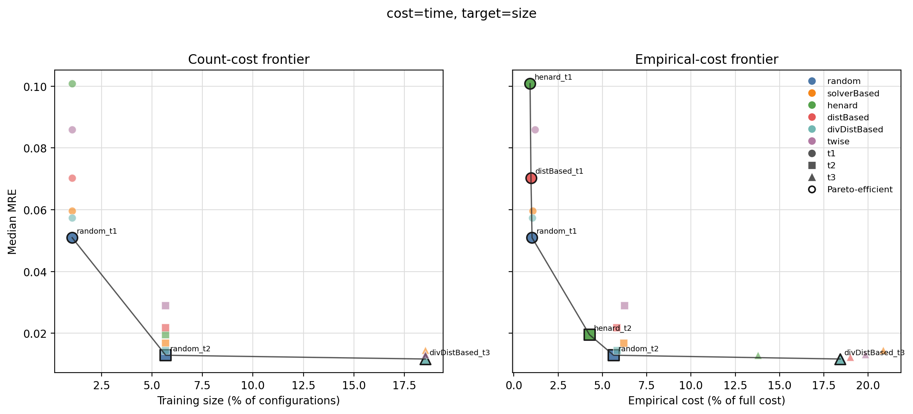

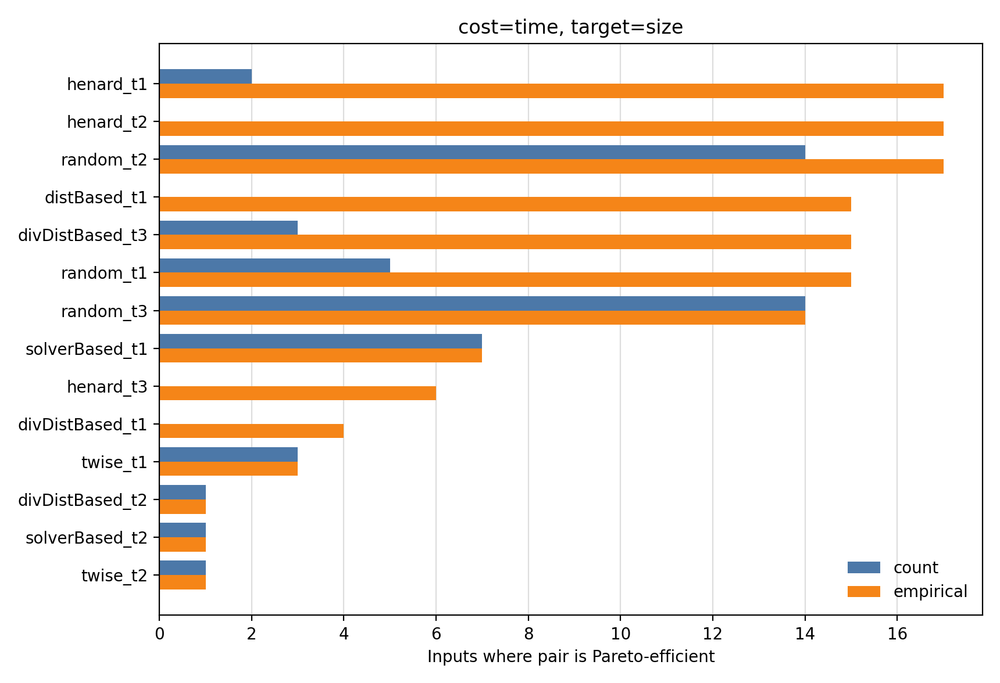

Count frontier concentration:

- `random_t2`: 14 / 17 contexts
- `random_t3`: 14 / 17 contexts
- `solverBased_t1`: 7 / 17 contexts
- `random_t1`: 5 / 17 contexts
- `divDistBased_t3`: 3 / 17 contexts
- `twise_t1`: 3 / 17 contexts
- `henard_t1`: 2 / 17 contexts
- `divDistBased_t2`: 1 / 17 contexts
- `solverBased_t2`: 1 / 17 contexts
- `twise_t2`: 1 / 17 contexts

Empirical frontier concentration:

- `henard_t1`: 17 / 17 contexts
- `henard_t2`: 17 / 17 contexts
- `random_t2`: 17 / 17 contexts
- `distBased_t1`: 15 / 17 contexts
- `divDistBased_t3`: 15 / 17 contexts
- `random_t1`: 15 / 17 contexts
- `random_t3`: 14 / 17 contexts
- `solverBased_t1`: 7 / 17 contexts
- `henard_t3`: 6 / 17 contexts
- `divDistBased_t1`: 4 / 17 contexts
- `twise_t1`: 3 / 17 contexts
- `divDistBased_t2`: 1 / 17 contexts
- `solverBased_t2`: 1 / 17 contexts
- `twise_t2`: 1 / 17 contexts

### cost=size, target=time

Median count-vs-empirical frontier Jaccard is 0.4286 (range 0.25-0.75).

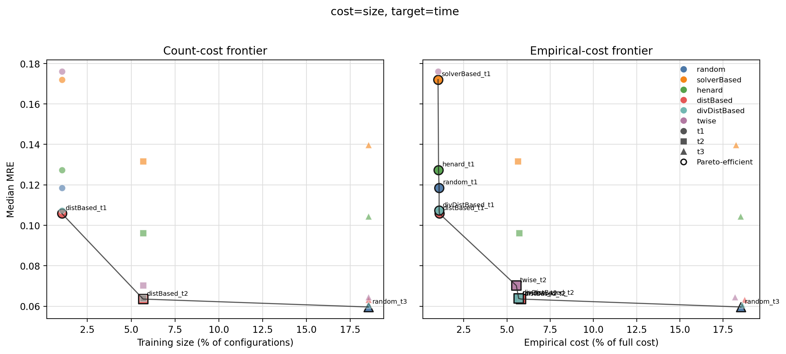

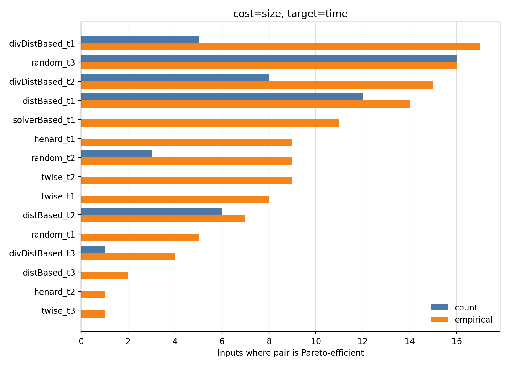

Count frontier concentration:

- `random_t3`: 16 / 17 contexts
- `distBased_t1`: 12 / 17 contexts
- `divDistBased_t2`: 8 / 17 contexts
- `distBased_t2`: 6 / 17 contexts
- `divDistBased_t1`: 5 / 17 contexts
- `random_t2`: 3 / 17 contexts
- `divDistBased_t3`: 1 / 17 contexts

Empirical frontier concentration:

- `divDistBased_t1`: 17 / 17 contexts
- `random_t3`: 16 / 17 contexts
- `divDistBased_t2`: 15 / 17 contexts
- `distBased_t1`: 14 / 17 contexts
- `solverBased_t1`: 11 / 17 contexts
- `henard_t1`: 9 / 17 contexts
- `twise_t2`: 9 / 17 contexts
- `random_t2`: 9 / 17 contexts
- `twise_t1`: 8 / 17 contexts
- `distBased_t2`: 7 / 17 contexts
- `random_t1`: 5 / 17 contexts
- `divDistBased_t3`: 4 / 17 contexts
- `distBased_t3`: 2 / 17 contexts
- `twise_t3`: 1 / 17 contexts
- `henard_t2`: 1 / 17 contexts

### cost=size, target=size

Median count-vs-empirical frontier Jaccard is 0.4286 (range 0.25-1).

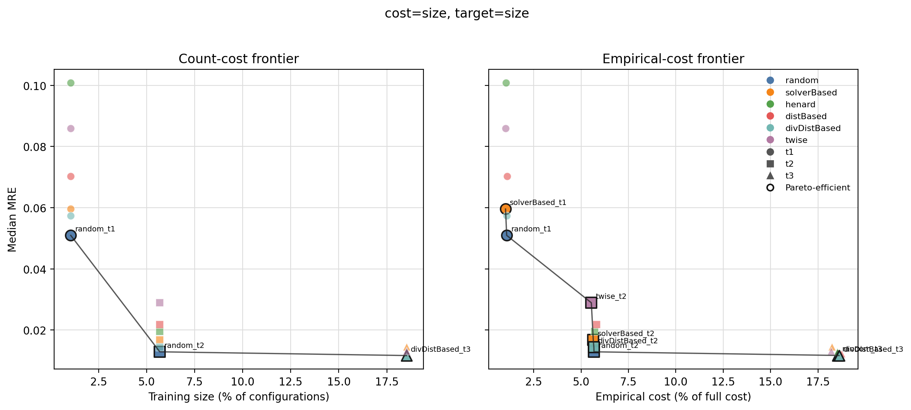

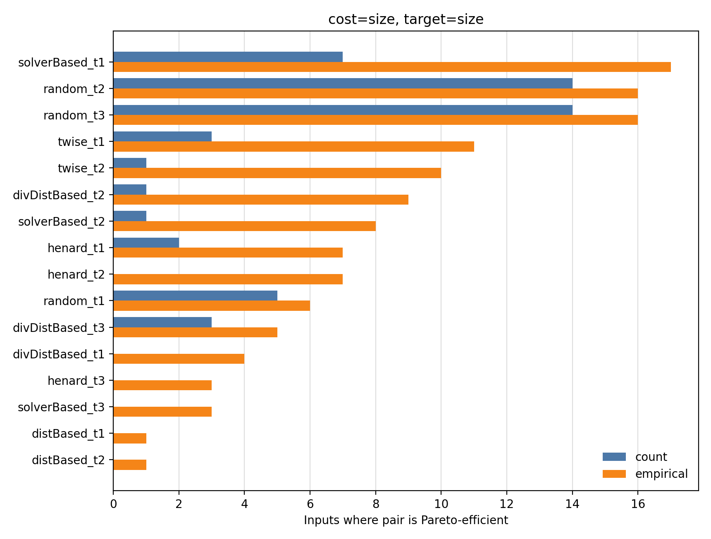

Count frontier concentration:

- `random_t2`: 14 / 17 contexts
- `random_t3`: 14 / 17 contexts
- `solverBased_t1`: 7 / 17 contexts
- `random_t1`: 5 / 17 contexts
- `divDistBased_t3`: 3 / 17 contexts
- `twise_t1`: 3 / 17 contexts
- `henard_t1`: 2 / 17 contexts
- `divDistBased_t2`: 1 / 17 contexts
- `solverBased_t2`: 1 / 17 contexts
- `twise_t2`: 1 / 17 contexts

Empirical frontier concentration:

- `solverBased_t1`: 17 / 17 contexts
- `random_t2`: 16 / 17 contexts
- `random_t3`: 16 / 17 contexts
- `twise_t1`: 11 / 17 contexts
- `twise_t2`: 10 / 17 contexts
- `divDistBased_t2`: 9 / 17 contexts
- `solverBased_t2`: 8 / 17 contexts
- `henard_t1`: 7 / 17 contexts
- `henard_t2`: 7 / 17 contexts
- `random_t1`: 6 / 17 contexts
- `divDistBased_t3`: 5 / 17 contexts
- `divDistBased_t1`: 4 / 17 contexts
- `henard_t3`: 3 / 17 contexts
- `solverBased_t3`: 3 / 17 contexts
- `distBased_t1`: 1 / 17 contexts
- `distBased_t2`: 1 / 17 contexts

RQ4 conclusion: the count-based frontier is not just a horizontally rescaled version of the empirical frontier. When empirical cost is used, fixed-size choices can move left or right depending on what they actually cost, so previously dominated points can become efficient and previously efficient points can disappear. This is the decision-level consequence of the RQ1/RQ2 calibration bias.

## Paper-level takeaway

The clean design is a 2x2 matrix: cost metric on one axis, prediction target on the other. RQ1 and RQ2 characterize the cost axis itself. RQ3 and RQ4 then ask how much the scientific conclusions change when that cost axis is combined with either time or size prediction error. This framing avoids conflating measurement-cost validity with target-prediction performance.
