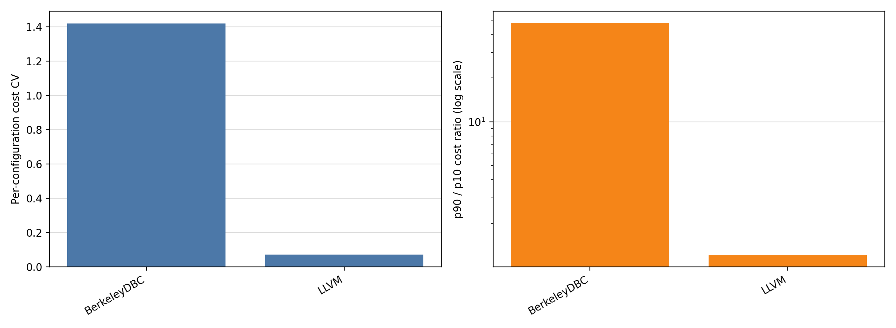
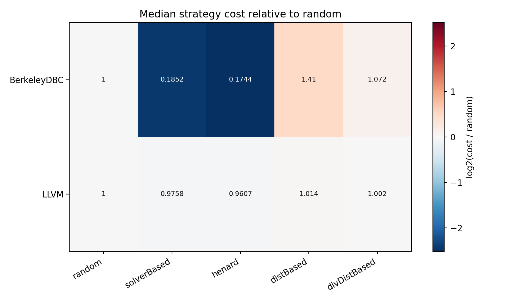
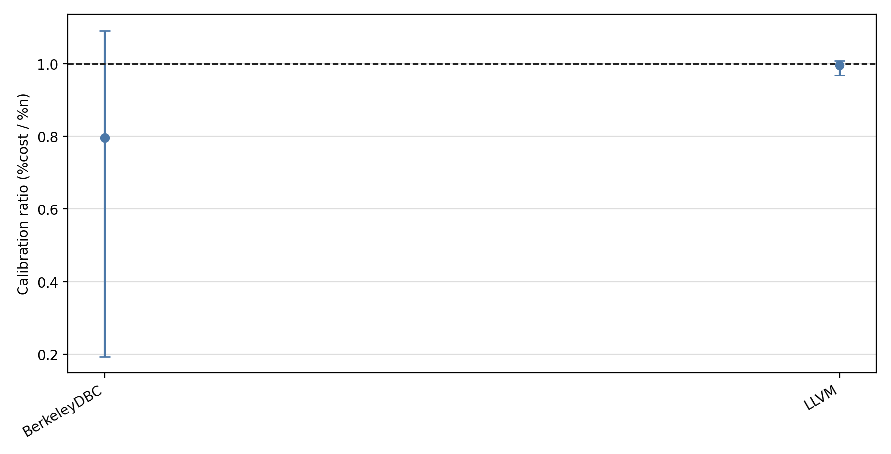
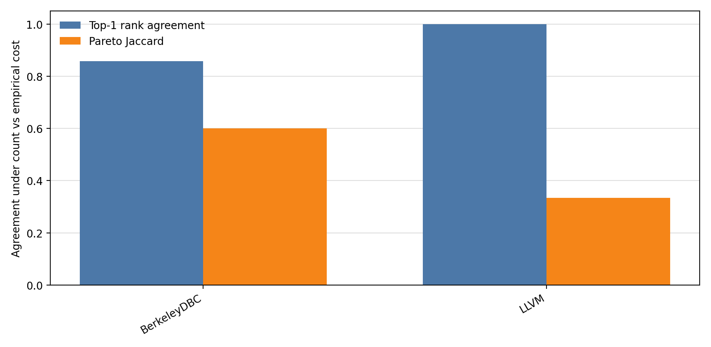

# NewRuns cross-system sampling-cost report

## Scope

This report systematizes the non-x264 `NewRuns.zip` systems that expose sampled configuration CSVs with a `Performance` column. Each system has one measured property, so every analysis is the diagonal scenario `cost=performance, target=performance`.

The cost model is the same as in the x264 infrastructure: empirical training cost is the sum of `Performance` over the configurations selected by a sampling run. The prediction target is also `Performance`, because these systems do not expose a separate size property in the sampled CSVs.

Included systems: BerkeleyDBC, LLVM.

## Overall conclusion

The conclusion is stronger than for x264. On these NewRuns systems, empirical cost is often highly heterogeneous and strategy-dependent. Sample size remains a useful coarse axis, but it is not a calibrated cost model and it can change decision-level conclusions.

Across 2 systems, cost CV ranges from 0.07236 to 1.42 (median 0.746), and p90/p10 cost ratio ranges from 1.212 to 47.9 (median 24.55). Median `%cost/%n` ranges from 0.7967 to 0.996. Pareto Jaccard ranges from 0.3333 to 0.6.

## RQ1: Empirical cost heterogeneity

| System | Reconstructed / expected configs | Cost CV | p90/p10 | Cost-over-random range | Strongest strategy-level bias |
|---|---:|---:|---:|---:|---|
| `BerkeleyDBC` | 2560 / 2560 | 1.42 | 47.9 | 0.1546-1.484 | `henard_t1` = 0.1546 |
| `LLVM` | 1024 / 1024 | 0.07236 | 1.212 | 0.9119-1.021 | `solverBased_t1` = 0.9119 |

Interpretation: the equal-cost assumption is weak for this batch. The issue is not only that configurations vary in cost; sampling strategies repeatedly select systematically cheaper or costlier regions at the same sample size.

## RQ2: Sample size as cost proxy

| System | Spearman rho | Median %cost/%n | IQR %cost/%n |
|---|---:|---:|---:|
| `BerkeleyDBC` | 0.8786 | 0.7967 | 0.1937-1.091 |
| `LLVM` | 0.943 | 0.996 | 0.9686-1.008 |

Interpretation: high correlation does not imply calibration. Several systems have median ratios far from one or wide IQRs, so a count budget can overstate or understate empirical measurement cost depending on the strategy.

## RQ3: Ranking robustness

| System | Top-1 flips / 7 lambdas | Mean Kendall tau | Mean top-3 overlap |
|---|---:|---:|---:|
| `BerkeleyDBC` | 1 / 7 | 0.6047 | 0.6667 |
| `LLVM` | 0 / 7 | 0.9455 | 1 |

Interpretation: replacing count by empirical cost can change the cost-sensitive ranking. The effect varies by system, which is exactly why systematizing beyond x264 matters.

## RQ4: Pareto-efficient sampling

| System | Jaccard | Count frontier size | Empirical frontier size | Best empirical simple pair |
|---|---:|---:|---:|---|
| `BerkeleyDBC` | 0.6 | 3 | 5 | `random_t2` |
| `LLVM` | 0.3333 | 3 | 9 | `random_t1` |

Interpretation: the Pareto front is a compact decision-level witness. When Jaccard is below one, the empirical-cost view is not just a rescaled count-cost view; it changes which sampling choices are non-dominated.

## Per-system reports

- [`BerkeleyDBC` report](BerkeleyDBC/BerkeleyDBC_performance_report.md)
- [`LLVM` report](LLVM/LLVM_performance_report.md)

## Paper-level takeaway

The NewRuns systems provide stronger evidence for the paper's main claim than x264 alone. x264 showed that sample size can be a strong but incomplete proxy. NewRuns shows that the incompleteness can be large enough to affect calibration, rankings, and Pareto-efficient recommendations across multiple configurable systems.
