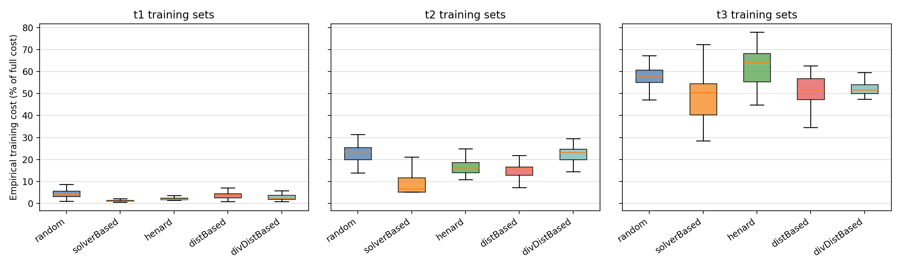
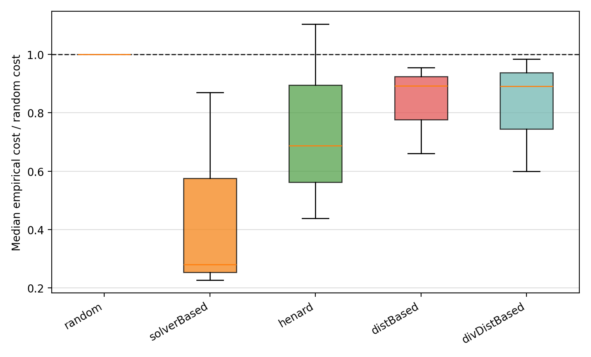
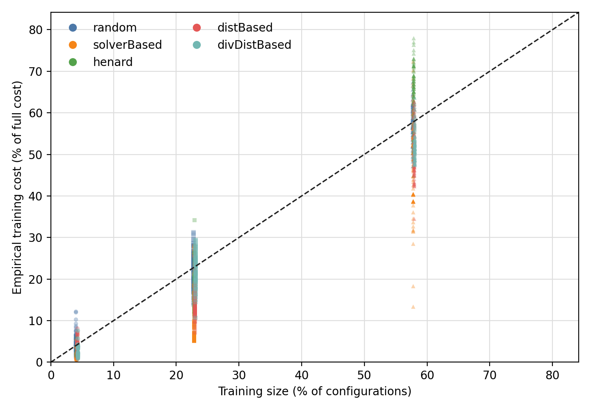
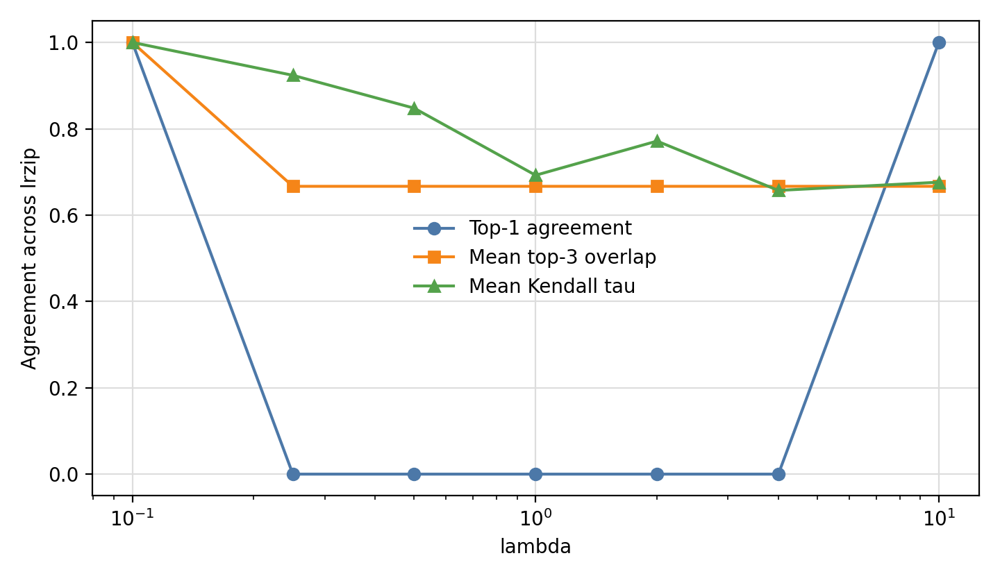
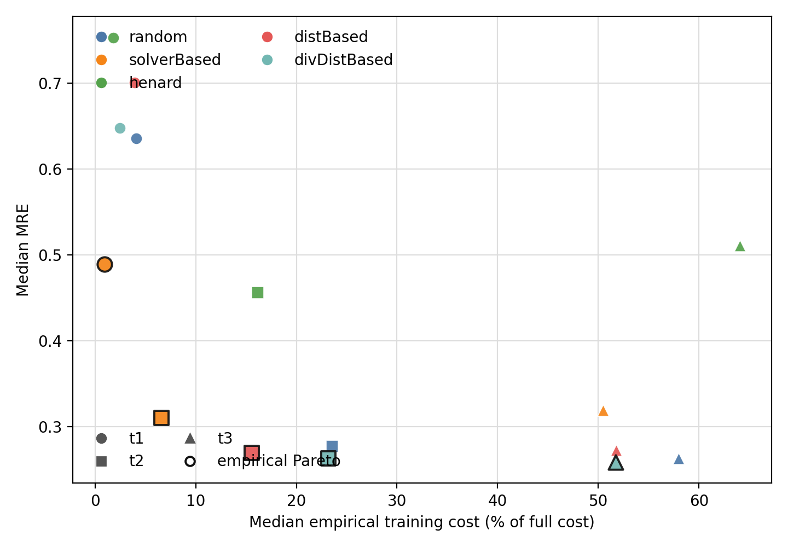
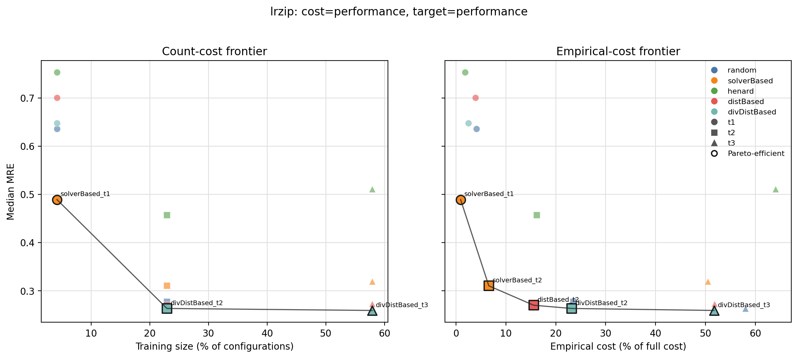

# lrzip sampling-cost report

## Scope and protocol

This report extends the infrastructure beyond x264 using `lrzip` from `NewRuns.zip`. The archive exposes sampled configuration CSVs for this system. The only available measured property is `Performance`, so this is the single diagonal scenario: empirical performance is both the cost of measuring a selected configuration and the target being predicted.

The sampled CSVs reconstruct 432 of 432 configurations. The current learner remains the lightweight ridge/log-linear model.

Because there is no separate size property here, this report is not a 2x2 matrix. It is the non-x264 analogue of the `cost=performance, target=performance` case.

## RQ1: Empirical cost heterogeneity

Per-configuration empirical cost is heterogeneous: CV is 1.981, and the p90/p10 cost ratio is 47.04. At fixed sample size, strategy overhead relative to random ranges from 0.2259 to 1.104.

Median cost-over-random by strategy:

- `distBased`: 0.8929
- `divDistBased`: 0.8915
- `henard`: 0.6868
- `random`: 1
- `solverBased`: 0.2794

Interpretation: even on this non-x264 system, `n` does not force all strategies at the same level to consume the same empirical cost. The strength of the bias depends on which regions of the configuration space the strategy selects.

## RQ2: Sample size as cost proxy

Spearman rho between `n` and empirical `TrainCost` is 0.9374. The median calibration ratio `%cost/%n` is 0.8563, with IQR 0.5665-1.005.

Median calibration ratio by strategy:

- `distBased`: 0.8161
- `divDistBased`: 0.8888
- `henard`: 0.7627
- `random`: 1.003
- `solverBased`: 0.3869

Interpretation: sample size is useful as a first-order axis only if one is satisfied with coarse ordering. Calibration and strategy-specific bias still need to be checked.

## RQ3: Ranking robustness

Across 7 lambda values, the top-1 recommendation changes 5 times, so top-1 agreement is 0.2857. Mean Kendall tau is 0.7955; the weakest lambda is 4 with tau 0.6571.

Interpretation: this directly tests whether a count-cost conclusion survives when empirical cost replaces sample size in the same accuracy-cost objective.

## RQ4: Pareto-efficient sampling

Count-vs-empirical frontier Jaccard is 0.6. The count-cost frontier contains:

- `divDistBased_t2`
- `divDistBased_t3`
- `solverBased_t1`

The empirical-cost frontier contains:

- `distBased_t2`
- `divDistBased_t2`
- `divDistBased_t3`
- `solverBased_t1`
- `solverBased_t2`

Interpretation: the Pareto comparison is the decision-level check. If the two lists differ, then replacing count cost by empirical cost changes which sampling choices are non-dominated.

## Takeaway

`lrzip` gives a useful non-x264 replication point. It does not support the full time/size matrix because the archive exposes one `Performance` property, but it does let us test the central cost-proxy claim on another configurable system using the same code path.
