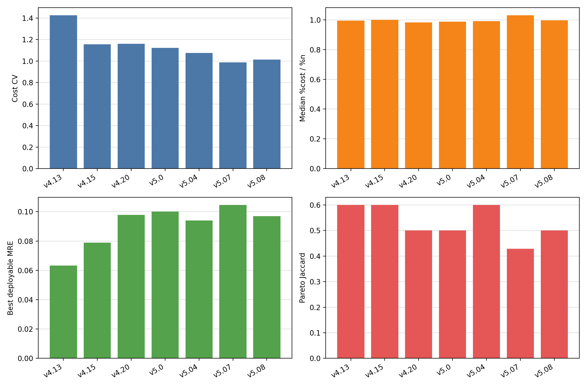
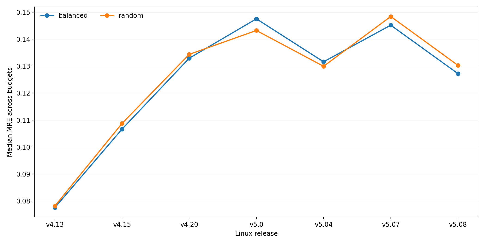

# Linux HGBT all-feature cross-release report

## Scope

This report summarizes the strong-learner Linux batch: `sk-hgbt-log`, all post-pruning feature columns, and approximately 1k/5k/10k generated training budgets across seven Linux releases.

The older Linux report remains the reproducibility-oriented baseline. This report is the strong-default learner view for the learner-sensitivity question.

## Main Findings

- Best observed deployable MRE is `0.06319` on `v4.13` with `balanced_n09997` at `0.1075` empirical cost fraction.
- Cost heterogeneity remains high in every release: CV ranges `0.9887`-`1.425`.
- Count-cost calibration is close at the aggregate level: median `%cost/%n` ranges `0.9827`-`1.03`.
- Decision-level Pareto disagreement remains visible: worst release is `v5.07` with Jaccard `0.4286`.

## Release Summary

| Release | Features | Configs | Cost CV | Proxy ratio | Top-1 agreement | Pareto Jaccard | Best MRE pair | Best MRE |
|---|---:|---:|---:|---:|---:|---:|---|---:|
| `v4.13` | 8760 | 92562 | 1.425 | 0.9944 | 0.7143 | 0.6 | `balanced_n09997` | 0.06319 |
| `v4.15` | 8960 | 39391 | 1.157 | 0.9997 | 0.4286 | 0.6 | `balanced_n04254` | 0.07897 |
| `v4.20` | 9645 | 23489 | 1.16 | 0.9827 | 0.2857 | 0.5 | `balanced_n02537` | 0.0979 |
| `v5.0` | 9733 | 19952 | 1.123 | 0.9868 | 0.4286 | 0.5 | `random_n02155` | 0.1001 |
| `v5.04` | 10283 | 25847 | 1.076 | 0.9918 | 0.2857 | 0.6 | `balanced_n02791` | 0.09407 |
| `v5.07` | 10740 | 20159 | 0.9887 | 1.03 | 0.4286 | 0.4286 | `balanced_n02177` | 0.1046 |
| `v5.08` | 10935 | 21923 | 1.014 | 0.9969 | 0.1429 | 0.5 | `balanced_n02368` | 0.09702 |

## Hypothesis Summary

| Hypothesis | Verdict | Supports | Refutes | Inconclusive |
|---|---|---:|---:|---:|
| `H1a` | supported (7/7) | 7 | 0 | 0 |
| `H1b` | mixed (sup=0, ref=1, inc=6 of 7) | 0 | 1 | 6 |
| `H2a` | supported (7/7) | 7 | 0 | 0 |
| `H2b` | refuted (5/7) | 0 | 5 | 2 |
| `H2c` | refuted (5/7) | 0 | 5 | 2 |
| `H3a` | supported (7/7) | 7 | 0 | 0 |
| `H4a` | supported (7/7) | 7 | 0 | 0 |
| `H4b` | supported (7/7) | 7 | 0 | 0 |

## Output Files

- `release_summary.csv`: one row per Linux release.
- `all_strategy_summary.csv`, `all_records.csv`, `all_rq*_*.csv`: concatenated per-release artifacts.
- `hypothesis_tests.csv` and `hypothesis_summary.csv`: H1a-H4b tests over release scopes.
- `fig_linux_hgbt_release_metrics.png` and `fig_linux_hgbt_strategy_mre.png`: cross-release figures.
