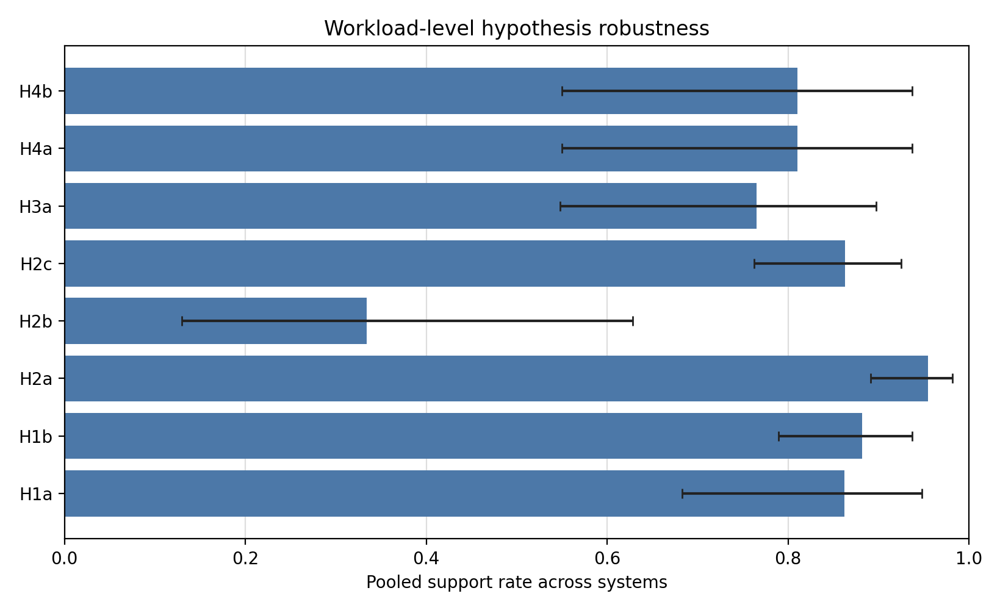
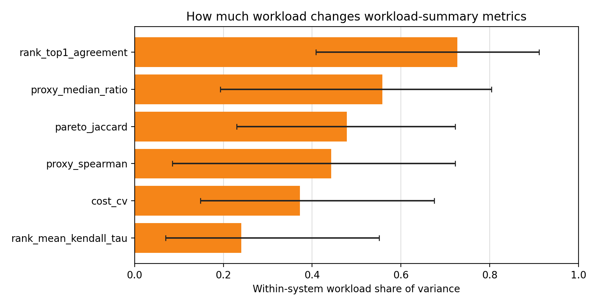

# Workload-Aware Cross-System Inference

Input batch: `/Users/mathieuacher/SANDBOX/cost-sampling-matters/artifacts/strong_learner_overnight/workload/sk-hgbt-log`.

This report answers a narrower question than the earlier system-level summaries:
once the system is fixed, does the workload still change the empirical conclusions?

The analysis has two layers:

1. formal workload-level H1a--H4b tests for each of the 93 workload contexts, using the existing `cost_sampling.hypotheses` logic;
2. cross-system random-effects meta-analysis of workload-level support rates, plus a random-intercept variance decomposition for workload-summary metrics.

## Headline

- Most workload-robust hypothesis: `H2a` with pooled support rate 0.9549 (95% CI 0.8916-0.982).
- Least workload-robust hypothesis: `H2b` with pooled support rate 0.3341 (95% CI 0.1297-0.6282).
- Strongest within-system workload share: `rank_top1_agreement` at 0.7269 (95% CI 0.4087-0.9114).
- Most system-dominated metric: `rank_mean_kendall_tau` at 0.2405 (95% CI 0.06975-0.5511).

## Meta-Analytic Robustness

| Hypothesis | Raw support | Pooled support | 95% CI | I2 | Mixed systems | Interpretation |
|---|---:|---:|---:|---:|---:|---|
| `H1a` | 0.871 | 0.8621 | 0.6827-0.9478 | 0.5935 | 4/9 | mostly robust |
| `H1b` | 0.9462 | 0.8822 | 0.7897-0.9373 | 0 | 3/9 | mostly robust |
| `H2a` | 1 | 0.9549 | 0.8916-0.982 | 0 | 0/9 | robust across workloads |
| `H2b` | 0.3656 | 0.3341 | 0.1297-0.6282 | 0.759 | 7/9 | workload-sensitive |
| `H2c` | 0.9355 | 0.8631 | 0.7628-0.9251 | 0 | 3/9 | mostly robust |
| `H3a` | 0.7527 | 0.765 | 0.5482-0.8973 | 0.6599 | 6/9 | mostly robust |
| `H4a` | 0.7742 | 0.8104 | 0.5502-0.9372 | 0.7118 | 3/9 | mostly robust |
| `H4b` | 0.7742 | 0.8104 | 0.5502-0.9372 | 0.7118 | 3/9 | mostly robust |

Interpretation:
- `H1b`, `H2a`, and `H2c` are workload-robust overall: fixed-n strategy cost differences usually remain visible, the count-based proxy stays positively correlated with empirical cost, and strategy effects on calibration generally survive workload changes.
- `H1a` is mostly robust but not universal: some systems, especially `dconvert`, contain workloads where cost heterogeneity becomes weak enough to refute or soften the claim.
- `H2b`, `H3a`, `H4a`, and `H4b` are workload-sensitive: changing workload can materially change whether miscalibration, rank flips, or Pareto disagreements appear.

## Within-System Workload Sensitivity

| Metric | Workload share | 95% CI | Median abs centered deviation | Interpretation |
|---|---:|---:|---:|---|
| `cost_cv` | 0.3725 | 0.1487-0.6747 | 0.1361 | mixed |
| `proxy_spearman` | 0.4431 | 0.08527-0.7218 | 0.01683 | mixed |
| `proxy_median_ratio` | 0.5584 | 0.1935-0.8039 | 0.009935 | workload-dominant |
| `rank_top1_agreement` | 0.7269 | 0.4087-0.9114 | 0.0989 | workload-dominant |
| `rank_mean_kendall_tau` | 0.2405 | 0.06975-0.5511 | 0.03186 | system-dominant |
| `pareto_jaccard` | 0.4783 | 0.23-0.722 | 0.08974 | mixed |

This variance decomposition says how much of the observed workload-summary variation remains inside systems after removing the system mean.
Values around `0.5` mean workload is contributing about as much as the system identity; values closer to `0` mean the metric is mainly system-driven.

## Per-System Verdict Stability

| System | H1a | H1b | H2a | H2b | H2c | H3a | H4b |
|---|---|---|---|---|---|---|---|
| `batik` | 10/11 support | 11/11 support | 11/11 support | 1/11 support | 11/11 support | 10/11 support | 11/11 support |
| `dconvert` | 4/12 support | 11/12 support | 12/12 support | 0/12 support | 11/12 support | 10/12 support | 12/12 support |
| `h2` | 6/8 support | 7/8 support | 8/8 support | 0/8 support | 7/8 support | 6/8 support | 8/8 support |
| `jump3r` | 6/6 support | 6/6 support | 6/6 support | 0/6 support | 6/6 support | 6/6 support | 6/6 support |
| `kanzi` | 9/9 support | 9/9 support | 9/9 support | 4/9 support | 9/9 support | 8/9 support | 4/9 support |
| `lrzip` | 12/13 support | 10/13 support | 13/13 support | 1/13 support | 9/13 support | 2/13 support | 2/13 support |
| `x264` | 9/9 support | 9/9 support | 9/9 support | 8/9 support | 9/9 support | 9/9 support | 9/9 support |
| `xz` | 13/13 support | 13/13 support | 13/13 support | 12/13 support | 13/13 support | 13/13 support | 13/13 support |
| `z3` | 12/12 support | 12/12 support | 12/12 support | 8/12 support | 12/12 support | 6/12 support | 7/12 support |

Practical reading:
- If the question is whether the simple count proxy remains positively aligned with true cost, the answer is yes almost everywhere.
- If the question is whether count-based decisions are safe regardless of workload, the answer is no: rank and Pareto conclusions move substantially with workload in several systems.
- Calibration is the most nuanced case: workload often changes its magnitude, and in some systems it changes the formal verdict.

## Output Files

- `workload_level_hypothesis_tests.csv`: formal H1a--H4b verdicts for each workload context.
- `workload_hypothesis_robustness.csv`: per-system verdict stability across workloads.
- `workload_hypothesis_meta.csv`: random-effects meta-analysis of workload-level support rates.
- `workload_metric_variance.csv`: random-intercept variance decomposition for workload-summary metrics.
- `fig_workload_meta_support_rates.png`: pooled workload-level support rates by hypothesis.
- `fig_workload_metric_variance.png`: workload-share-of-variance chart for the workload-summary metrics.
