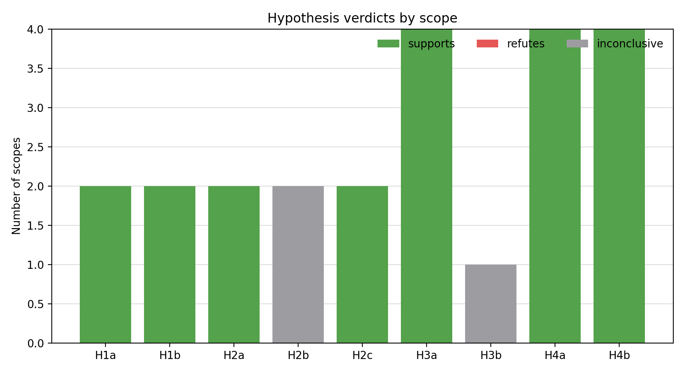

# TwinsOrFalseFriends Generated-Sampling Hypothesis Checks

## Scope

Input batch: `artifacts/twins_HSQLDB_generated`.

The tests reuse the H1a--H4b operationalization in `cost_sampling/hypotheses.py`.
For this 2x2 performance/energy setting, scopes are deliberately not aggregated:

- H1/H2 are tested per system and cost property.
- H3/H4 are tested per system, cost property, and prediction target.
- H3b is a single cross-scenario correlation between cost CV and top-1 rank flips.

The main H1/H2 tests exclude the diagnostic cheap/expensive oracles; oracle calibration is reported separately.

This run has 20 stochastic seeds and no row cap recorded in the scenario summary.
H3b is descriptive only for this single-system report; use the broad batch for the cross-system H3b claim.

## Verdict Summary

| Hypothesis | RQ | Scope | Verdict summary | Interpretation |
|---|---|---|---|---|
| H1a | RQ1 | system-cost | supported (2/2) (2 support, 0 refute, 0 inconclusive) | Per-configuration acquisition cost is usually heterogeneous. Strong-CV contexts: 0/2. |
| H1b | RQ1 | system-cost | supported (2/2) (2 support, 0 refute, 0 inconclusive) | Formal strategy-cost effects are supported in 2/2 scopes; 2/2 scopes have large eta^2. |
| H2a | RQ2 | system-cost | supported (2/2) (2 support, 0 refute, 0 inconclusive) | n is often rank-correlated with TrainCost; strong rho contexts: 2/2. |
| H2b | RQ2 | system-cost | mixed (sup=0, ref=0, inc=2 of 2) (0 support, 0 refute, 2 inconclusive) | Aggregate median calibration is conditional, with context medians spanning 0.994-0.995. |
| H2c | RQ2 | system-cost | supported (2/2) (2 support, 0 refute, 0 inconclusive) | Calibration depends on strategy, so a single global ratio is not enough. |
| H3a | RQ3 | system-cost-target | supported (4/4) (4 support, 0 refute, 0 inconclusive) | Count-cost and empirical-cost rankings disagree in 4/4 scenarios. |
| H3b | RQ3 | global scenarios | mixed (sup=0, ref=0, inc=1 of 1) (0 support, 0 refute, 1 inconclusive) | Cross-scenario CV-to-flip relation: rho=0.577, p=0.423. |
| H4a | RQ4 | system-cost-target | supported (4/4) (4 support, 0 refute, 0 inconclusive) | At least one pair flips Pareto status in most or all scenarios. |
| H4b | RQ4 | system-cost-target | supported (4/4) (4 support, 0 refute, 0 inconclusive) | Count and empirical Pareto frontiers differ in 4/4 scenarios. |

## RQ-Level Synthesis

**RQ1.** The equal-cost-per-configuration assumption is not credible for Twins overall.
H1a gives the formal support. H1b also supports strategy-induced cost differences at fixed n.
The strongest cost heterogeneity appears in:

- `twins_HSQLDB_generated` cost=`energy`: CV=0.358, p90/p10=2.26.
- `twins_HSQLDB_generated` cost=`performance`: CV=0.319, p90/p10=2.04.

The lowest-heterogeneity contrasts are:

- `twins_HSQLDB_generated` cost=`performance`: CV=0.319, p90/p10=2.04.
- `twins_HSQLDB_generated` cost=`energy`: CV=0.358, p90/p10=2.26.

**RQ2.** Sample size is a useful ordering proxy in many contexts, but not a complete cost model.
The median calibration ratios across system-cost contexts span 0.994-0.995, and H2c shows that strategy-specific calibration must be reported.

**RQ3.** The cost model changes cost-sensitive strategy rankings.
Top-1 recommendations change in 4/4 cost-target scenarios under the lambda sweep.
This is why performance/energy cost and performance/energy targets should be kept faceted.

**RQ4.** The Pareto-front conclusion is stronger than the scalar-ranking conclusion.
Empirical-cost and count-cost frontiers differ in 4/4 scenarios.
For paper figures, prefer the per-system frontier plots because the x-axis is an actual cost fraction and the y-axis is MRE.

## Per-Strategy Calibration Appendix

This table aggregates per-system bootstrap checks of the median calibration ratio by strategy and cost property.
The verdict is `miscalibrated` when the 95% bootstrap CI excludes 1 and the median deviation is at least 5%.
With limited stochastic repetition, deterministic strategies and oracles often have fewer than ten records per system-cost context, so `inconclusive` here usually means insufficient bootstrap sample size rather than evidence of calibration.

| Cost | Strategy | Scopes | Calibrated | Miscalibrated | Inconclusive | Median ratio | Median abs deviation |
|---|---|---:|---:|---:|---:|---:|---:|
| `energy` | `balanced` | 1 | 0 | 0 | 1 | 1.01 | 0.00721 |
| `energy` | `cheapOracle` | 1 | 0 | 1 | 0 | 0.715 | 0.285 |
| `energy` | `diversity` | 1 | 1 | 0 | 0 | 0.989 | 0.0112 |
| `energy` | `expensiveOracle` | 1 | 0 | 1 | 0 | 1.72 | 0.715 |
| `energy` | `pairwise` | 1 | 0 | 0 | 1 | 0.985 | 0.0148 |
| `energy` | `pilotCost` | 1 | 0 | 1 | 0 | 0.843 | 0.157 |
| `energy` | `random` | 1 | 1 | 0 | 0 | 1 | 0.00305 |
| `performance` | `balanced` | 1 | 0 | 0 | 1 | 1.01 | 0.0101 |
| `performance` | `cheapOracle` | 1 | 0 | 1 | 0 | 0.766 | 0.234 |
| `performance` | `diversity` | 1 | 1 | 0 | 0 | 0.988 | 0.0116 |
| `performance` | `expensiveOracle` | 1 | 0 | 1 | 0 | 1.59 | 0.595 |
| `performance` | `pairwise` | 1 | 0 | 0 | 1 | 0.983 | 0.0173 |
| `performance` | `pilotCost` | 1 | 0 | 1 | 0 | 0.854 | 0.146 |
| `performance` | `random` | 1 | 1 | 0 | 0 | 1 | 0.000248 |

## Output Files

- `hypothesis_tests.csv`: one row per formal H1--H4 test scope.
- `hypothesis_summary.csv`: support/refute/inconclusive counts per hypothesis.
- `strategy_calibration_tests.csv`: per-system, per-cost, per-strategy bootstrap calibration checks.
- `strategy_calibration_summary.csv`: aggregate strategy-calibration table.
- `fig_twins_hypothesis_verdicts.png`: stacked verdict-count figure.
