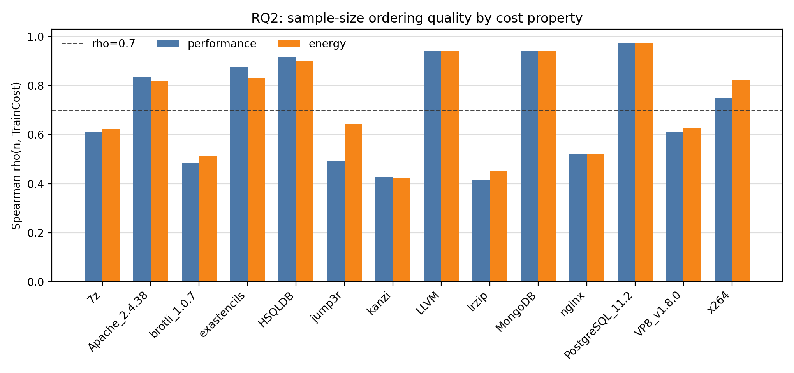
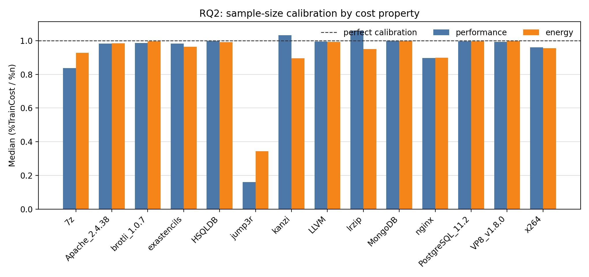
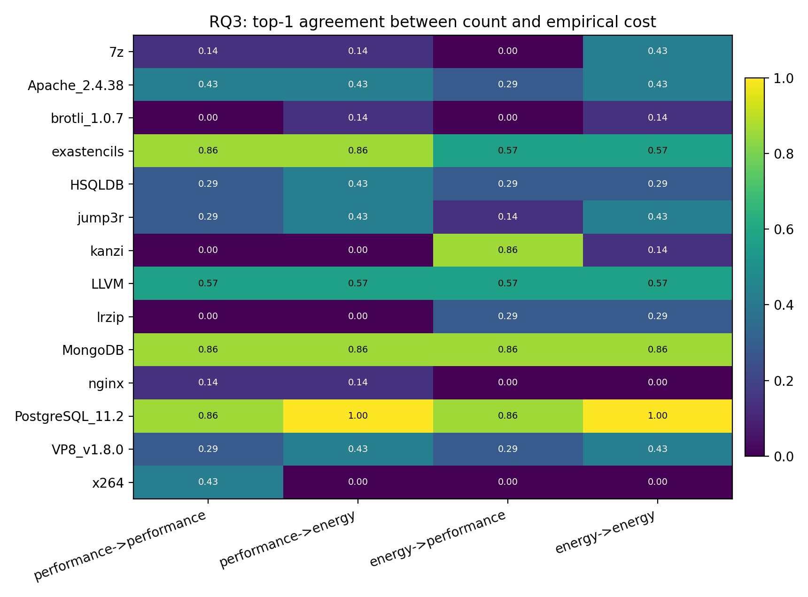
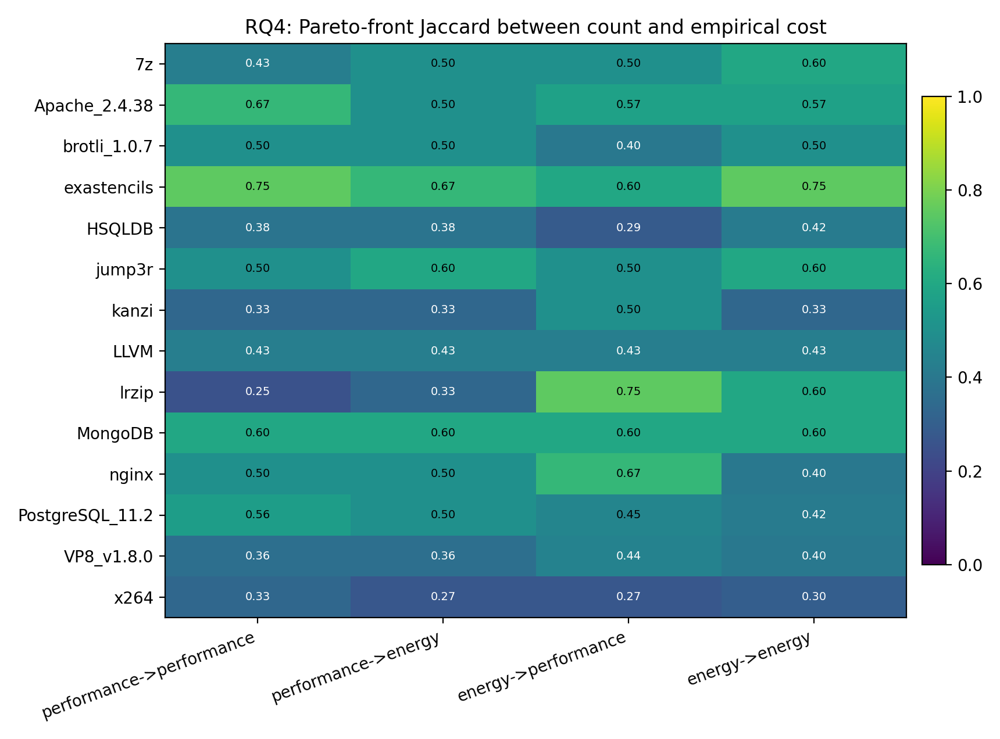
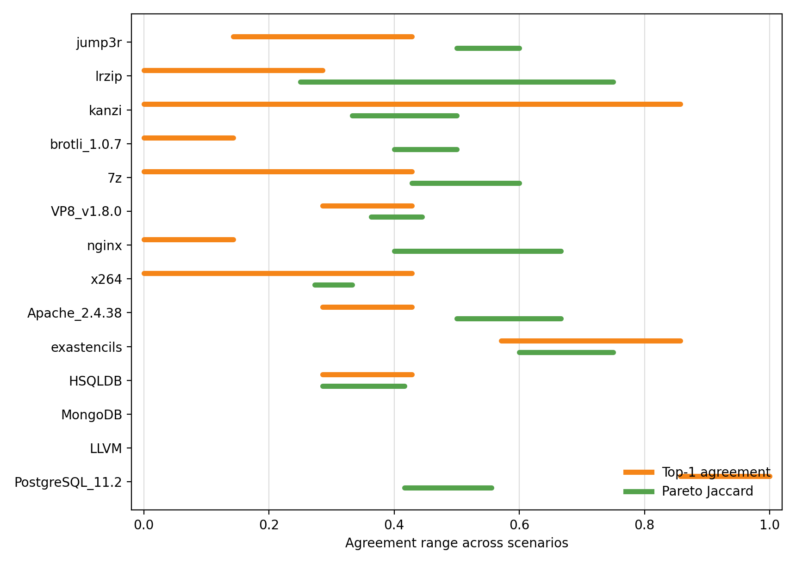

# TwinsOrFalseFriends Generated-Sampling Batch

## Scope

This report summarizes the generated-sampling protocol over the TwinsOrFalseFriends performance/energy data.
Unlike the ICPE x264 and Kaltenecker/NewRuns tiers, this dataset has no precomputed sampling traces; samples are generated from the measured configuration universe.

Systems covered: `14`. Cost-target scenarios: `56`.
Seeds per stochastic strategy: `3`.
Budget grids observed: `8 13 16 32; 8 16 28 32; 8 16 32 ...`.
Row-capped systems: `7z, LLVM, MongoDB, exastencils, lrzip`.

RQ1 and RQ2 are grouped by cost property because they only concern acquisition cost.
RQ3 and RQ4 are grouped by cost-target scenario because accuracy depends on the prediction target.

## RQ Answers

### RQ1: Empirical Cost Heterogeneity

**Answer:** empirical acquisition cost is heterogeneous across Twins systems and cost properties, but the magnitude is system-dependent.
Across 28 system-cost contexts, CV spans 0.05751-7.104; 16 contexts have CV >= 0.4.
Hypothesis checks: H1a is supported (23/28); 23/28 supporting scopes; H1b is mixed (sup=0, ref=0, inc=28 of 28); 0/28 supporting scopes. The quick batch is underpowered for the fixed-n strategy-effect test, so H1b remains a rerun-with-more-seeds item even when cost-over-random ranges are visibly wide.

Strongest heterogeneity examples:

- `jump3r` cost=`performance`: CV=7.104, p90/p10=4.504.
- `jump3r` cost=`energy`: CV=5.538, p90/p10=2.2.
- `lrzip` cost=`performance`: CV=2.182, p90/p10=26.19.
- `kanzi` cost=`energy`: CV=2.132, p90/p10=80.46.

Lowest-heterogeneity contrasts:

- `PostgreSQL_11.2` cost=`energy`: CV=0.05751, p90/p10=1.151.
- `PostgreSQL_11.2` cost=`performance`: CV=0.06759, p90/p10=1.177.
- `LLVM` cost=`energy`: CV=0.117, p90/p10=1.369.
- `LLVM` cost=`performance`: CV=0.1197, p90/p10=1.379.

### RQ2: Sample Size as a Cost Proxy

**Answer:** sample size is often a useful rank proxy, but it is not sufficient as a calibrated cost model.
Spearman rho spans 0.413-0.9735; 14/28 contexts have rho >= 0.7.
Median calibration `%TrainCost/%n` spans 0.1615-1.06; 8/28 contexts deviate by at least 5%.
Hypothesis checks: H2a is supported (28/28); 28/28 supporting scopes; H2b is refuted (15/28); 5/28 supporting scopes; H2c is supported (27/28); 27/28 supporting scopes.

Interpretation: high rho means larger samples usually cost more, but calibration and strategy bias still matter for budget claims.

### RQ3: Ranking Robustness

**Answer:** replacing count cost with empirical cost frequently changes the best cost-accuracy choice.
Top-1 recommendations differ in 54/56 scenarios.
Hypothesis checks: H3a is supported (54/56); 54/56 supporting scopes; H3b is supported (1/1); 1/1 supporting scopes.

Least stable ranking scenarios:

- `7z` cost=energy, target=performance: top-1 agreement=0, flips=7/7, tau=0.551.
- `brotli_1.0.7` cost=performance, target=performance: top-1 agreement=0, flips=7/7, tau=0.6176.
- `brotli_1.0.7` cost=energy, target=performance: top-1 agreement=0, flips=7/7, tau=0.6253.
- `kanzi` cost=performance, target=performance: top-1 agreement=0, flips=7/7, tau=0.4527.

Most stable ranking scenarios:

- `PostgreSQL_11.2` cost=performance, target=energy: top-1 agreement=1, flips=0/7.
- `PostgreSQL_11.2` cost=energy, target=energy: top-1 agreement=1, flips=0/7.
- `exastencils` cost=performance, target=performance: top-1 agreement=0.8571, flips=1/7.
- `exastencils` cost=performance, target=energy: top-1 agreement=0.8571, flips=1/7.

### RQ4: Pareto-Efficient Sampling

**Answer:** Pareto conclusions are even more sensitive than scalar top-1 rankings.
Count-cost and empirical-cost frontiers differ in 56/56 scenarios.
Hypothesis checks: H4a is supported (56/56); 56/56 supporting scopes; H4b is supported (56/56); 56/56 supporting scopes.

Largest frontier disagreements:

- `lrzip` cost=performance, target=performance: Pareto Jaccard=0.25, count=2, empirical=3.
- `x264` cost=performance, target=energy: Pareto Jaccard=0.2727, count=3, empirical=11.
- `x264` cost=energy, target=performance: Pareto Jaccard=0.2727, count=3, empirical=11.
- `HSQLDB` cost=energy, target=performance: Pareto Jaccard=0.2857, count=5, empirical=13.

For intuitive paper figures, use the per-system `fig_rq4_frontier_*.png` files: they show MRE against count-cost and empirical-cost frontiers on the same plane.

## System Coverage

| System | Filter | Rows used | Row cap | Report |
|---|---|---:|---:|---|
| `7z` | `none` | 5000 | 5000 | [7z/7z_generated_report.md](7z/7z_generated_report.md) |
| `Apache` | `revision=2.4.38` | 640 | 0 | [Apache_2_4_38/Apache_generated_report.md](Apache_2_4_38/Apache_generated_report.md) |
| `brotli` | `revision=1.0.7` | 180 | 0 | [brotli_1_0_7/brotli_generated_report.md](brotli_1_0_7/brotli_generated_report.md) |
| `exastencils` | `none` | 5000 | 5000 | [exastencils/exastencils_generated_report.md](exastencils/exastencils_generated_report.md) |
| `HSQLDB` | `none` | 864 | 0 | [HSQLDB/HSQLDB_generated_report.md](HSQLDB/HSQLDB_generated_report.md) |
| `jump3r` | `none` | 4296 | 0 | [jump3r/jump3r_generated_report.md](jump3r/jump3r_generated_report.md) |
| `kanzi` | `none` | 3202 | 0 | [kanzi/kanzi_generated_report.md](kanzi/kanzi_generated_report.md) |
| `LLVM` | `none` | 5000 | 5000 | [LLVM/LLVM_generated_report.md](LLVM/LLVM_generated_report.md) |
| `lrzip` | `none` | 5000 | 5000 | [lrzip/lrzip_generated_report.md](lrzip/lrzip_generated_report.md) |
| `MongoDB` | `none` | 5000 | 5000 | [MongoDB/MongoDB_generated_report.md](MongoDB/MongoDB_generated_report.md) |
| `nginx` | `none` | 4416 | 0 | [nginx/nginx_generated_report.md](nginx/nginx_generated_report.md) |
| `PostgreSQL` | `revision=11.2` | 864 | 0 | [PostgreSQL_11_2/PostgreSQL_generated_report.md](PostgreSQL_11_2/PostgreSQL_generated_report.md) |
| `VP8` | `revision=v1.8.0` | 2736 | 0 | [VP8_v1_8_0/VP8_generated_report.md](VP8_v1_8_0/VP8_generated_report.md) |
| `x264` | `none` | 4608 | 0 | [x264/x264_generated_report.md](x264/x264_generated_report.md) |

## Scenario Ranges

| System | Cost CV range | Spearman rho range | Median ratio range | Top-1 agreement range | Pareto Jaccard range |
|---|---:|---:|---:|---:|---:|
| `7z` | 1.22-1.277 | 0.6083-0.6222 | 0.8374-0.928 | 0-0.4286 | 0.4286-0.6 |
| `Apache_2.4.38` | 0.3825-0.3862 | 0.8171-0.8332 | 0.9816-0.9842 | 0.2857-0.4286 | 0.5-0.6667 |
| `brotli_1.0.7` | 1.974-2.092 | 0.4842-0.5126 | 0.9865-0.9959 | 0-0.1429 | 0.4-0.5 |
| `exastencils` | 0.2812-0.3845 | 0.8315-0.8762 | 0.964-0.9816 | 0.5714-0.8571 | 0.6-0.75 |
| `HSQLDB` | 0.319-0.3584 | 0.8999-0.9173 | 0.9908-0.9974 | 0.2857-0.4286 | 0.2857-0.4167 |
| `jump3r` | 5.538-7.104 | 0.4911-0.6418 | 0.1615-0.3445 | 0.1429-0.4286 | 0.5-0.6 |
| `kanzi` | 1.978-2.132 | 0.4241-0.4269 | 0.8958-1.032 | 0-0.8571 | 0.3333-0.5 |
| `LLVM` | 0.117-0.1197 | 0.9431-0.9431 | 0.993-0.9945 | 0.5714-0.5714 | 0.4286-0.4286 |
| `lrzip` | 2.005-2.182 | 0.413-0.452 | 0.9503-1.06 | 0-0.2857 | 0.25-0.75 |
| `MongoDB` | 0.142-0.1672 | 0.9431-0.9431 | 0.9972-0.9975 | 0.8571-0.8571 | 0.6-0.6 |
| `nginx` | 0.6412-0.6419 | 0.519-0.519 | 0.8975-0.8978 | 0-0.1429 | 0.4-0.6667 |
| `PostgreSQL_11.2` | 0.05751-0.06759 | 0.9724-0.9735 | 0.9959-0.9963 | 0.8571-1 | 0.4167-0.5556 |
| `VP8_v1.8.0` | 0.5778-0.6863 | 0.612-0.628 | 0.9935-0.9984 | 0.2857-0.4286 | 0.3636-0.4444 |
| `x264` | 0.4133-0.5945 | 0.7478-0.8231 | 0.9542-0.9594 | 0-0.4286 | 0.2727-0.3333 |

## Files To Use

- `scenario_summary.csv`: compact table for all 56 cost-target scenarios.
- `hypothesis_tests.csv` and `hypothesis_summary.csv`: formal H1--H4 verdicts.
- `twins_hypothesis_report.md`: readable hypothesis-test synthesis.
- Per-system folders: detailed RQ reports and the Pareto-front figures for each scenario.

## Caveat

This folder is an exploratory broad pass. Use it to select representative systems and figures.
For final claims, rerun selected systems or the whole batch with more seeds, larger budgets, and no row cap where feasible.
