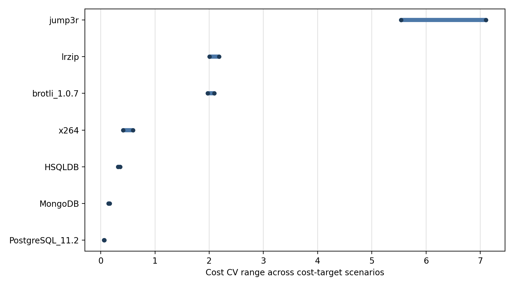
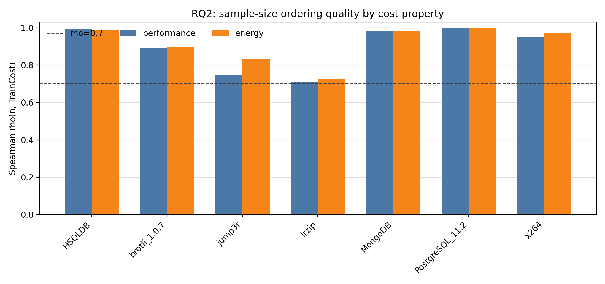
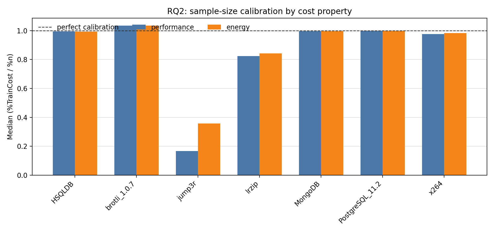
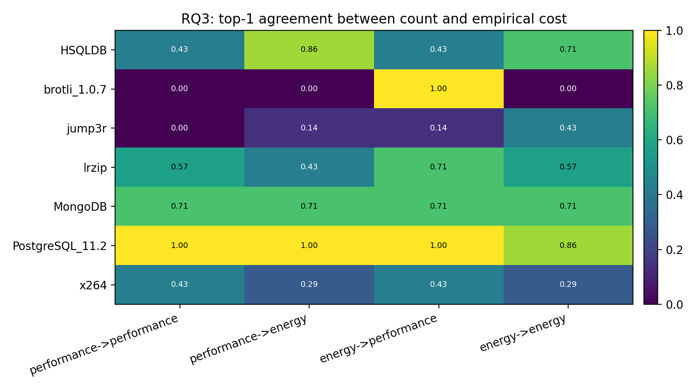
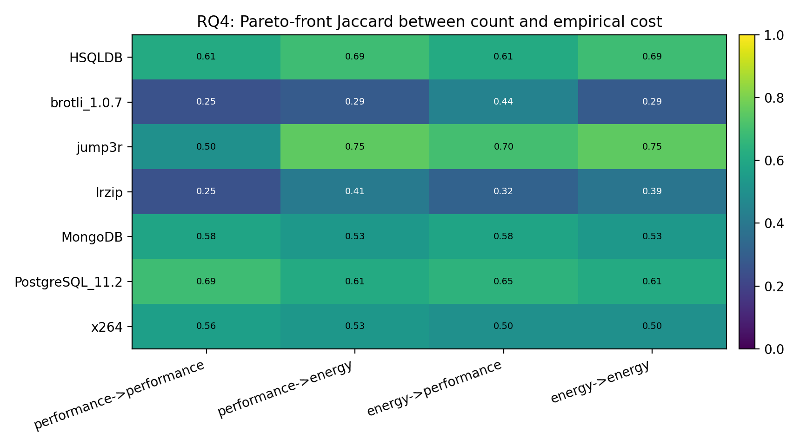
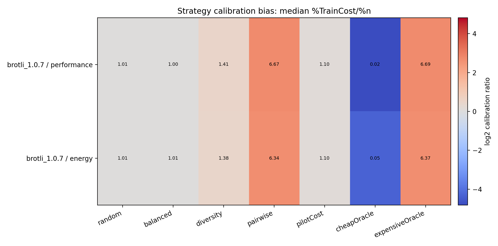
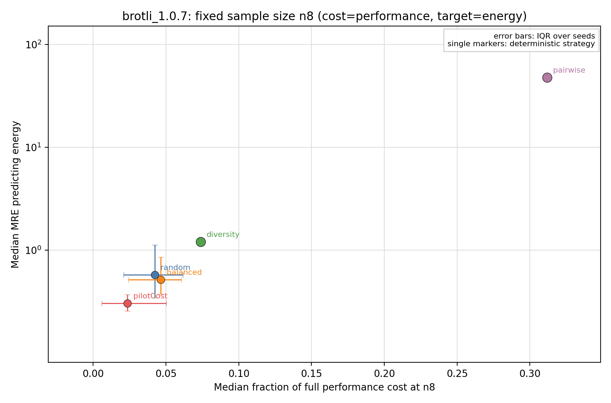
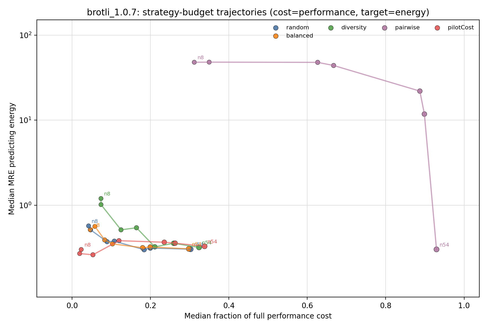
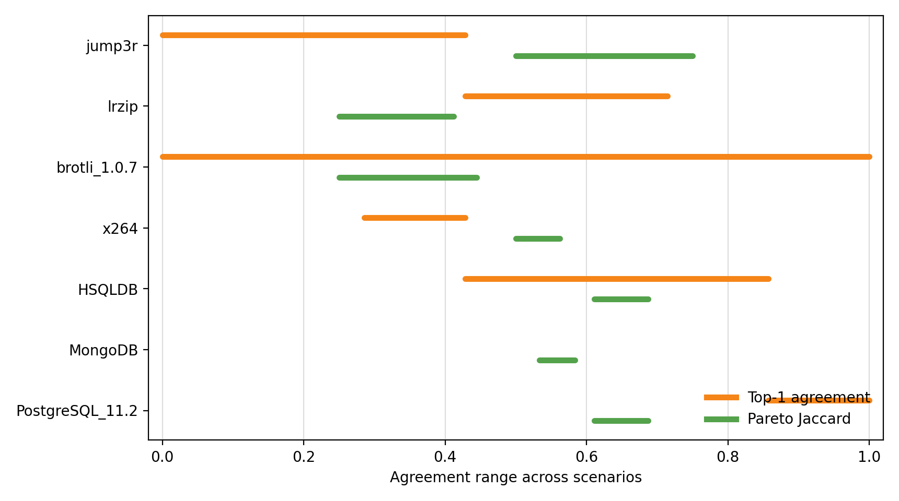

# TwinsOrFalseFriends Generated-Sampling Batch

## Scope

This report summarizes the generated-sampling protocol over the TwinsOrFalseFriends performance/energy data.
Unlike the ICPE x264 and Kaltenecker/NewRuns tiers, this dataset has no precomputed sampling traces; samples are generated from the measured configuration universe.

Systems covered: `7`. Cost-target scenarios: `28`.
Seeds per stochastic strategy: `100`.
Budget grids observed: `8 16 32 43 64 86 128 215 256; 8 16 32 47 64 93 128 231 256; 8 16 32 52 64 104 128 256 ...`.
Row-capped systems: `none`.

RQ1 and RQ2 are grouped by cost property because they only concern acquisition cost.
RQ3 and RQ4 are grouped by cost-target scenario because accuracy depends on the prediction target.

## RQ Answers

### RQ1: Empirical Cost Heterogeneity

**Answer:** empirical acquisition cost is heterogeneous across Twins systems and cost properties, but the magnitude is system-dependent.
Across 14 system-cost contexts, CV spans 0.05751-7.104; 8 contexts have CV >= 0.4.
Hypothesis checks: H1a is supported (11/14); 11/14 supporting scopes; H1b is supported (14/14); 14/14 supporting scopes.

Strongest heterogeneity examples:

- `jump3r` cost=`performance`: CV=7.104, p90/p10=4.504.
- `jump3r` cost=`energy`: CV=5.538, p90/p10=2.2.
- `lrzip` cost=`performance`: CV=2.18, p90/p10=32.2.
- `brotli_1.0.7` cost=`performance`: CV=2.092, p90/p10=149.4.

Lowest-heterogeneity contrasts:

- `PostgreSQL_11.2` cost=`energy`: CV=0.05751, p90/p10=1.151.
- `PostgreSQL_11.2` cost=`performance`: CV=0.06759, p90/p10=1.177.
- `MongoDB` cost=`performance`: CV=0.1417, p90/p10=1.474.
- `MongoDB` cost=`energy`: CV=0.1669, p90/p10=1.589.

### RQ2: Sample Size as a Cost Proxy

**Answer:** sample size is often a useful rank proxy, but it is not sufficient as a calibrated cost model.
Spearman rho spans 0.7101-0.9958; 14/14 contexts have rho >= 0.7.
Median calibration `%TrainCost/%n` spans 0.1682-1.035; 4/14 contexts deviate by at least 5%.
Hypothesis checks: H2a is supported (14/14); 14/14 supporting scopes; H2b is mixed (sup=4, ref=0, inc=10 of 14); 4/14 supporting scopes; H2c is supported (14/14); 14/14 supporting scopes.

Interpretation: high rho means larger samples usually cost more, but calibration and strategy bias still matter for budget claims.

### RQ3: Ranking Robustness

**Answer:** replacing count cost with empirical cost frequently changes the best cost-accuracy choice.
Top-1 recommendations differ in 24/28 scenarios.
Hypothesis checks: H3a is supported (24/28); 24/28 supporting scopes; H3b is supported (1/1); 1/1 supporting scopes.

Least stable ranking scenarios:

- `brotli_1.0.7` cost=performance, target=performance: top-1 agreement=0, flips=7/7, tau=0.6479.
- `brotli_1.0.7` cost=performance, target=energy: top-1 agreement=0, flips=7/7, tau=0.6396.
- `brotli_1.0.7` cost=energy, target=energy: top-1 agreement=0, flips=7/7, tau=0.6469.
- `jump3r` cost=performance, target=performance: top-1 agreement=0, flips=7/7, tau=0.5914.

Most stable ranking scenarios:

- `brotli_1.0.7` cost=energy, target=performance: top-1 agreement=1, flips=0/7.
- `PostgreSQL_11.2` cost=performance, target=performance: top-1 agreement=1, flips=0/7.
- `PostgreSQL_11.2` cost=performance, target=energy: top-1 agreement=1, flips=0/7.
- `PostgreSQL_11.2` cost=energy, target=performance: top-1 agreement=1, flips=0/7.

### RQ4: Pareto-Efficient Sampling

**Answer:** Pareto conclusions are even more sensitive than scalar top-1 rankings.
Count-cost and empirical-cost frontiers differ in 28/28 scenarios.
Hypothesis checks: H4a is supported (28/28); 28/28 supporting scopes; H4b is supported (28/28); 28/28 supporting scopes.

Largest frontier disagreements:

- `brotli_1.0.7` cost=performance, target=performance: Pareto Jaccard=0.25, count=4, empirical=6.
- `lrzip` cost=performance, target=performance: Pareto Jaccard=0.25, count=7, empirical=13.
- `brotli_1.0.7` cost=performance, target=energy: Pareto Jaccard=0.2857, count=3, empirical=6.
- `brotli_1.0.7` cost=energy, target=energy: Pareto Jaccard=0.2857, count=3, empirical=6.

For intuitive paper figures, use the per-system `fig_rq4_frontier_*.png` files: they show MRE against count-cost and empirical-cost frontiers on the same plane.

## Explanatory Bias Figures

These figures explain the mechanism behind the RQ results: heavy-tailed cost distributions, strategy calibration bias, and samples that move into costly regions without proportionally improving MRE.

Per-system `fig_explain_cost_error_*.png` plots are the detailed run-level view: each point is one generated sample run at one budget. They are useful for seeing stochastic spread and cost-distribution overlap, but a strategy can appear many times because it is evaluated at several `n` levels and seeds.

Per-system `fig_explain_strategy_budget_path_*.png` plots are the aggregated alternative: one point per strategy and budget, using median cost fraction and median MRE, with points connected to show each strategy's budget trajectory.

Per-system `fig_explain_fixed_n8_*.png` plots fix the budget at `n=8`: one point per strategy, with IQR error bars over seeds for stochastic strategies and single markers for deterministic strategies. These are the clearest figures when the goal is to compare where each strategy operates under the same sample size.

Brotli is the cleanest caricatural example. For cost=`performance`, target=`energy`, and deployable strategies only, `pairwise` at `n=8` sits far above and to the right of the other strategies: it spends a much larger fraction of the full empirical cost while producing much worse MRE. At `n=8`, `pairwise` uses `31.19%` of the full performance cost and has median MRE `47.98`; the deployable alternatives are `random` cost `4.228%`, MRE `0.7828`, `balanced` cost `4.655%`, MRE `0.7418`, `pilotCost` cost `2.352%`, MRE `0.5333`.

The corresponding trajectory view keeps all budget levels but aggregates runs, making it explicit that the bad `pairwise` behavior is budget-dependent rather than a plotting artifact.

- `brotli_1.0.7` example: [brotli_1_0_7/fig_explain_cost_error_cost_performance__target_energy.png](brotli_1_0_7/fig_explain_cost_error_cost_performance__target_energy.png)
- `jump3r` example: [jump3r/fig_explain_cost_error_cost_performance__target_energy.png](jump3r/fig_explain_cost_error_cost_performance__target_energy.png)
- `PostgreSQL_11.2` example: [PostgreSQL_11_2/fig_explain_cost_error_cost_performance__target_energy.png](PostgreSQL_11_2/fig_explain_cost_error_cost_performance__target_energy.png)

## System Coverage

| System | Filter | Rows used | Row cap | Report |
|---|---|---:|---:|---|
| `HSQLDB` | `none` | 864 | 0 | [HSQLDB/HSQLDB_generated_report.md](HSQLDB/HSQLDB_generated_report.md) |
| `brotli` | `revision=1.0.7` | 180 | 0 | [brotli_1_0_7/brotli_generated_report.md](brotli_1_0_7/brotli_generated_report.md) |
| `jump3r` | `none` | 4296 | 0 | [jump3r/jump3r_generated_report.md](jump3r/jump3r_generated_report.md) |
| `lrzip` | `none` | 5184 | 0 | [lrzip/lrzip_generated_report.md](lrzip/lrzip_generated_report.md) |
| `MongoDB` | `none` | 6840 | 0 | [MongoDB/MongoDB_generated_report.md](MongoDB/MongoDB_generated_report.md) |
| `PostgreSQL` | `revision=11.2` | 864 | 0 | [PostgreSQL_11_2/PostgreSQL_generated_report.md](PostgreSQL_11_2/PostgreSQL_generated_report.md) |
| `x264` | `none` | 4608 | 0 | [x264/x264_generated_report.md](x264/x264_generated_report.md) |

## Scenario Ranges

| System | Cost CV range | Spearman rho range | Median ratio range | Top-1 agreement range | Pareto Jaccard range |
|---|---:|---:|---:|---:|---:|
| `HSQLDB` | 0.319-0.3584 | 0.9907-0.9912 | 0.9928-0.995 | 0.4286-0.8571 | 0.6111-0.6875 |
| `brotli_1.0.7` | 1.974-2.092 | 0.89-0.896 | 1.034-1.035 | 0-1 | 0.25-0.4444 |
| `jump3r` | 5.538-7.104 | 0.7488-0.8353 | 0.1682-0.3578 | 0-0.4286 | 0.5-0.75 |
| `lrzip` | 2.003-2.18 | 0.7101-0.7254 | 0.8237-0.842 | 0.4286-0.7143 | 0.25-0.4118 |
| `MongoDB` | 0.1417-0.1669 | 0.9814-0.9815 | 0.9964-0.9969 | 0.7143-0.7143 | 0.5333-0.5833 |
| `PostgreSQL_11.2` | 0.05751-0.06759 | 0.9958-0.9958 | 0.9986-0.9988 | 0.8571-1 | 0.6111-0.6875 |
| `x264` | 0.4133-0.5945 | 0.9516-0.9739 | 0.9756-0.9836 | 0.2857-0.4286 | 0.5-0.5625 |

## Files To Use

- `scenario_summary.csv`: compact table for all 28 cost-target scenarios.
- `hypothesis_tests.csv` and `hypothesis_summary.csv`: formal H1--H4 verdicts.
- `twins_hypothesis_report.md`: readable hypothesis-test synthesis.
- Per-system folders: detailed RQ reports and the Pareto-front figures for each scenario.

## Caveat

This folder is a stronger representative pass: at least 100 stochastic seeds, no row caps, and larger budget grids on the selected systems.
It is appropriate for representative paper evidence, but it is not a full 14-system Twins pass; cite the selected-system scope explicitly.
