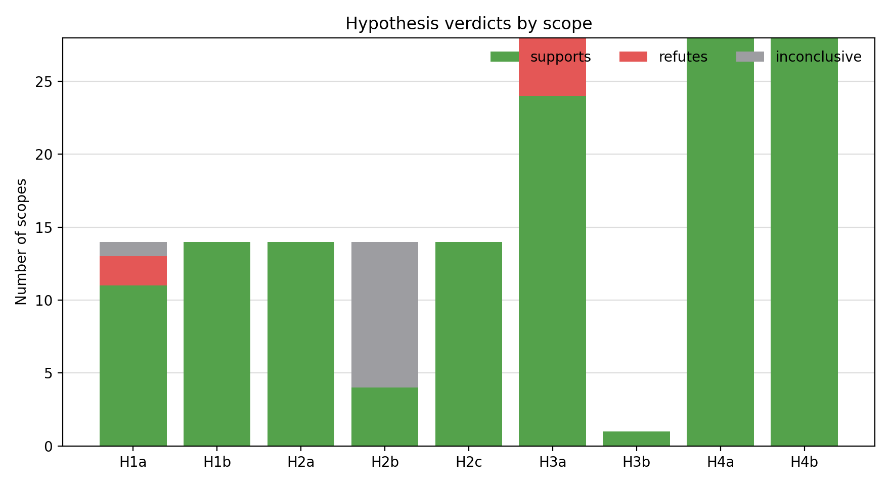

# TwinsOrFalseFriends Generated-Sampling Hypothesis Checks

## Scope

Input batch: `artifacts/twins_generated_representative_100s`.

The tests reuse the H1a--H4b operationalization in `cost_sampling/hypotheses.py`.
For this 2x2 performance/energy setting, scopes are deliberately not aggregated:

- H1/H2 are tested per system and cost property.
- H3/H4 are tested per system, cost property, and prediction target.
- H3b is a single cross-scenario correlation between cost CV and top-1 rank flips.

The main H1/H2 tests exclude the diagnostic cheap/expensive oracles; oracle calibration is reported separately.

This run has 100 stochastic seeds and no row cap recorded in the scenario summary.
H3b is evaluated across the cost-target scenarios in this batch.

## Verdict Summary

| Hypothesis | RQ | Scope | Verdict summary | Interpretation |
|---|---|---|---|---|
| H1a | RQ1 | system-cost | supported (11/14) (11 support, 2 refute, 1 inconclusive) | Per-configuration acquisition cost is usually heterogeneous. Strong-CV contexts: 8/14. |
| H1b | RQ1 | system-cost | supported (14/14) (14 support, 0 refute, 0 inconclusive) | Formal strategy-cost effects are supported in 14/14 scopes; 14/14 scopes have large eta^2. |
| H2a | RQ2 | system-cost | supported (14/14) (14 support, 0 refute, 0 inconclusive) | n is often rank-correlated with TrainCost; strong rho contexts: 14/14. |
| H2b | RQ2 | system-cost | mixed (sup=4, ref=0, inc=10 of 14) (4 support, 0 refute, 10 inconclusive) | Aggregate median calibration is conditional, with context medians spanning 0.168-1.04. |
| H2c | RQ2 | system-cost | supported (14/14) (14 support, 0 refute, 0 inconclusive) | Calibration depends on strategy, so a single global ratio is not enough. |
| H3a | RQ3 | system-cost-target | supported (24/28) (24 support, 4 refute, 0 inconclusive) | Count-cost and empirical-cost rankings disagree in 24/28 scenarios. |
| H3b | RQ3 | global scenarios | supported (1/1) (1 support, 0 refute, 0 inconclusive) | Cross-scenario CV-to-flip relation: rho=0.719, p=1.63e-05. |
| H4a | RQ4 | system-cost-target | supported (28/28) (28 support, 0 refute, 0 inconclusive) | At least one pair flips Pareto status in most or all scenarios. |
| H4b | RQ4 | system-cost-target | supported (28/28) (28 support, 0 refute, 0 inconclusive) | Count and empirical Pareto frontiers differ in 28/28 scenarios. |

## RQ-Level Synthesis

**RQ1.** The equal-cost-per-configuration assumption is not credible for Twins overall.
H1a gives the formal support. H1b also supports strategy-induced cost differences at fixed n.
The strongest cost heterogeneity appears in:

- `jump3r` cost=`performance`: CV=7.1, p90/p10=4.5.
- `jump3r` cost=`energy`: CV=5.54, p90/p10=2.2.
- `lrzip` cost=`performance`: CV=2.18, p90/p10=32.2.
- `brotli_1.0.7` cost=`performance`: CV=2.09, p90/p10=149.
- `lrzip` cost=`energy`: CV=2, p90/p10=27.1.

The lowest-heterogeneity contrasts are:

- `PostgreSQL_11.2` cost=`energy`: CV=0.0575, p90/p10=1.15.
- `PostgreSQL_11.2` cost=`performance`: CV=0.0676, p90/p10=1.18.
- `MongoDB` cost=`performance`: CV=0.142, p90/p10=1.47.
- `MongoDB` cost=`energy`: CV=0.167, p90/p10=1.59.
- `HSQLDB` cost=`performance`: CV=0.319, p90/p10=2.04.

**RQ2.** Sample size is a useful ordering proxy in many contexts, but not a complete cost model.
The median calibration ratios across system-cost contexts span 0.168-1.04, and H2c shows that strategy-specific calibration must be reported.

**RQ3.** The cost model changes cost-sensitive strategy rankings.
Top-1 recommendations change in 24/28 cost-target scenarios under the lambda sweep.
This is why performance/energy cost and performance/energy targets should be kept faceted.

**RQ4.** The Pareto-front conclusion is stronger than the scalar-ranking conclusion.
Empirical-cost and count-cost frontiers differ in 28/28 scenarios.
For paper figures, prefer the per-system frontier plots because the x-axis is an actual cost fraction and the y-axis is MRE.

## Per-Strategy Calibration Appendix

This table aggregates per-system bootstrap checks of the median calibration ratio by strategy and cost property.
The verdict is `miscalibrated` when the 95% bootstrap CI excludes 1 and the median deviation is at least 5%.
With limited stochastic repetition, deterministic strategies and oracles often have fewer than ten records per system-cost context, so `inconclusive` here usually means insufficient bootstrap sample size rather than evidence of calibration.

| Cost | Strategy | Scopes | Calibrated | Miscalibrated | Inconclusive | Median ratio | Median abs deviation |
|---|---|---:|---:|---:|---:|---:|---:|
| `energy` | `balanced` | 7 | 3 | 1 | 3 | 1 | 0.00515 |
| `energy` | `cheapOracle` | 7 | 0 | 2 | 5 | 0.817 | 0.183 |
| `energy` | `diversity` | 7 | 2 | 0 | 5 | 0.993 | 0.00714 |
| `energy` | `expensiveOracle` | 7 | 0 | 2 | 5 | 1.41 | 0.405 |
| `energy` | `pairwise` | 7 | 0 | 0 | 7 | 1 | 0.0171 |
| `energy` | `pilotCost` | 7 | 0 | 6 | 1 | 0.762 | 0.238 |
| `energy` | `random` | 7 | 4 | 1 | 2 | 1 | 0.00207 |
| `performance` | `balanced` | 7 | 4 | 1 | 2 | 1 | 0.00282 |
| `performance` | `cheapOracle` | 7 | 0 | 2 | 5 | 0.849 | 0.151 |
| `performance` | `diversity` | 7 | 2 | 0 | 5 | 0.993 | 0.00712 |
| `performance` | `expensiveOracle` | 7 | 0 | 2 | 5 | 1.35 | 0.353 |
| `performance` | `pairwise` | 7 | 0 | 0 | 7 | 1 | 0.0209 |
| `performance` | `pilotCost` | 7 | 0 | 6 | 1 | 0.801 | 0.199 |
| `performance` | `random` | 7 | 5 | 1 | 1 | 1 | 0.00164 |

## Output Files

- `hypothesis_tests.csv`: one row per formal H1--H4 test scope.
- `hypothesis_summary.csv`: support/refute/inconclusive counts per hypothesis.
- `strategy_calibration_tests.csv`: per-system, per-cost, per-strategy bootstrap calibration checks.
- `strategy_calibration_summary.csv`: aggregate strategy-calibration table.
- `fig_twins_hypothesis_verdicts.png`: stacked verdict-count figure.
