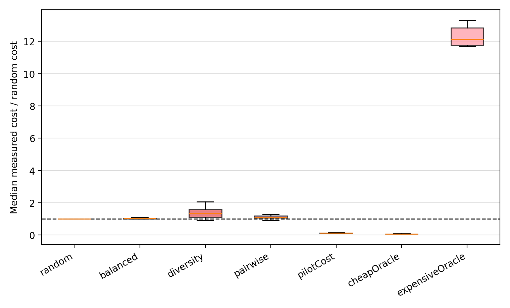
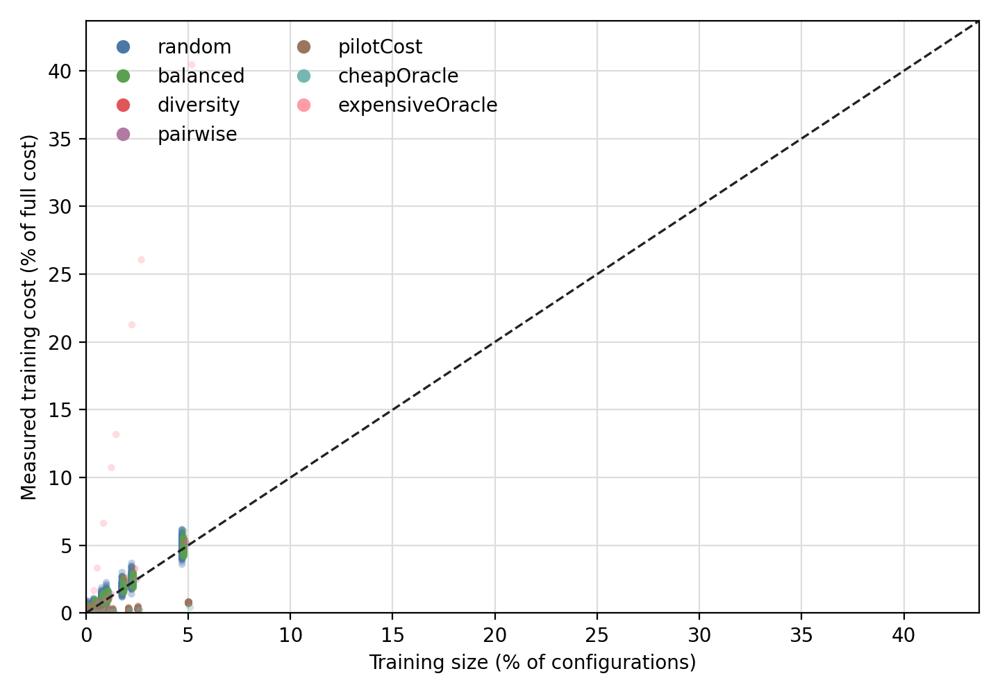
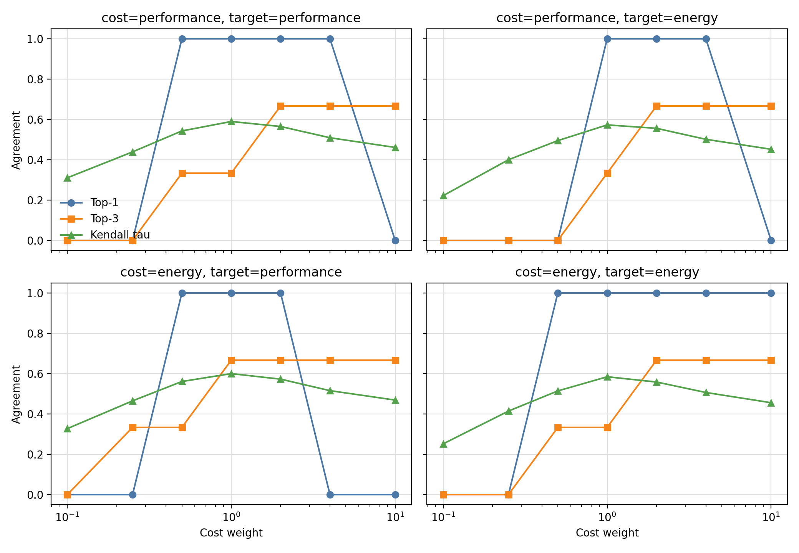
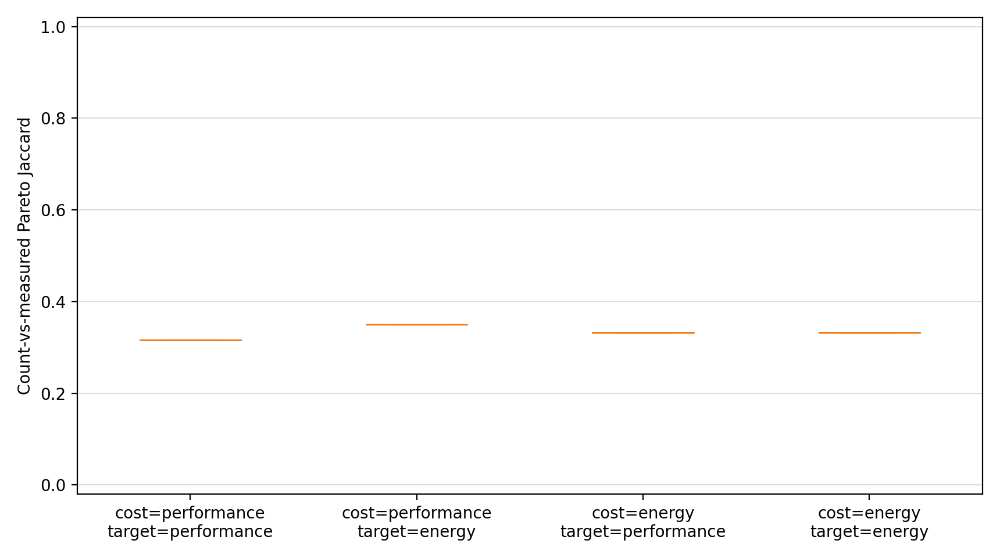
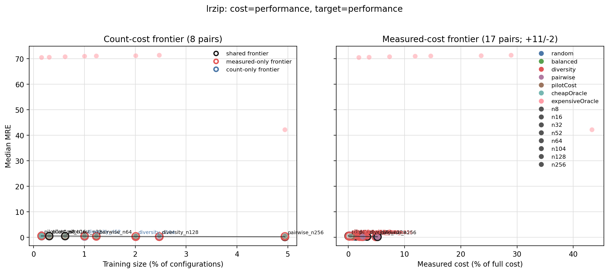
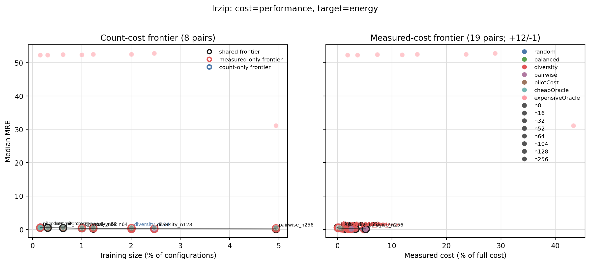
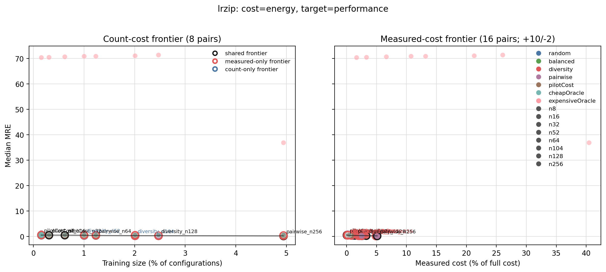
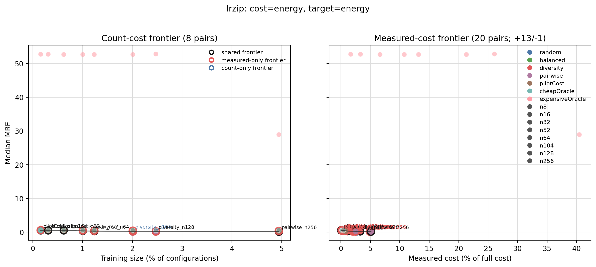

# Generated sampling on TwinsOrFalseFriends `lrzip`

## Scope

Source archive: `/tmp/twins_main.zip`

Source member: `TwinsOrFalseFriends-main/data/lrzip/measurements.csv`

The table has 5184 rows, 12 encoded feature columns, and labels `energy, performance`.

Context columns excluded from features: `none`.

Generated budgets: `8, 16, 32, 52, 64, 104, 128, 256` with 100 stochastic seeds.

Current learner: `sk-rf-log` (sk-rf-log).

Interpretation note: these results test the sampling-cost protocol, not the final learner choice. The learner is now a command-line parameter, so the same generated samples can be rerun with CART or raw-target ridge. A full replication with stepwise linear regression and a literature-aligned CART implementation should be reported as a learner-robustness extension.

The protocol uses random, feature-balanced, diversity, pairwise-coverage, and pilot-cost-aware sampling. Cheap-first and expensive-first are diagnostic oracles when enabled.

## RQ1/RQ2: cost properties

### Cost = `performance`

**RQ1 answer:** empirical cost is heterogeneous at fixed sample size. For `performance`, CV=2.18, p90/p10=32.2, and strategy cost-over-random spans 0.07082-15.99.

**RQ2 answer:** sample size is a strong rank proxy but not a fully calibrated cost model. Spearman rho=0.7101; median `%cost/%n`=0.8237 with IQR 0.1409-1.04.

Cost heterogeneity: CV=2.18, p90/p10=32.2. Sample-size proxy: Spearman rho=0.7101, median `%cost/%n`=0.8237 (IQR 0.1409-1.04).

Strategy cost-over-random range: 0.07082-15.99. Median calibration by strategy:

- `balanced`: 0.9835
- `cheapOracle`: 0.07164
- `diversity`: 1.334
- `expensiveOracle`: 11.84
- `pairwise`: 1.079
- `pilotCost`: 0.1191
- `random`: 0.9611

### Cost = `energy`

**RQ1 answer:** empirical cost is heterogeneous at fixed sample size. For `energy`, CV=2.003, p90/p10=27.14, and strategy cost-over-random spans 0.08227-14.23.

**RQ2 answer:** sample size is a strong rank proxy but not a fully calibrated cost model. Spearman rho=0.7251; median `%cost/%n`=0.8421 with IQR 0.1573-1.036.

Cost heterogeneity: CV=2.003, p90/p10=27.14. Sample-size proxy: Spearman rho=0.7251, median `%cost/%n`=0.8421 (IQR 0.1573-1.036).

Strategy cost-over-random range: 0.08227-14.23. Median calibration by strategy:

- `balanced`: 0.988
- `cheapOracle`: 0.08076
- `diversity`: 1.283
- `expensiveOracle`: 10.68
- `pairwise`: 1.055
- `pilotCost`: 0.1236
- `random`: 0.9616

## RQ3/RQ4: cost-target scenarios

**RQ3 answer:** replacing count cost with empirical cost changes the cost-sensitive ranking in all scenarios.

**RQ4 answer:** replacing count cost with empirical cost changes the non-dominated sampling choices in all scenarios.

| Scenario | Top-1 agreement | Mean tau | Pareto Jaccard | Best simple pair |
|---|---:|---:|---:|---|
| `cost=performance, target=performance` | 0.5714 | 0.4881 | 0.3158 | `pairwise_n256` |
| `cost=performance, target=energy` | 0.4286 | 0.457 | 0.35 | `pairwise_n256` |
| `cost=energy, target=performance` | 0.4286 | 0.5015 | 0.3333 | `pairwise_n256` |
| `cost=energy, target=energy` | 0.7143 | 0.4694 | 0.3333 | `pairwise_n256` |

The Pareto-front figures below show the direct count-cost vs empirical-cost decision comparison.

### cost=performance, target=performance

RQ3 detail: top-1 agreement is 0.5714; 3 of 7 lambda settings select a different top recommendation under empirical cost than under count cost.

RQ4 detail: Pareto Jaccard is 0.3158; count cost selects 8 non-dominated pairs and empirical cost selects 17.

### cost=performance, target=energy

RQ3 detail: top-1 agreement is 0.4286; 4 of 7 lambda settings select a different top recommendation under empirical cost than under count cost.

RQ4 detail: Pareto Jaccard is 0.35; count cost selects 8 non-dominated pairs and empirical cost selects 19.

### cost=energy, target=performance

RQ3 detail: top-1 agreement is 0.4286; 4 of 7 lambda settings select a different top recommendation under empirical cost than under count cost.

RQ4 detail: Pareto Jaccard is 0.3333; count cost selects 8 non-dominated pairs and empirical cost selects 16.

### cost=energy, target=energy

RQ3 detail: top-1 agreement is 0.7143; 2 of 7 lambda settings select a different top recommendation under empirical cost than under count cost.

RQ4 detail: Pareto Jaccard is 0.3333; count cost selects 8 non-dominated pairs and empirical cost selects 20.

## Interpretation

This is a generated-sampling replication point: the dataset supplies measured configurations and labels, but not sample traces. Therefore, conclusions should be compared to precomputed ICPE/Kaltenecker results by protocol-aware facets, not by aggregating all rows into one table.

For paper writing, use this as the first proof that the same RQ machinery works when we must generate common strategies and a common budget grid ourselves.
