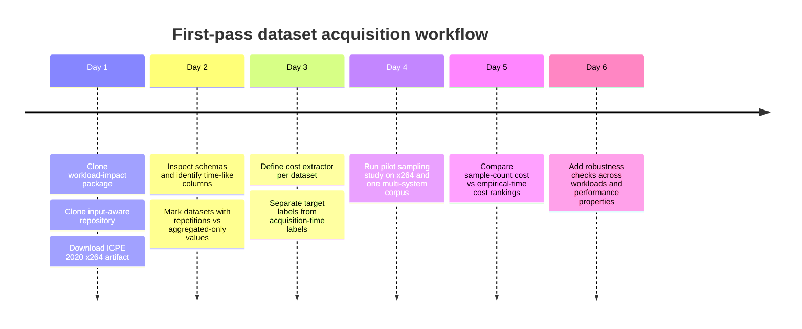

# Cost-Aware Datasets and Literature for Configurable-Systems Regression

## Executive summary

For experiments on whether sample size is a good proxy for *measurement time*, the strongest public datasets are the ones that expose either execution/encoding/compression time directly, or enough protocol detail to reconstruct acquisition cost from repeated runs and fixed benchmark phases. Among configurable-systems corpora, the best immediate choices are the ICSE 2023 workload-impact package, the JSS input-aware performance-models repository, the x264 video-encoding datasets, the Green Configuration / *Twins or False Friends?* measurements, and the newer JHipster performance dataset, because they provide runtime-related labels, workload variation, or explicit repetition protocols. citeturn26search2turn6view0turn8view0turn17view0turn31view0

A recurring problem is that many well-known configurable-systems datasets expose only *aggregated performance labels* or *counts of sampled configurations* rather than raw wall-clock traces, setup overhead, or repetition-level logs. Those datasets remain useful for prediction baselines, but they are weaker for claims about empirical acquisition cost unless you can reconstruct cost from the measured property itself or from a published protocol. citeturn27view0turn18view0turn10view0

On the ML side, the best secondary testbeds are NAS-Bench-101, NAS-Bench-201, and LCBench, because they expose heterogeneous per-configuration training/runtime metadata and repeated evaluations; however, JAHS-Bench-201, YAHPO Gym, and many HPOBench problems are better viewed as *algorithm-prototyping* environments than as direct evidence about real physical measurement cost, because some are surrogate-based. citeturn43view0turn44view0turn43view2turn43view1turn43view3turn38search0

The literature closest to your framing comes less from software-product-line performance prediction than from cost-aware active learning, projective/progressive sampling, and utility-based learning. That literature is highly relevant conceptually, but it usually models cost as annotation effort, feature-acquisition cost, or global utility trade-offs rather than testing whether “number of sampled points” is a valid proxy for observed runtime cost on configurable software. citeturn45search0turn45search9turn45search3turn45search2turn39search1turn40search7

## Candidate configurable-systems datasets

The table below prioritizes datasets that are either directly suitable for empirical time-based cost models or close enough that an empirical cost can be reconstructed with defensible assumptions.

| Dataset name | Domain/system | Number of configurations | Per-configuration measurement time or raw logs available | Measured performance properties | Input/workload variants available | Source / URL | Licensing / access | Notes on heterogeneity and repeated-measure protocols |
|---|---|---:|---|---|---|---|---|---|
| **Input-aware Performance Models** | 8 systems: gcc, ImageMagick, lingeling, nodeJS, poppler, SQLite, x264, xz | Exact per-system counts not extracted here; paper reports **8 systems**, **hundreds of configurations and inputs**, and **1,941,075 configuration measurements** total | **Yes, partially.** Repository documents systematic execution of configurations on all inputs and publishes resulting datasets; raw per-run repetition logs were not confirmed from retrieved metadata | Compile time, execution time, binary size, image-processing time/size, SAT conflicts/reductions, ops/sec, query times, x264 elapsed time / fps / bitrate / size / CPU usage, xz compression time / size | **Yes.** Strong workload diversity by system, including PolyBench, ImageNet images, TPC-H DBs, YouTube UGC videos, Silesia corpus | GitHub `https://github.com/simula-vias/input-aware-performance-models` citeturn6view0turn7search12turn12search11 | Public GitHub repository; license not confirmed from retrieved lines | Excellent for RQ-style tests on workload sensitivity and time-based cost because several subjects expose explicit elapsed/compression/query times. Biggest caveat: retrieved metadata confirms publication of datasets and protocol, but not raw repetition-level logs. citeturn6view0turn12search11 |
| **Analyzing the Impact of Workloads on Modeling the Performance of Configurable Software Systems** | 9 systems: jump3r, kanzi, dconvert, h2, batik, xz, lrzip, x264, z3 | **25,258** total; per system spans **190–6,764** in retrieved table | **Yes.** Archive includes performance measurements per configuration and workload as CSV files, plus measurement scripts; paper reports median over **5 repetitions** for all but H2 | Mostly execution time; **throughput** for H2 | **Yes.** 6–13 workloads per system in retrieved table | Zenodo `https://zenodo.org/records/7504284` and companion repo `https://github.com/AI-4-SE/workload_coverage_companion` citeturn26search2turn22view0turn26search9 | Open Zenodo package; exact license not confirmed from retrieved lines | One of the strongest datasets for your purposes: explicit workload dimension, per-config performance data, and a stated repetition protocol with medians over five runs. Because measurement scripts are included, you can separate setup overhead from execution cost more credibly than in most archives. citeturn23view2turn26search2 |
| **Green Configuration / TwinsOrFalseFriends measurements** | 14 systems including 7z, Apache, brotli, exastencils, HSQLDB, jump3r, kanzi, LLVM, lrzip, MongoDB, nginx, PostgreSQL, VP8, x264 | Per-system counts include **68,640 (7z), 13,441 (Apache), 181 (brotli), 86,058 (ExaStencils), 864 (HSQLDB), 933 sampled (jump3r), 1,984 sampled (kanzi), 65,536 (LLVM), 5,184 (lrzip), 6,840 (MongoDB), 4,416 (nginx), 864 (PostgreSQL), 2,736 (VP8), 3,840 (x264)** | **Yes.** Repository ships `measurements.csv`; raw measurement data are also referenced in Zenodo artifact/replication package | Runtime performance and energy; some function-level measurements for brotli, lrzip, x264 | Mostly single canonical workloads per system | GitHub `https://github.com/AI-4-SE/TwinsOrFalseFriends` and Zenodo/replication package citeturn14view1turn17view0turn26search8 | GitHub repo is GPL-2.0; data package is public, but data-license details were not fully confirmed from retrieved metadata | Very strong for testing whether a global proxy breaks down locally: the study shows near-perfect global energy–performance correlations can still fail on subsets of configurations. Measurements were repeated **3 times** and averaged after pre-experiments on bias. citeturn17view0turn15view0 |
| **Performance Evolution of Configurable Software Systems** | 12 real systems across releases: brotli, Fast Downward, HSQLDB, lrzip, MariaDB, MySQL, OpenVPN, Opus, PostgreSQL, VP8, VP9, z3 | **190 releases** across **12 systems**; per-release configuration spaces are complete for selected systems | **Partially.** `measurements.csv` is available for each case study and release; raw repetition logs not confirmed from retrieved lines | Measured performance values; repository notes additional non-functional properties were measured beyond the paper’s focus | **Yes.** Workload descriptions are included | GitHub `https://github.com/ChristianKaltenecker/PerformanceEvolution_Website` citeturn18view0turn18view1turn26search14 | Public GitHub archive, GPL-2.0 | Best if you want to test whether cost-aware conclusions remain stable across *software versions* in addition to workloads. Less ideal than workload-impact for raw runtime reconstruction, but valuable for robustness. citeturn18view0turn18view1 |
| **CPM** | 6 classic configurable systems: Apache, Berkeley DB C, Berkeley DB Java, LLVM, SQLite, x264 | Whole population for each system, except SQLite with **4,553** modeling configs + **100** evaluation configs | **Sometimes.** Dataset contains performance measurements, but retrieved metadata does not confirm raw repetition logs or acquisition-time bookkeeping | Standard system-specific performance values from established benchmarks; exact property varies by subject | Usually no input variants beyond the benchmark and system setup | Zenodo `https://zenodo.org/records/322483` citeturn27view0 | CC BY 4.0 | Important historical baseline and still worth citing, but weaker for *empirical* cost modeling because retrieved metadata confirms labels, not raw run-level timing traces or repetition protocol. citeturn27view0 |
| **ICPE 2020 x264 artifact** | x264 video encoder | **1,152** configurations measured on **17** videos | **Yes, effectively.** Artifact includes measured performance values for time and size plus sampled configurations and prediction logs | **Encoding time** and **encoded size** | **Yes.** 17 input videos | GitHub `https://github.com/jualvespereira/ICPE2020` / Zenodo DOI in README citeturn8view0 | Public GitHub artifact; exact data license not confirmed from retrieved lines | One of the cleanest datasets for your exact question because it centers x264, varies the workload, and has explicit time-vs-size targets. Excellent for comparing size-based and empirical-time-based cost models on the same subject system. citeturn8view0 |
| **x264 performances on the YouTube UGC Dataset** | x264 video encoder | **201** configurations × **1,397** videos | **Yes, likely.** Record says one CSV per video with measurements; retrieved metadata does not list all columns, but this dataset is explicitly a performance-analysis result archive | Performance analysis of x264 on each video; related x264 studies usually include elapsed time, bitrate, fps, CPU usage, and size | **Yes.** Very strong input diversity: 1,397 UGC videos | Zenodo `https://zenodo.org/records/3928253` citeturn25search2turn7search2 | Open Zenodo record; specific license not confirmed from retrieved snippet | Extremely attractive for input-sensitive cost studies because workload diversity is massive. Main caveat: the retrieved record does not expose the full schema or repetition protocol, so you should inspect the CSV columns before committing. citeturn25search2 |
| **x264 and x265 performance on eight videos of the YouTube UGC Dataset** | x264 and x265 encoders | **3,125** configurations across two encoders on **8** videos | **Probably yes**, but retrieved metadata is sparse | Performance measurements for x264/x265; exact metric columns were not confirmed from retrieved snippet | **Yes.** 8 videos | Zenodo `https://zenodo.org/records/5662589` citeturn25search0 | Open Zenodo record; license not confirmed from retrieved snippet | Useful if you want a smaller, more manageable codec dataset than the 1,397-video corpus, but it is less documented from the metadata I could confirm. Treat as promising but verify before use. citeturn25search0 |
| **Exploring Performance Trade-offs in JHipster** | JHipster-generated web stacks | Paper states JHipster has **more than 100,000 valid configurations** and reports an exhaustive analysis of valid configurations | **Partially.** The study clearly measures startup, idle and workload phases; retrieved HTML confirms five replications and warm-up, but the exact public dataset schema was not recoverable from metadata alone | Response times, startup duration, total size, idle power, workload power | Single synthetic Gatling workload generated by JHipster | arXiv `https://arxiv.org/abs/2409.16480` and Zenodo dataset record `https://zenodo.org/records/8140600` citeturn31view0turn32view1turn33search0turn30search0 | Public preprint and public Zenodo record; dataset license not confirmed from retrieved lines | Particularly valuable because the *true* acquisition cost is not merely request latency: the paper’s protocol includes warm-up, idle windows, startup, and a one-minute workload, all of which matter for empirical measurement cost. citeturn31view0 |
| **JHipster v3.6.1 exhaustive dataset** | JHipster generation/testing | **26,257** configurations | **No for regression cost**, but **yes for computational effort** at test/build level | Build/test outcomes, logs, failures | No workload variation in the performance sense | GitHub `https://github.com/xdevroey/jhipster-dataset` and Zenodo DOI `10.5281/zenodo.3766690` citeturn10view0turn11view0turn8view1 | CC BY-SA 4.0 | Adjacent rather than central. It is excellent if you want to study *infrastructure cost* and total build/test time, but it is not a performance-regression dataset in the usual sense. Still useful for reminding readers that “counting configurations” can badly understate real measurement infrastructure effort. citeturn11view0 |

### Immediate read on the configurable-systems landscape

If your paper’s core contribution is about replacing count-based cost proxies with observed measurement time, the datasets above separate into three tiers. The highest-confidence tier is the workload-impact package, ICPE 2020 x264, the x264 UGC corpus, Green Configuration / *TwinsOrFalseFriends*, and the JHipster performance paper, because they all either expose runtime-related labels directly or document measurement protocols well enough to reconstruct time-based acquisition cost credibly. citeturn23view2turn8view0turn25search2turn17view0turn31view0

The second tier consists of the input-aware collection and performance-evolution collection: both are rich and highly relevant, but the retrieved metadata did not fully confirm repetition-level traces for every case study, so they are strongest when used with careful preprocessing and explicit assumptions. The third tier is classic modeling corpora such as CPM, which remain useful baselines but are not ideal if your evaluator demands direct evidence about measurement-time heterogeneity rather than performance labels alone. citeturn12search11turn18view0turn27view0

## Candidate ML and tabular benchmarks

These are not configurable software systems in the SPL sense, but they are strong *secondary* testbeds because each “sample” is itself a configuration of a learning system and often comes with explicit runtime or training-cost metadata.

| Dataset / benchmark | Domain/system | Number of configurations | Per-configuration measurement time or raw logs available | Measured properties | Input/workload variants available | Source / URL | Licensing / access | Notes on heterogeneity and repeated-measure protocols |
|---|---|---:|---|---|---|---|---|---|
| **NAS-Bench-101** | CNN architecture search on CIFAR-10 | **423,624** unique architectures; **5M+** trained/evaluated models overall | **Yes.** Training and evaluation metrics are queryable, and each network is trained/evaluated multiple times at various budgets | Accuracy, training/evaluation metrics, training time | Single main dataset (CIFAR-10), but multiple budgets and repeats | GitHub `https://github.com/google-research/nasbench` citeturn43view0 | Apache-2.0 | Excellent secondary benchmark for heterogeneous per-configuration cost. It is not a configurable software *system* dataset, but it is a very good analogue for cost-aware sampling because runtime varies by architecture and budget. citeturn43view0 |
| **NAS-Bench-201** | NAS benchmark on CIFAR-10 / CIFAR-100 / ImageNet16-120 | **15,625** architecture candidates | **Yes.** Query API exposes trials, train/valid/test info, latency, and per-architecture trial info | Accuracy, latency, train/valid/test metrics, parameters, FLOPs | **Yes.** 3 image datasets, multiple trials/seeds | GitHub `https://github.com/D-X-Y/NAS-Bench-201` citeturn44view0 | MIT | Strong benchmark for rank-change analyses under cost models. Because it includes latency and multiple datasets, it is useful for “context sensitivity” style analyses. citeturn44view0 |
| **LCBench** | Hyperparameter benchmark for feedforward nets on OpenML tabular tasks | **2,000** configurations × **35** datasets × **50** epochs | **Yes.** Logs include **runtime for each epoch** | Training/validation/test losses and accuracy, gradient stats, learning rate, runtime | **Yes.** 35 OpenML datasets | GitHub `https://github.com/automl/LCBench` citeturn43view2 | Apache-2.0 | Of the ML benchmarks, this is one of the easiest to use for sample-size-versus-time studies because runtime is explicit and tabular workloads vary a lot across datasets. citeturn43view2 |
| **JAHS-Bench-201** | Joint architecture and hyperparameter search | Search space is joint architecture + HP; exact exhaustive cardinality not stated in retrieved lines | **Surrogate-based** rather than raw measurement logs in the repository interface | Joint architecture/HP objective values; designed for multi-objective, cost-aware, multi-fidelity optimization | Multiple problem settings in benchmark suite | GitHub `https://github.com/automl/jahs_bench_201` citeturn43view1 | MIT | Highly relevant methodologically because it explicitly targets *cost-aware* optimization, but weaker as empirical evidence for real measurement cost because the benchmark interface is surrogate-based. citeturn43view1 |
| **HPOBench** | Collection of HPO benchmark problems | **100+** multi-fidelity benchmark problems | Mixed: includes real, tabular, and surrogate problems | Objective quality, runtime/cost depending on benchmark family | Many scenarios and fidelities | GitHub `https://github.com/automl/HPOBench` citeturn38search0turn38search6 | Apache-2.0 | Very useful for rapid algorithmic prototyping. Less useful for novelty claims about *observed physical acquisition time* unless you restrict yourself to its tabular/raw sub-benchmarks. citeturn38search0turn38search6 |
| **YAHPO Gym** | Surrogate HPO benchmark suite | **14 scenarios** and **700+** multi-fidelity HPO problems; many scenario “instances” | Runtime and memory are available as objectives, but through fast surrogates | Performance metrics, runtime, memory | Strong scenario/instance variation | GitHub `https://github.com/slds-lmu/yahpo_gym` and docs `https://slds-lmu.github.io/yahpo_gym/` citeturn43view3turn38search4turn38search7 | Public benchmark software; exact repo license not confirmed from retrieved lines | Good for stress-testing optimization methods, not for making the strongest possible empirical claim about runtime measurement cost because costs are surrogate-emulated. citeturn43view3turn38search7 |

### How to use the ML benchmarks without overstating them

These benchmarks are best used as *secondary confirmation*. If the same qualitative findings hold in configurable-software datasets and in NAS/HPO benchmarks with explicit runtime metadata, that strengthens the generality of your argument. But for the core novelty claim in configurable software systems, I would not let surrogate-heavy benchmarks such as JAHS-Bench-201 or YAHPO Gym carry the main burden of proof. citeturn43view1turn43view3

## Extracting empirical measurement cost

The safest general principle is to define empirical training cost as the *wall-clock effort needed to acquire the labels used for training*, not the value of the target variable in the abstract. In practice, that means the implementation differs by dataset family.

| Dataset family | Recommended empirical cost extraction | Best label statistic | Main pitfalls |
|---|---|---|---|
| **Workload-impact ICSE 2023** | Use the published per-configuration/per-workload performance CSVs and define `cost(S) = sum median_runtime(c,w)` over training points. Because the paper reports five repetitions and uses the median, you can also estimate acquisition effort as `5 × median_runtime` when raw repetitions are unavailable. citeturn23view2 | Median across 5 runs (except H2) citeturn23view2 | Throughput for H2 is *not* an acquisition-time label; if you use H2, the real measurement cost is the benchmark duration, not the throughput value itself. |
| **Input-aware collection** | For systems with explicit elapsed/compression/query times, sum those times over the training set. For x264/xz/SQLite, keep workload identity attached so cost is `sum time(c,input)` rather than `sum time(c)`. citeturn6view0 | Use the published time property directly; prefer median/mean only if repeated runs are exposed in the downloaded files | Some published properties are not time-like at all, such as output size or bitrate. Those should stay as *targets*, not cost proxies. |
| **Green Configuration / Twins** | Use runtime performance, not energy, as acquisition cost. Where measurements were repeated three times and averaged, cost can be approximated as `3 × avg_runtime(c)` if raw repetition traces are not exposed. citeturn17view0 | Average of 3 runs in the published study citeturn17view0 | A global runtime–energy correlation can break down on subsets, so never substitute energy for time or vice versa in local analyses. citeturn17view0turn15view0 |
| **x264 datasets** | Use elapsed encoding time if present; if only FPS and frame count are present in a file, reconstruct time as `frames / fps` only after checking that the schema is consistent. For ICPE 2020 x264, use the explicit time target. citeturn8view0turn25search2 | Median if repeated runs exist; otherwise the published elapsed-time field | Video workloads vary massively in content and size, so two samples with the same configuration count can have very different cost totals. That is exactly why these datasets are so useful here. |
| **JHipster performance dataset** | Define acquisition cost as **build/startup + idle windows + workload execution + monitoring overhead**, not merely request latency. The paper’s protocol explicitly includes idle monitoring, startup duration, and Gatling workload execution. citeturn31view0 | Median across 5 replications after device warm-up citeturn31view0 | This is the clearest example where “target value” and “measurement effort” are different. Request latency alone seriously understates true acquisition cost. |
| **CPM / Performance Evolution / older baseline corpora** | When only one aggregated performance value per configuration is available, use that value as a *proxy for acquisition cost* only if the measured property is itself wall-clock time. Otherwise, mark cost as unavailable or collect missing execution traces yourself. citeturn27view0turn18view0 | As published | Do not pretend that counts or non-time properties are empirical cost. These datasets are still valuable baselines, but they are not the best evidence for your central claim. |
| **NAS / HPO benchmarks** | Use the benchmark’s recorded training time, latency, or runtime directly. In LCBench, summing per-epoch runtime makes it easy to simulate partial-budget acquisition, while NAS-Bench-101/201 expose repeated trials and cost metadata per architecture. citeturn43view0turn44view0turn43view2 | Keep original repeated runs when possible; otherwise use the query API’s per-trial numbers | Surrogate benchmarks should not be described as raw empirical runtime unless the benchmark documentation says the values come directly from measured runs. |

### Measurement pitfalls that matter for your paper

Warm-up, caching, and repeated execution are not implementation trivia here; they are central to the credibility of a time-based cost model. The JHipster performance study explicitly warms up the device and uses the median over five replications. The ICSE 2023 workload study also reports median over five repetitions in controlled environments. The *TwinsOrFalseFriends* study repeated final measurements three times after estimating bias, while the uncertainty companion resource reports an even stricter protocol for some systems: five measurements, increasing up to ten until the coefficient of variation dropped below 10%. citeturn31view0turn23view2turn17view0turn35view0

That implies two practical rules. First, if all you have is a single aggregated runtime column, be explicit that you are approximating acquisition cost rather than recomputing it exactly. Second, if you have repetition-level traces, keep both the **label statistic** and the **acquisition-effort statistic**: for example, use the median runtime as the target label but the **sum of all repeated wall-clock runs** as the true measurement effort. citeturn23view2turn31view0turn35view0

## Prioritized shortlist

This shortlist is ordered for **immediate experimentation**, balancing relevance to configurable systems, availability of time-like labels, workload diversity, and feasibility.

| Priority | Dataset | Why it should be in your first wave |
|---|---|---|
| **Top pick** | **Workload-impact ICSE 2023 package** | Best balance of realism and usability: 9 configurable systems, 25,258 configurations, explicit workload variation, CSV measurements, measurement scripts, and a documented five-run median protocol. It is almost purpose-built for testing whether count-based cost proxies fail under workload variation. citeturn22view0turn23view2turn26search2 |
| **Top pick** | **Input-aware Performance Models** | Largest real configurable-systems collection I found in this space, with 1,941,075 measurements across 8 systems and multiple performance properties. Especially attractive if you want to test context sensitivity across both workload and target property. citeturn6view0turn12search11 |
| **Top pick** | **x264 performances on the YouTube UGC Dataset** | The best single-system stress test for input heterogeneity: 201 configurations over 1,397 videos. If sample count fails as a cost proxy anywhere, it should fail here. citeturn25search2 |
| **Very strong** | **ICPE 2020 x264 artifact** | Cleaner and smaller than the 1,397-video corpus, with direct time and size targets on 1,152 configurations × 17 videos. Ideal for early ablation studies and method debugging. citeturn8view0 |
| **Very strong** | **Green Configuration / TwinsOrFalseFriends** | Gives you cross-system heterogeneity and an already-demonstrated example of global proxies breaking down locally. Especially helpful if you want to pair time with another non-functional property such as energy. citeturn17view0turn15view0 |
| **Very strong** | **JHipster performance-tradeoff dataset** | Offers a valuable “full-stack” notion of acquisition cost because it includes startup, monitoring windows, power, and workload phases. It is especially good for showing that request latency is not the whole measurement bill. citeturn31view0turn33search0 |
| **Strong robustness add-on** | **Performance Evolution** | Best if you want to test whether cost-aware conclusions survive across software releases, not just across workloads and properties. citeturn18view0turn18view1 |
| **Best ML-side cross-check** | **LCBench** | Explicit runtime logs, 2,000 configs, 35 datasets, 50 epochs. If you want one non-configurable-software benchmark with clear time metadata, this is the one I would start with. citeturn43view2 |

### Datasets I would treat cautiously

I would treat **CPM** as a baseline archive rather than a core empirical-cost dataset, because the retrieved metadata confirms performance labels but not raw timing protocols. I would also treat **JAHS-Bench-201**, **HPOBench**, and **YAHPO Gym** as strong *algorithmic* benchmarks but weaker evidence about physical measurement effort whenever the interface is surrogate-based. Finally, the **x264/x265 eight-video** Zenodo record looks promising, but I would inspect its schema before relying on it, because the retrieved metadata did not expose the metric columns clearly enough. citeturn27view0turn43view1turn38search0turn43view3turn25search0

## Related ML literature

This literature is not the same as configurable-systems performance prediction, but it gives you the right conceptual vocabulary for arguing about cost-aware sampling, heterogeneous per-sample cost, and utility-sensitive evaluation.

| Paper | Area | How cost is modeled | Uniform cost or heterogeneous cost | Datasets / benchmarks noted in retrieved sources | Relevance to your paper |
|---|---|---|---|---|---|
| **Weiss & Tian, “Maximizing classifier utility when there are data acquisition and modeling costs”** | Progressive / utility-aware sampling | Utility combines acquisition and modeling costs; seeks an optimal training-set size rather than blindly maximizing sample count | Treats acquisition/modeling cost explicitly; typically global utility-level rather than per-instance wall-clock variation | Classification setting; retrieved sources do not enumerate benchmark datasets in detail | Very relevant as a conceptual ancestor: it directly attacks the assumption that “more data is always better” once training-data cost is counted. citeturn45search0turn45search4turn45search12 |
| **Mark Last, “Improving data mining utility with projective sampling”** | Utility-based progressive sampling | Fits partial learning and runtime curves, then analytically estimates the utility-optimal training size | Mostly cost as a function of training-set size and runtime curve, not per-instance heterogeneous measurement time | KDD 2009 paper; retrieved source confirms utility projection from partial learning and runtime curves | Close to your paper’s spirit, but still largely count-and-runtime-curve oriented rather than configuration-dependent measurement-cost oriented. citeturn45search9turn45search13turn45search17 |
| **Settles, Craven, Friedland, “Active Learning with Real Annotation Costs”** | Cost-aware active learning | Uses *real* annotation costs and emphasizes that reducing labeled instances does not necessarily reduce total cost | Explicitly **heterogeneous per-instance** labeling cost | Four real-world human-annotation domains | Probably the clearest ML analogue to your main claim: sample count is not a reliable proxy for total acquisition cost when instance costs vary. citeturn45search3turn40search11 |
| **Margineantu, “Active Cost-Sensitive Learning”** | Active learning + misclassification cost | Combines labeling cost with cost-sensitive decision-making using conditional density / probability estimates | Cost-sensitive, but not focused on runtime measurement cost | Classification experiments; retrieved snippet does not list datasets | Relevant for framing but not a direct match: it is about label-acquisition and decision costs, not benchmarking time for configurable systems. citeturn39search1turn42search12turn40search17 |
| **Beygelzimer, Langford, Lifschitz, Sloan, Zhang, “Active Learning for Cost-Sensitive Classification” (COAL)** | Cost-sensitive active learning | Regresses to each label’s cost and queries only labels that could plausibly be optimal | **Heterogeneous label costs**, modeled through cost regressors | Theoretical/algorithmic paper; retrieved sources do not summarize datasets in detail | Useful because it explicitly treats costs as predictable, label-specific quantities rather than constants. citeturn40search7turn42search17turn39search17 |
| **Torgo & Ribeiro, “Utility-based Regression”** | Cost-sensitive regression / evaluation | Uses a domain-defined relevance function over the target value and evaluates predictions under non-uniform cost/benefit | Not acquisition cost; rather **target-dependent utility** | Regression evaluation framework; no dedicated benchmark suite in retrieved sources | Important to cite if you discuss “cost-aware regression,” but it is conceptually different from your measurement-cost question. It is about asymmetric value of prediction errors, not data-acquisition effort. citeturn45search2turn45search10turn39search11 |
| **Arora, Nyberg, Rose, “Estimating Annotation Cost for Active Learning in a Multi-Annotator Environment”** | Annotation-cost estimation | Predicts annotation cost when actual cost is unavailable | **Heterogeneous per-instance** annotation-time modeling | Movie-review annotation setting in retrieved abstract | Useful if you want to argue that missing cost observations can sometimes be estimated from auxiliary features instead of replaced by sample count. citeturn45search15 |
| **Herde et al., survey on cost types in active learning** | Survey | Surveys uniform-cost assumptions and richer cost types in AL | Distinguishes uniform vs heterogeneous annotator/query costs | Survey | Useful background paragraph for explaining why sample-count proxies are often unrealistic across ML more broadly. citeturn45search11turn40search4 |
| **Contardo et al., “Sequential Cost-Sensitive Feature Acquisition”** | Feature-acquisition cost | Each feature has an explicit acquisition cost; model decides adaptively which features to buy | Typically **heterogeneous feature-dependent** costs | Variety of datasets in reported experiments | Adjacent rather than direct. Good for broadening the literature map from label cost to feature cost, especially if you compare “configuration measurement cost” to other acquisition-cost paradigms in ML. citeturn41search0turn41search2 |
| **Elreedy et al., active learning for regression** | Active learning for regression | Focuses on reducing labeling burden by selecting informative points | Usually assumes a budget in *number of labels* rather than real heterogeneous label cost | General ALR benchmarks | Relevant mostly as a contrast: much ALR work still optimizes label count, not empirical heterogeneous acquisition time. citeturn42search10 |

### What this literature gives you

The strongest transferable lessons are straightforward. First, the active-learning community has already shown that fewer labeled samples do **not** necessarily imply lower total acquisition cost when instance costs vary. Second, utility-based and projective-sampling work gives you language for balancing accuracy against acquisition effort. Third, utility-based regression is worth citing to avoid the criticism that “cost-aware regression” already has a literature — while simultaneously clarifying that most of that literature means *error utility*, not *empirical measurement time*. citeturn45search3turn45search0turn45search9turn45search2

## Search strategy and instrumentation guidance

I would prioritize sources in this order:

First, **paper companion websites, official GitHub repositories, and Zenodo artifacts** linked from the original configurable-systems papers. Those are the places most likely to expose measurement schemas, scripts, and repetition protocols rather than just polished summary tables. That strategy is what surfaced the workload-impact package, the input-aware collection, ICPE 2020 x264, Green Configuration / *TwinsOrFalseFriends*, CPM, the performance-evolution archive, and both JHipster datasets. citeturn26search2turn6view0turn8view0turn14view1turn27view0turn18view0turn10view0turn30search0

Second, follow **backward and forward citations from seed papers** into author webpages, arXiv/OpenReview pages, and publisher PDFs. That is what surfaces measurement protocols that repository READMEs often omit, such as the five-run median protocol in the ICSE 2023 workload paper, the three-run averaging in *TwinsOrFalseFriends*, and the warm-up plus five-replication protocol in the JHipster performance study. citeturn23view2turn17view0turn31view0

Third, for ML analogues, prefer **official benchmark repositories** over secondary wrappers. For NAS/HPO, that means the original NAS-Bench, NAS-Bench-201, LCBench, and HPOBench repositories before any third-party benchmark wrappers. citeturn43view0turn44view0turn43view2turn38search0

A practical search stack that worked well here is:

```text
"configurable systems" performance dataset elapsed time
"software configuration" Zenodo x264 measurements
"workloads" configurable software measurements csv
"performance evolution" configurable systems measurements.csv
"NAS benchmark" runtime training time official GitHub
"active learning" "real annotation costs"
"utility-based regression" cost-sensitive regression
"projective sampling" runtime curve training size
```

### If real datasets still lack per-configuration cost

If a promising configurable-systems dataset exposes labels but not *measurement effort*, there are two defensible fallback strategies.

One is **instrumentation replay**. Re-run the benchmark harness for a manageable subset of configurations and log the full wall-clock decomposition: build/setup, warm-up, measurement rounds, teardown, and retries. This is especially appropriate for JHipster-like systems, databases, web servers, and other systems where setup cost is non-negligible relative to the “target” metric. The published protocols above are good templates for what to log. citeturn31view0turn23view2turn17view0

The other is **calibrated synthetic cost generation**. If you only have a target like response time or query time, construct a cost simulator of the form

```text
measCost(c, w) = fixed_overhead(w) + repeats(w) × runtime(c, w) + retry_penalty(c, w)
```

and fit the fixed overhead and repeat counts from one or two datasets with published protocols. This is much weaker than direct logging, but it is still far better than silently assuming `cost ∝ sample_size`. Use it only when you clearly label it as a simulation study.

### Suggested acquisition workflow



## Experimental checklist and limitations

A practical first pass would do only a few things, but do them rigorously.

- **Download and normalize four datasets first:** workload-impact, input-aware, ICPE 2020 x264, and one of the x264 UGC corpora. These four already let you test workload sensitivity, target-property sensitivity, and single-system versus multi-system behavior. citeturn26search2turn6view0turn8view0turn25search2
- **Build a schema inventory** with three flags per metric: “time-like target,” “non-time target,” and “true acquisition-cost observable.” Many columns that look performance-related are not acquisition time.
- **Extract two costs for every training set:** a count-based one (`n`, or `n+m` if you must replicate older papers) and an empirical one (`sum observed wall-clock effort`). Do not mix test/evaluation cost into the training cost unless the paper explicitly studies end-to-end workflow cost.
- **Run the same ranking analysis twice:** once under the size proxy and once under empirical time. Then compute Kendall’s tau or simple top-k overlap of strategy rankings.
- **Keep workload and property stratified.** x264 time versus x264 size is not the same problem; SQLite query families are not interchangeable; JHipster request latency is not the same as total measurement effort.
- **Preserve repetition information whenever possible.** Use medians or averages for labels, but if repeated runs were actually performed, count all of them in the acquisition-effort budget. citeturn23view2turn17view0turn31view0turn35view0

There are two important limitations in this report. First, a few promising Zenodo records exposed only high-level metadata to the search tool, so I have explicitly marked rows where the exact schema or license should be verified before use. Second, some ML benchmarks in the shortlist are surrogate-based; they are excellent for rapid benchmarking, but they should support your argument, not define it. The strongest empirical claim will still come from the configurable-systems datasets with direct or reconstructable wall-clock measurement cost.