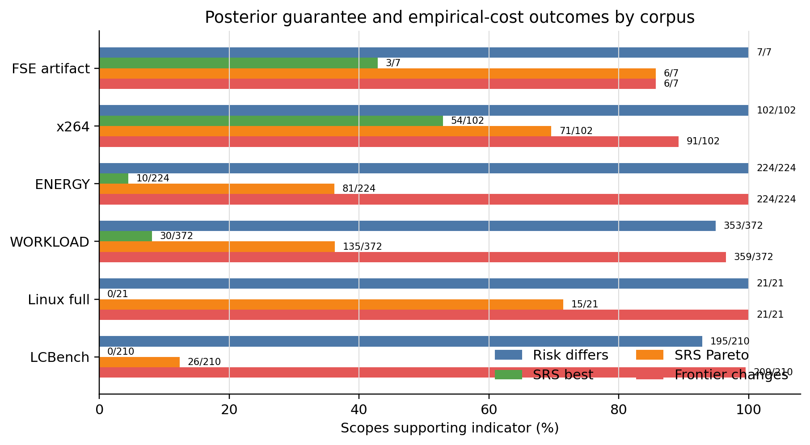
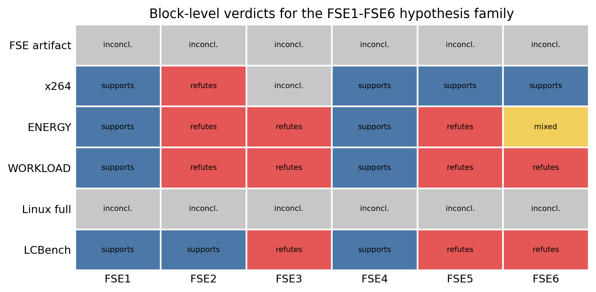
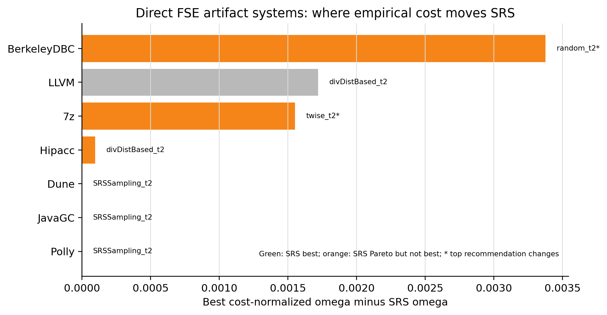
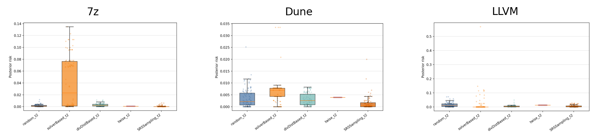
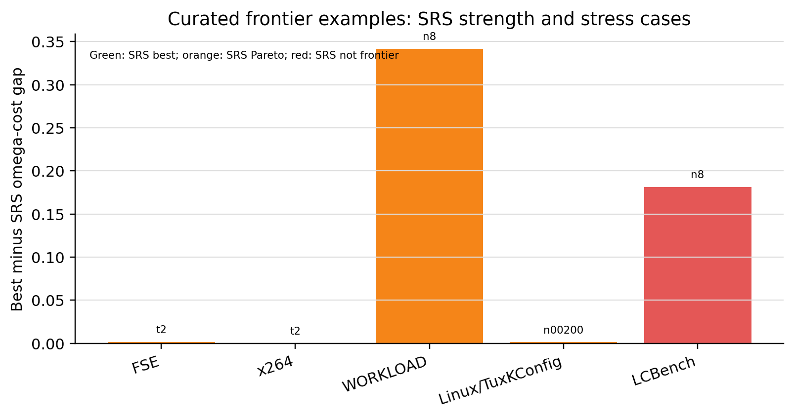
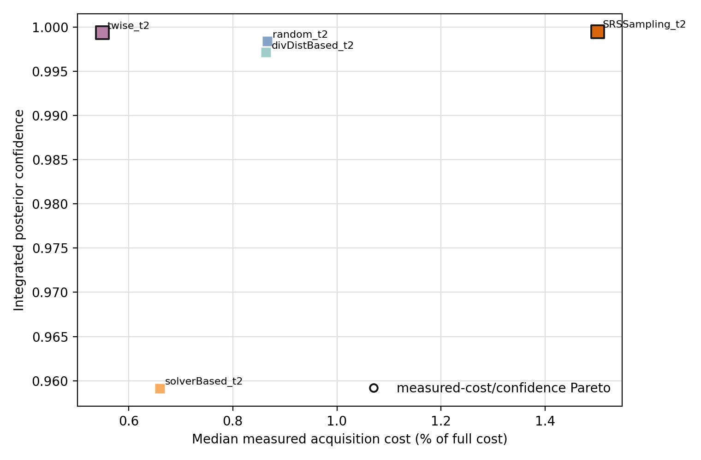
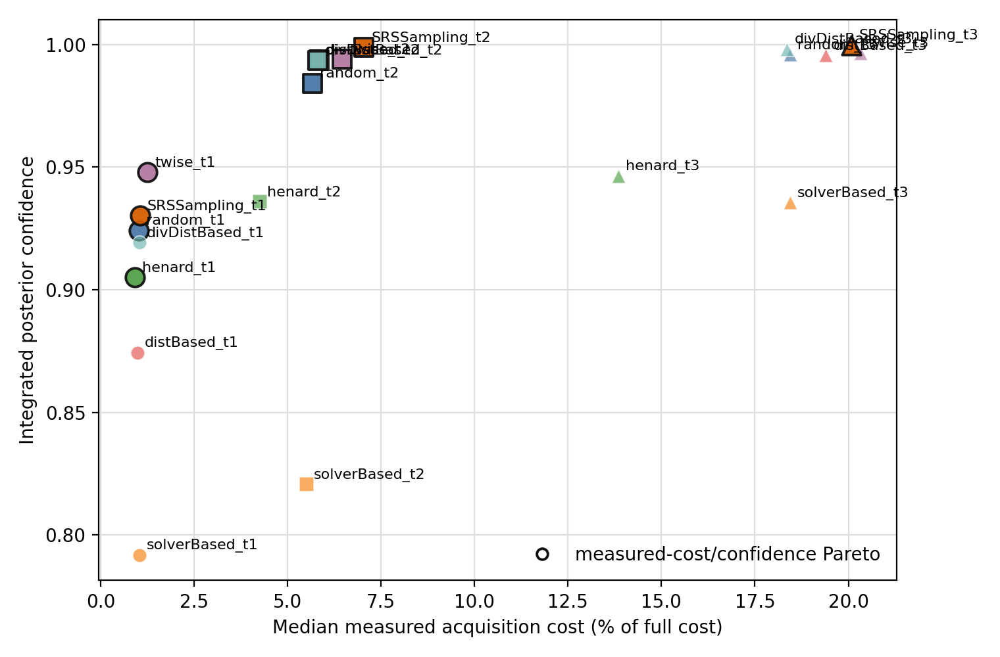
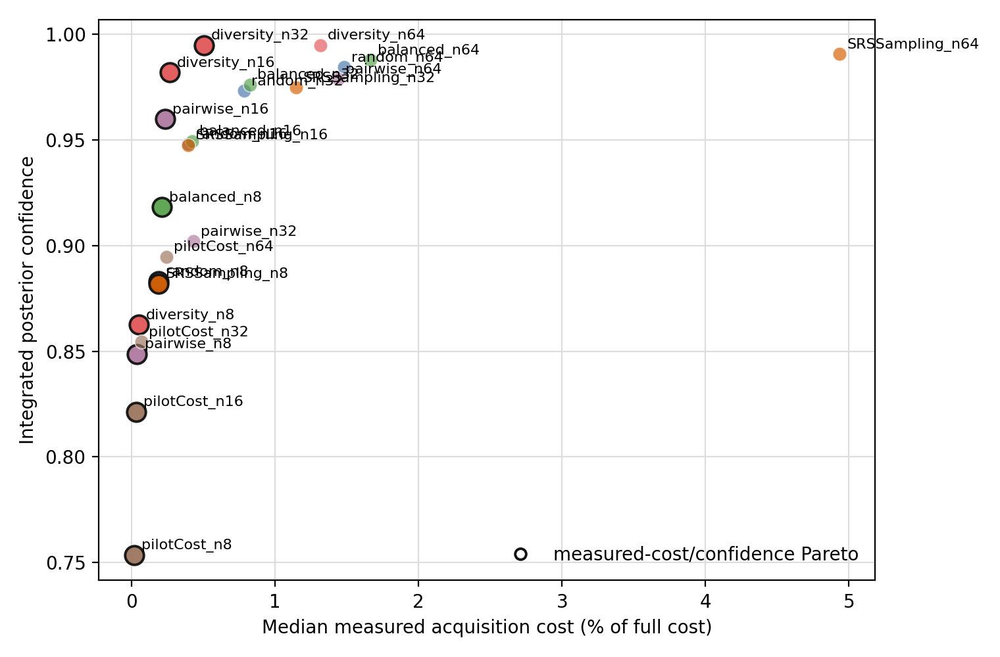
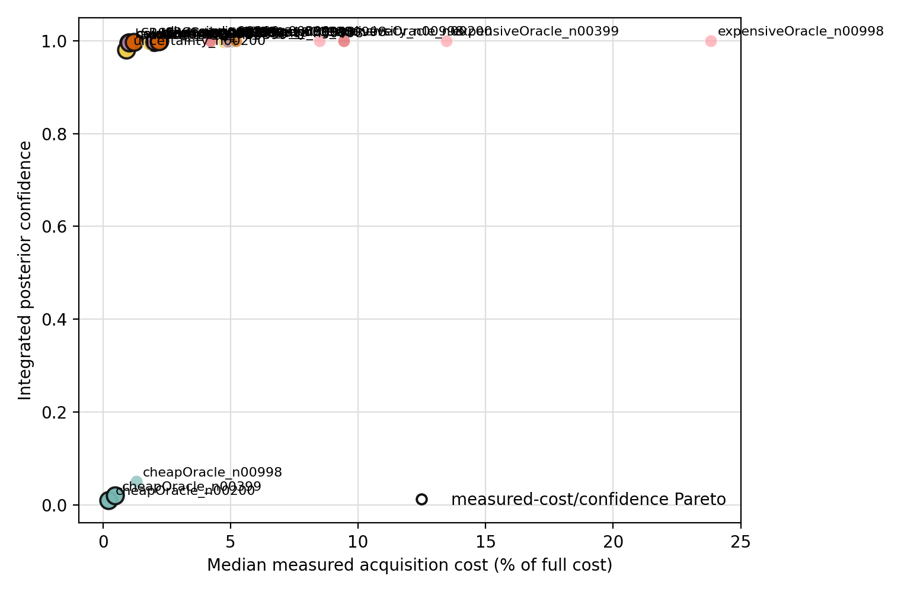
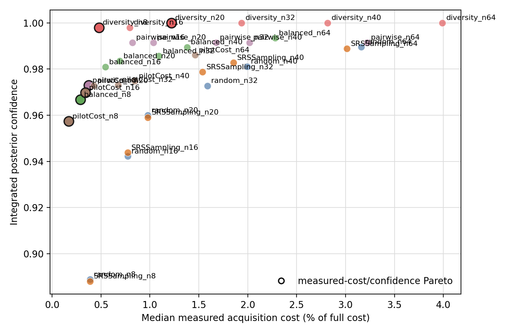

## Abstract

Sampling is central to performance analysis of configurable software systems:
the full configuration space is often too large to measure exhaustively, so
researchers and practitioners select a finite sample and reason from the
observed behavior. A recent FSE 2026 paper proposed a posterior-guarantee
framework for this setting. Instead of asking only whether a predictive model is
accurate, it asks whether the worst observed performance bound in a sample is
trustworthy, using posterior risk, posterior confidence, integrated confidence
discrepancy, and Statistical Recursive Search (SRS) [WMS26]. In parallel,
recent work on sampling cost argues that the usual proxy for acquisition
effort, sample size, is often not the same as the empirical cost of measuring
the sampled configurations [CostSamplingICSE].

This paper connects these two lines of work. We first replicate the FSE
posterior-guarantee framework on the restored FSE artifact systems. We then
extend the analysis to x264, energy/performance measurements, workload-sensitive
configurable systems, Linux/TuxKConfig measured pools, and LCBench measured
hyperparameter-configuration pools. Across 936 primary context-budget scopes,
posterior risk distinguishes sampling strategies in 902 scopes, showing that
the FSE metric transfers well. However, replacing nominal sample size by
measured acquisition cost changes the confidence/cost Pareto frontier in 910
scopes. SRS remains strong in the direct FSE revisit and especially in x264, but
it is not a universal empirical-cost-normalized recommendation: it is best in
54/102 x264 scopes, but 10/224 ENERGY scopes, 30/372 WORKLOAD scopes, 0/21
Linux scopes, and 0/210 LCBench scopes.

The contribution is therefore a refinement rather than a contradiction of FSE
2026. Posterior risk and confidence are useful, portable guarantee metrics, but
the recommended sampling strategy depends on the measured acquisition cost and
the dataset context. Sample size remains a useful nominal budget variable; it is
not, by itself, a calibrated cost model for posterior performance guarantees.

Keywords: configurable software systems, performance sampling, posterior risk,
posterior confidence, sampling cost, empirical cost, replication, SRS.

## Introduction

Configurable software systems expose large configuration spaces. A compiler, a
database, a video encoder, or an operating-system kernel can have tens,
hundreds, or thousands of valid options, and the performance impact of those
options can vary by workload, input, and measured property. Exhaustively
measuring every configuration is often impractical. The usual response is to
sample: select a subset of configurations, measure them, and use the sample to
guide modeling, optimization, or risk assessment.

Sampling creates a second problem. Once we have measured only a subset, what can
we say about the configurations that remain unmeasured? The FSE 2026 paper
answers this question with a posterior-guarantee framework [WMS26]. Given a
sampled performance bound, such as the worst performance value observed in the
sample, the framework estimates the posterior risk that unmeasured
configurations violate that bound. It also derives posterior confidence curves
and an integrated confidence discrepancy that compare the observed posterior
guarantee with a prior confidence baseline. The same paper proposes Statistical
Recursive Search (SRS), a sampling strategy designed to discover influential
decisions and improve the observed bound.

The FSE contribution is important because it changes the question from "did our
model predict well?" to "how much risk remains behind the bound we observed?".
That question is directly relevant when a practitioner uses sampling to make a
safety, performance, or resource-planning decision. If the sample never observes
a slow configuration, a large energy consumption, or a high-cost build, the
practitioner needs to know whether this absence is informative or merely lucky.

At the same time, the sampling literature commonly treats sample size as the
cost of a study. If two strategies both measure n configurations, they are often
considered to have the same acquisition cost. This assumption is convenient and
sometimes defensible for abstract analysis, but it is not generally true for
performance measurement. Individual configurations can differ substantially in
runtime, energy use, compilation time, storage footprint, or benchmarking
duration. Two samples with the same number of configurations can require very
different empirical effort. Recent cost-validity work makes this point for
accuracy-based sampling studies: sample size is a nominal budget, not always a
calibrated empirical cost [CostSamplingICSE].

This paper combines these two ideas as a two-paper replication. From FSE 2026,
we replicate posterior risk, posterior confidence, integrated confidence
discrepancy, and SRS. From the ICSE cost-validity study, we replicate the
construct-validity question: whether sample size is a safe proxy for empirical
sampling cost. We ask whether the FSE posterior-guarantee results replicate and
transfer, and whether the FSE metrics lead to the same recommendations when
empirical acquisition cost replaces sample size. The goal is not to claim that
the FSE framework is wrong. On the contrary, our results show that posterior
risk and posterior confidence are useful across a wider set of systems and
datasets than the original paper. The goal is to test the cost model behind the
recommendation. If posterior guarantees are plotted, ranked, or selected against
sample size, do the same conclusions hold when the x-axis is the measured cost
actually paid to obtain the sample?

We study six primary corpora. The first is the restored FSE artifact, which
provides the closest direct replication of the original setting. The second is
x264 from the ICPE configurable-systems corpus, used as a positive
configurable-system replication with multiple inputs and target properties
[PereiraICPE20]. The third is an energy/performance corpus, which changes the
measured property used as acquisition cost [TwinsEnergy]. The fourth is a
workload corpus, which tests input and workload sensitivity [WorkloadICSE23].
The fifth is a Linux/TuxKConfig measured-pool stress test [TuxKConfig]. The
sixth is LCBench, a hyperparameter-configuration benchmark used as a
cross-domain measured-pool stress test [LCBench].

Across these corpora, the main pattern is stable. Posterior risk distinguishes
strategies in almost all scopes. This supports the FSE framework. However,
empirical cost changes the confidence/cost Pareto frontier in almost all scopes.
This supports the cost-validity concern. SRS remains a strong and often
defensible strategy in the direct FSE artifact and x264, but its advantage does
not generalize uniformly to ENERGY, WORKLOAD, Linux, or LCBench once empirical
cost is used.

This paper makes four contributions:

1. It provides a direct, artifact-based replication of the FSE posterior-risk
   framework on the restored FSE sampling data, including a documented
   comparison between the paper-text prior exponent and the artifact-compatible
   `n + 1` exponent.
2. It extends FSE-style posterior risk and confidence to five additional
   empirical settings: x264, ENERGY, WORKLOAD, Linux measured pools, and LCBench
   measured pools.
3. It evaluates the FSE metrics under measured empirical acquisition cost,
   showing that the cost-aware confidence Pareto frontier changes in 910/936
   primary scopes.
4. It audits the local SRS implementation against the original FSE notebook
   cells on controlled fixtures and documents the one deliberate difference:
   the local implementation fills from unselected configurations so cost
   accounting does not double-count duplicate rows.

The rest of the paper is organized as follows. Section 2 gives background on
posterior guarantees and empirical acquisition cost. Section 3 states the
research questions. Section 4 describes the protocol, datasets, metrics,
implementation, and statistical analysis. Sections 5 and 6 present the results
for replication/transfer and empirical cost. Section 7 reports sensitivities and
audits. Section 8 discusses implications. Section 9 covers threats to validity.
Section 10 summarizes related work and Section 11 concludes.

## Background and Motivation

### Sampling for Configurable Systems

Configurable systems can expose a large number of valid configurations. Each
configuration is a vector of decisions, and each decision can affect
performance, energy, output size, compilation time, memory footprint, or other
non-functional properties. The full measurement matrix is often unavailable:
measuring every configuration under every workload or input can be too slow,
too expensive, or physically impractical.

Sampling strategies choose which configurations to measure. Common strategies
include random sampling, pairwise or t-wise combinatorial sampling,
distance-based sampling, solver-based sampling, diversity-based sampling, and
adaptive strategies that use information from previous measurements. The
standard evaluation question is often accuracy-based: for a fixed number of
measurements, which strategy supports the most accurate model or decision?

The posterior-guarantee perspective asks a different question. Suppose the
sample observes a worst-case bound, such as the maximum runtime in the sampled
configurations. A model might predict many values, but a practitioner may simply
need to know how credible the observed bound is. If 100 configurations were
measured and none exceeded a given bound, how much risk remains that an
unmeasured configuration does exceed it?

### FSE Posterior Risk and Confidence

Let `C` be a finite reference set of configurations and let `f(c)` be the
measured property of configuration `c`. For a max-bound analysis, a sample `S`
observes the bound:

```text
b(S) = max { f(c) | c in S }.
```

The posterior risk of the sample is the fraction of configurations in the
reference set whose measured value exceeds that sampled bound:

```text
risk(S) = | { c in C | f(c) > b(S) } | / |C|.
```

For a min-bound analysis, the inequality is reversed. The present primary
protocol follows the FSE max-bound framing, with a documented lower-bound
sensitivity for throughput-like WORKLOAD cases.

Posterior confidence is the empirical distribution function of posterior risks
over repeated samples. For an accepted risk threshold `epsilon`, posterior
confidence is the fraction of repeated samples whose posterior risk is at most
`epsilon`:

```text
confidence_post(epsilon) = Pr[ risk(S) <= epsilon ].
```

The FSE framework compares this posterior confidence curve with a prior
confidence curve from scenario-theory reasoning. In the paper-first protocol we
use the paper-text exponent:

```text
confidence_prior(epsilon, n) = 1 - (1 - epsilon)^n,
```

where `n` is the nominal sample size. The released artifact also contains an
`n + 1` convention; we rerun that convention as an appendix sensitivity.

The integrated posterior confidence is the area under the posterior confidence
curve. For the empirical distribution used here, this is exactly:

```text
area_post = 1 - mean(risk).
```

The integrated confidence discrepancy is the posterior area minus the prior
area. In the rerun tables this appears as `omega_size_baseline` when the prior
baseline uses nominal sample size, and as `omega_cost_baseline` when the prior
baseline uses an effective sample size induced by measured acquisition cost.

### SRS

Statistical Recursive Search (SRS) is the adaptive strategy proposed in the FSE
artifact. It repeatedly draws a small random batch, identifies decisions shared
by high-performing configurations, tests whether those decisions are
statistically associated with performance, and recursively restricts the search
space. The artifact uses a default batch step size of 25 and Welch's t-test at
`p < 0.05`. If recursion stops before the requested sample size, the sample is
supplemented with random configurations.

Our implementation follows these defaults in `cost_sampling/srs.py`. The direct
FSE artifact rerun uses the artifact-provided `SRSSampling_t2` traces rather
than regenerating those samples. For generated or pool-based corpora, the local
SRS implementation generates samples with the same defaults and 100 seeds where
the wrapper supports repeated stochastic runs.

### Sample Size as a Cost Model

A sampling study needs a cost model. The simplest model is the count model: one
measured configuration costs one unit, so a sample of size `n` costs `n`. This
model is attractive because it is easy to compare across systems, independent
of hardware, and aligned with many theoretical treatments.

The count model is not the same as empirical acquisition cost. If one
configuration takes 0.1 seconds to measure and another takes 100 seconds, a
sample of 20 configurations can be cheap or expensive depending on which
configurations are selected. The same issue appears when cost is energy,
encoded output size, cumulative training time, compilation time, or another
measured property.

This distinction matters for posterior guarantees. A guarantee obtained from 64
cheap configurations and a guarantee obtained from 64 expensive configurations
may have the same nominal sample size, but they did not require the same
measurement effort. A cost-aware decision should therefore consider the measured
acquisition cost behind the guarantee.

### Connecting the Two Lines of Work

The FSE framework supplies a useful outcome: posterior risk and posterior
confidence. The cost-validity argument supplies a different x-axis: measured
acquisition cost rather than nominal sample size. Combining them asks:

```text
Which strategy gives the best posterior guarantee for the empirical cost paid?
```

This question is not answered by either line of work alone. A posterior-risk
study can rank strategies by fixed sample size without checking whether fixed
sample size is fixed cost. A cost-validity study can show that sample size is
miscalibrated without asking whether the resulting guarantee is trustworthy.
The combined question is the focus of this paper.

## Research Questions

We organize the journal version around two main research questions.

### RQ1: Replication and Transfer of FSE Posterior Claims

**RQ1. To what extent do the FSE posterior-risk results replicate on the
original artifact systems and transfer to other datasets?**

This RQ evaluates the posterior-guarantee framework itself. It asks whether
posterior risk distinguishes strategies, whether guarantees improve with
nominal budget, whether SRS remains strong, and whether these conclusions are
context-sensitive.

We decompose RQ1 into four sub-questions:

- **RQ1.1 Metric transfer:** Do posterior-risk distributions distinguish
  sampling strategies at the same nominal budget?
- **RQ1.2 Budget response:** Do posterior guarantees improve as the nominal
  sample budget grows?
- **RQ1.3 SRS recommendation:** Does SRS remain a strong or best strategy under
  posterior-risk and posterior-confidence outcomes?
- **RQ1.4 Context sensitivity:** Where do the answers change across systems,
  inputs, workloads, properties, and measured pools?

### RQ2: Replication of FSE Metrics Under Empirical Cost

**RQ2. Do FSE posterior metrics and recommendations replicate when measured
acquisition cost replaces sample size?**

This RQ evaluates the cost model behind the recommendation. It adapts the
existing cost-validity RQs to the posterior-guarantee setting. Prediction error
is replaced by posterior risk and integrated confidence; sample-size cost is
compared with measured empirical acquisition cost.

We decompose RQ2 into five sub-questions:

- **RQ2.1 Cost heterogeneity:** At fixed sample size, do strategies induce
  different measured acquisition costs?
- **RQ2.2 Sample-size proxy validity:** Is sample size a calibrated proxy for
  posterior-guarantee acquisition cost?
- **RQ2.3 Recommendation stability:** Does the top guarantee/cost strategy
  change when empirical cost replaces sample size?
- **RQ2.4 Pareto-front stability:** Does the confidence/cost Pareto frontier
  change when empirical cost replaces sample size?
- **RQ2.5 Context sensitivity:** Are cost-aware conclusions stable across
  datasets, properties, inputs, workloads, and measured pools?

Table \ref{tab:replication-targets} makes the two replication targets explicit.
The first target provides the guarantee outcome and SRS treatment. The second
target provides the cost-model threat and the sample-size-vs-measured-cost
analysis pattern.

\begin{table}[H]
\caption{Replication targets and how they are used in this study.}
\label{tab:replication-targets}
\centering
\small
\begin{tabular}{@{}p{0.24\linewidth}p{0.69\linewidth}@{}}
\toprule
Target & Role in this paper \\
\midrule
FSE 2026 & Replicate posterior risk, posterior confidence, integrated discrepancy, SRS, and FSE-style claims; then test transfer beyond the released artifact. \\
ICSE cost study & Replicate the sample-size versus measured-cost threat model; replace prediction error with posterior guarantees. \\
Joint extension & Analyze sampling decisions in the measured guarantee/cost plane using aggregate counts, block tests, and curated frontier examples. \\
\bottomrule
\end{tabular}
\end{table}

## Experimental Protocol

### Units of Analysis

The main descriptive unit is a scope: one corpus-specific context at one budget
level. A context can be a system, an input/target pair, a
system/workload/property tuple, a Linux release, or an LCBench dataset,
depending on the corpus. A budget level is a nominal sample size such as `t2`,
`n32`, or a fraction of a measured Linux pool.

For each scope, we compute posterior risks over repeated runs of each strategy.
We then summarize:

- posterior-risk distributions by strategy;
- median acquisition cost and percent of full measured cost;
- effective sample size induced by measured cost;
- integrated posterior confidence;
- integrated confidence discrepancy against the size baseline;
- integrated confidence discrepancy against the measured-cost baseline;
- count-cost and measured-cost Pareto frontiers.

### Corpora

Table \ref{tab:corpora} summarizes the primary corpora and their intended
roles.

\begin{table}[H]
\caption{Primary corpora, budgets, measured cost axis, and replication role.}
\label{tab:corpora}
\centering
\scriptsize
\begin{tabular}{@{}p{0.23\linewidth}r p{0.12\linewidth}p{0.16\linewidth}p{0.30\linewidth}@{}}
\toprule
Corpus & Ctx. & Budgets & Cost & Role \\
\midrule
Original FSE artifact & 7 & t2 & performance & Direct FSE artifact revisit. \\
x264 & 34 & t1--t3 & time & Configurable-system replication. \\
ENERGY & 56 & n8--n64 & energy/perf. & Property/cost extension. \\
WORKLOAD & 93 & n8--n64 & time & Workload/input sensitivity. \\
Linux full & 7 & 1--5\% & vmlinux & Measured-pool stress test. \\
LCBench & 35 & n8--n64 & time\_total & HPO measured-pool stress test. \\
\bottomrule
\end{tabular}
\end{table}

The direct FSE artifact is the closest replication of the original study. The
official Zenodo `data.zip` was restored and checksum-verified with SHA-256:

```text
12ee2295d3d9d596eb57a92008b27562a0bf1882b21fcad9c8cd82082bf654bd
```

The Linux and LCBench studies are intentionally phrased as measured-pool
analyses. Their posterior risk is reference-relative to the measured pool; we
do not claim exhaustive risk over all possible Linux or hyperparameter
configurations.

### Strategies

The direct FSE artifact run uses the five paper-aligned strategies available in
the restored sampling traces:

- `random`
- `solverBased`
- `divDistBased`
- `twise`
- `SRSSampling`

The extended corpora use the strategy sets supported by their runners. These
include random, balanced, diversity, solver/distance or generated baselines,
pilot-cost strategies where available, and SRS. Diagnostic cheap/expensive
oracles are excluded from the primary generated-corpus reruns because they are
local diagnostic baselines rather than FSE paper strategies.

### Posterior Metrics

For each repeated sample, we compute the sampled bound and posterior risk over
the reference universe. For each strategy and level, we aggregate posterior
risks over runs and compute integrated posterior confidence:

```text
area_post = 1 - mean(risk).
```

We compare this area with two prior baselines. The size baseline uses the
nominal sample size `n`. The cost baseline converts the median percent of full
measured acquisition cost into an effective sample size:

```text
effective_n_by_cost = (sample_cost / full_cost) * |C|.
```

The cost-aware confidence discrepancy is then:

```text
omega_cost = area_post - area_prior(effective_n_by_cost).
```

This makes the cost-aware comparison structurally parallel to the original
size-aware comparison. It does not simply divide confidence by time; it asks
whether the posterior confidence exceeds the prior confidence expected at the
empirical cost actually paid.

### Decision Metrics

For each scope, we compute six operational hypotheses:

| Hyp. | Short question | Type |
| --- | --- | --- |
| FSE1 | Risk differs by strategy. | Inferential |
| FSE2 | Empirical cost changes the top choice. | Decision |
| FSE3 | SRS remains best under empirical cost. | Decision |
| FSE4 | Empirical cost changes the frontier. | Decision |
| FSE5 | SRS risk is lower than random. | Inferential |
| FSE6 | SRS and random costs differ. | Inferential |

FSE1, FSE5, and FSE6 are inferential scope-level tests. FSE2, FSE3, and FSE4
are deterministic decision indicators computed from the resulting summaries and
frontiers.

### Statistical Policy

The statistical layer post-processes the clean rerun outputs without modifying
the raw posterior records. It applies Holm-Bonferroni correction to the
scope-level inferential hypotheses FSE1, FSE5, and FSE6 within each corpus and
hypothesis. Decision hypotheses FSE2, FSE3, and FSE4 are reported as indicators,
not p-value tests.

For paper-level claims, repeated budget levels and stochastic runs should not be
treated as independent systems. We therefore collapse scope rows into
corpus-specific blocks:

- original FSE artifact: system;
- x264: input and target property;
- ENERGY: system, target property, and cost property;
- WORKLOAD: system, workload, target property, and cost property;
- Linux: release;
- LCBench: OpenML dataset.

For each corpus and hypothesis, the block majority supports or refutes the
hypothesis. Mixed blocks are reported separately and omitted from the exact sign
test denominator. Block-level p-values are Holm-corrected within corpus across
FSE1-FSE6.

### Protocol Constants and Adaptations

The paper-first reruns use these constants:

- prior confidence exponent: paper-text `n`, implemented as `--prior-offset 0`;
- SRS step size: 25;
- SRS test: Welch t-test with `p < 0.05`;
- SRS completion: random fill to requested sample size;
- repetitions: 100 stochastic/SRS seeds where the wrapper supports them;
- primary diagnostic oracles: excluded;
- primary bound orientation: max;
- primary clean reruns: table-first, with curated plots generated post hoc.

The artifact-compatible `n + 1` prior exponent is retained as an appendix
sensitivity. Linux diversity sampling is the most expensive part of the full
Linux run; the completed full run uses two 256-candidate diversity runs per
eligible release/level while keeping random/balanced and SRS at 100 seeds. The
earlier one-run, 128-candidate Linux diversity pass is retained as a sampler
budget sensitivity.

## RQ1 Results: Replication and Transfer

### Primary Descriptive Results

Tables \ref{tab:rq1-descriptive} and \ref{tab:rq2-descriptive} summarize the
primary clean reruns. A scope is one context at one budget level. The
descriptive totals are useful as compact magnitude summaries, but they should
not be interpreted as pooled inferential tests because corpora differ in size
and structure.

\begin{table}[H]
\caption{RQ1-oriented descriptive outcomes under the clean rerun protocol.}
\label{tab:rq1-descriptive}
\centering
\scriptsize
\begin{tabular}{@{}lrrrrr@{}}
\toprule
Corpus & Scopes & Risk diff. & SRS best & SRS Pareto & SRS lower risk \\
\midrule
FSE artifact & 7 & 7/7 & 3/7 & 6/7 & 6/7 \\
x264 & 102 & 102/102 & 54/102 & 71/102 & 68/102 \\
ENERGY & 224 & 224/224 & 10/224 & 81/224 & 54/224 \\
WORKLOAD & 372 & 353/372 & 30/372 & 135/372 & 94/372 \\
Linux full & 21 & 21/21 & 0/21 & 15/21 & 5/21 \\
LCBench & 210 & 195/210 & 0/210 & 26/210 & 1/210 \\
Total & 936 & 902/936 & 97/936 & 334/936 & 228/936 \\
\bottomrule
\end{tabular}
\end{table}

\begin{table}[H]
\caption{RQ2-oriented descriptive outcomes when measured cost replaces sample count.}
\label{tab:rq2-descriptive}
\centering
\scriptsize
\begin{tabular}{@{}lrrrr@{}}
\toprule
Corpus & Scopes & Top changes & Frontier changes & SRS cost diff. \\
\midrule
FSE artifact & 7 & 2/7 & 6/7 & 7/7 \\
x264 & 102 & 7/102 & 91/102 & 66/102 \\
ENERGY & 224 & 51/224 & 224/224 & 106/224 \\
WORKLOAD & 372 & 72/372 & 359/372 & 156/372 \\
Linux full & 21 & 10/21 & 21/21 & 20/21 \\
LCBench & 210 & 133/210 & 209/210 & 26/210 \\
Total & 936 & 275/936 & 910/936 & 381/936 \\
\bottomrule
\end{tabular}
\end{table}



### RQ1.1: Metric Transfer

Posterior risk transfers well. Strategy posterior-risk distributions differ in
902/936 primary scopes. The direct FSE artifact, x264, ENERGY, and Linux show
differences in every scope. WORKLOAD and LCBench are slightly less uniform but
still high at 353/372 and 195/210 scopes.

The block-level statistical layer supports the same conclusion for the larger
corpora. x264, ENERGY, WORKLOAD, and LCBench all support FSE1 at the block
level after correction. The direct FSE artifact and Linux each have only seven
blocks, so even all-directional scope results often remain block-sign
inconclusive after Holm correction. This should be read as a power and blocking
limitation, not as contradictory evidence.

**Answer to RQ1.1.** Yes. FSE-style posterior risk is a portable outcome for
comparing sampling strategies. It distinguishes strategies across the direct
artifact, configurable-system replications, generated-sampling extensions, and
measured-pool stress tests.

### RQ1.2: Budget Response

Budget response is clearest in the corpora with comparable repeated budget
levels. x264 is the cleanest example: for SRS, posterior risk is non-increasing
in 34/34 input/target contexts and integrated posterior confidence is
non-decreasing in 34/34 contexts. Linux also shows monotonic SRS posterior-risk
improvement in the completed full pass.

This result should be interpreted carefully. A larger nominal sample usually
improves the posterior guarantee, but it does not imply that sample size is a
calibrated empirical cost. Two samples at the same nominal level can have
different measured costs, and a strategy can improve posterior confidence while
spending substantially more or less acquisition effort.

**Answer to RQ1.2.** Mostly yes where budget scaling is directly comparable.
More samples generally improve posterior guarantees, but the improvement should
not be conflated with equal empirical cost.

### RQ1.3: SRS Recommendation

SRS remains important, but not universally dominant.

In the direct FSE artifact, SRS is best under the measured-cost baseline in 3/7
systems and appears on the empirical cost/confidence Pareto frontier in 6/7.
This supports the original FSE intuition that SRS is a strong strategy in the
artifact setting.

x264 is the strongest positive external replication. SRS is best in 54/102
scopes and appears on the empirical Pareto frontier in 71/102. It has lower
posterior risk than random in 68/102 scopes. At the block level, x264 supports
the SRS-risk advantage over random and is inconclusive, rather than negative,
on the stricter "SRS remains best under empirical cost" question.

The other corpora weaken a universal SRS recommendation. SRS is best in only
10/224 ENERGY scopes and 30/372 WORKLOAD scopes. It is never the best
cost-normalized strategy in the Linux full run or LCBench. SRS remains
Pareto-efficient in many Linux scopes, but it is rarely Pareto-efficient in
LCBench.

Table \ref{tab:block-verdicts} compresses the block-level verdicts; the
heatmap figure shows the full corpus-by-hypothesis grid.

\begin{table}[H]
\caption{Block-level statistical verdicts, summarized by corpus.}
\label{tab:block-verdicts}
\centering
\scriptsize
\begin{tabular}{@{}p{0.24\linewidth}p{0.69\linewidth}@{}}
\toprule
Corpus & Block-level summary \\
\midrule
FSE artifact & Directional but inconclusive after blocking. \\
x264 & Supports risk transfer, SRS-risk advantage, cost differences, and frontier changes. \\
ENERGY & Supports risk transfer/frontier changes; refutes universal SRS best. \\
WORKLOAD & Supports risk transfer/frontier changes; refutes universal SRS best. \\
Linux full & Directional but inconclusive after seven release blocks. \\
LCBench & Supports risk transfer/frontier changes; refutes universal SRS best. \\
\bottomrule
\end{tabular}
\end{table}

The "refutes" label is hypothesis-specific. For FSE3, it means the block-level
evidence refutes the claim that SRS remains the best empirical-cost-normalized
strategy. For FSE2, it means top-choice changes are not consistently frequent
in that corpus. For FSE5, it means the evidence does not support a broad SRS
posterior-risk advantage over random.



The direct FSE artifact deserves separate visual inspection because it is the
closest replication target. The next figure shows how much the best measured-cost
strategy improves over SRS in each original artifact system. Green bars indicate
systems where SRS is still the cost-normalized winner; orange bars indicate
systems where SRS remains on the measured-cost frontier but is not best. An
asterisk marks systems where empirical cost changes the top recommendation.



**Answer to RQ1.3.** SRS remains a strong baseline and often a defensible
choice, especially for the direct FSE artifact and x264. It should not be
presented as a universally best cost-aware recommendation.

### RQ1.4: Context Sensitivity

The posterior framework transfers more robustly than the SRS recommendation.
x264 is favorable to SRS. ENERGY and WORKLOAD preserve the usefulness of the
posterior-risk metric but substantially reduce the frequency with which SRS is
the best empirical-cost-normalized strategy. Linux shows SRS often remains
Pareto-efficient but not top-ranked. LCBench is the strongest negative
stress-test case for SRS.

This is the central context-sensitivity result. The FSE posterior-risk metric
generalizes; a universal strategy recommendation does not.

The next figure gives FSE-style posterior-risk panels for three representative
artifact systems. These panels preserve the original paper's visual language:
they compare strategies by posterior risk at the fixed artifact budget before
the paper turns to the measured-cost extension.



**Answer to RQ1.4.** Context matters. The guarantee framework transfers across
contexts, but the strategy recommendation depends on the corpus, workload,
property, and acquisition-cost model.

## RQ2 Results: Empirical Acquisition Cost

### RQ2.1: Cost Heterogeneity

At fixed nominal sample size, strategies often induce different measured
acquisition costs. SRS and random costs differ in 381/936 descriptive scopes.
The rate is especially high in the direct FSE artifact (7/7), x264 (66/102),
and Linux (20/21).

The lower rates in ENERGY, WORKLOAD, and LCBench should not be read as evidence
that sample size is generally safe. These corpora still show extensive
frontier changes, meaning that even when a particular pairwise cost comparison
is not consistently decisive, the overall guarantee/cost decision surface can
change.

**Answer to RQ2.1.** Fixed sample size does not generally imply fixed measured
acquisition cost. Cost heterogeneity is present and strategy-dependent.

### RQ2.2: Sample-Size Proxy Validity

The posterior rerun evaluates sample-size proxy validity by asking whether the
scientific decisions agree under two baselines:

- the size baseline, where prior confidence is computed using nominal `n`;
- the cost baseline, where prior confidence is computed using the effective
  sample size implied by measured acquisition cost.

If sample size were a safe proxy, the top recommendations and Pareto frontiers
would usually agree. They do not. The top recommendation changes in 275/936
descriptive scopes, and the confidence/cost Pareto frontier changes in 910/936.

Top changes are context-dependent; Pareto changes are nearly universal. This is
important. A top-1 winner is a scalar summary that can remain stable even when
many defensible tradeoff options change. The Pareto frontier exposes the
structure of the decision surface. Under empirical acquisition cost, that
surface is usually not the same as under nominal sample size.

**Answer to RQ2.2.** Sample size is a useful nominal budget parameter, but it
is not a calibrated proxy for empirical acquisition cost when making
posterior-guarantee decisions.

### RQ2.3: Recommendation Stability

The single top recommendation changes in some, but not all, corpora:

- direct FSE artifact: 2/7 scopes;
- x264: 7/102 scopes;
- ENERGY: 51/224 scopes;
- WORKLOAD: 72/372 scopes;
- Linux: 10/21 scopes;
- LCBench: 133/210 scopes.

LCBench is the strongest top-change result. At the block level, LCBench
supports frequent top recommendation changes. x264, ENERGY, and WORKLOAD
refute frequent top changes at the block level, even though many individual
scopes change. The direct FSE artifact and Linux are small-block and
inconclusive.

The conclusion is therefore not that empirical cost always changes the top
choice. Instead, empirical cost sometimes changes the top choice, and the
frequency of that change is itself context-sensitive.

**Answer to RQ2.3.** Empirical cost can change the top recommendation, but
top-1 instability is not the most general result. It is strongest in LCBench
and visible in Linux and the direct artifact; it is less frequent in x264,
ENERGY, and WORKLOAD.

### RQ2.4: Pareto-Front Stability

Pareto-front stability is the strongest empirical-cost result. The measured
cost/confidence frontier changes in 910/936 descriptive scopes:

- direct FSE artifact: 6/7;
- x264: 91/102;
- ENERGY: 224/224;
- WORKLOAD: 359/372;
- Linux: 21/21;
- LCBench: 209/210.

The block-level synthesis supports frontier changes for x264, ENERGY, WORKLOAD,
and LCBench. Direct FSE and Linux are directionally strong but inconclusive at
the corrected block-sign level because each has only seven blocks.

This result is more important for practitioners than a top-1 flip alone. A
Pareto frontier represents the choices that are not obviously wasteful: no
other available strategy/level pair offers at least as much confidence for no
more cost. If empirical cost changes that set, then a practitioner using
sample-size cost may discard a defensible measured-cost choice or retain a
choice that is dominated once real acquisition cost is considered.

**Answer to RQ2.4.** Yes. Replacing sample size with measured acquisition cost
changes the confidence/cost Pareto frontier in almost every primary scope.

### RQ2.5: Cost-Aware Context Sensitivity

The cost-aware conclusions differ by corpus.

x264 remains favorable to SRS: SRS is often best and often Pareto-efficient.
Nevertheless, empirical-cost frontiers change in 91/102 x264 scopes. This
means the top recommendation can remain stable while the surrounding set of
defensible choices changes.

ENERGY and WORKLOAD show that the posterior metrics transfer, but SRS is not
often the best measured-cost choice. These corpora are important because they
remain within configurable-system style settings while changing measured
properties and workload contexts.

Linux shows a different pattern. SRS is never the best cost-normalized strategy
in the completed full run, but it remains on the measured-cost Pareto frontier
in 15/21 scopes. That is a nuanced negative result: SRS is not dominant, but it
is often not wasteful.

LCBench is the strongest external stress test. SRS is never the best
cost-normalized strategy and is Pareto-efficient in only 26/210 scopes. This
does not refute FSE for configurable software; it shows that the SRS
recommendation should not be generalized without checking domain and cost
structure.

**Answer to RQ2.5.** The effect of empirical cost is context-dependent. The
most stable result is not a universal winner change, but a widespread change in
the guarantee/cost Pareto frontier.

### Curated Frontier Examples

The curated frontier example set consists of five panels generated by the
curated-frontier artifact. These panels illustrate the main decision patterns
without dumping every per-context plot.





Panel A: the restored FSE 7z system. SRS remains Pareto-efficient, but measured
cost changes the top recommendation to `twise_t2`.



Panel B: x264 time input 1. SRS is both the measured-cost winner and
Pareto-efficient.



Panel C: WORKLOAD kanzi/vmlinux. SRS is Pareto-efficient but not the best
measured-cost option.



Panel D: Linux 5.0.0 measured pool. SRS is Pareto-efficient but not dominant.



Panel E: LCBench mfeat-factors. SRS is not on the measured-cost frontier.

For journal layout, these panels can be combined into one multi-panel figure
with a shared legend and a caption explaining that the x-axis is measured
acquisition cost and the y-axis is integrated posterior confidence.

## Sensitivities and Audits

### Prior Exponent Sensitivity

The paper-first protocol uses the paper-text prior exponent `n`. The released
artifact convention uses `n + 1`. We reran the direct FSE artifact with the
artifact-compatible exponent as an appendix sensitivity.

The headline counts are identical:

- SRS best: 3/7;
- SRS Pareto: 6/7;
- top recommendation changes: 2/7;
- frontier changes: 6/7.

This means the main conclusion is not driven by the exponent convention. The
`n + 1` run should remain in the appendix, because the paper-text definition is
the clearer main-text choice and the sensitivity validates robustness.

### x264 Size as Cost

The x264 primary run uses encoding time as acquisition cost while evaluating
time and size targets. We also reran x264 with encoded size as acquisition
cost. SRS remains favorable:

- SRS best: 57/102;
- SRS Pareto: 76/102;
- frontier changes: 96/102.

This supports the claim that x264 is a positive external replication for SRS
under both primary cost choices, while still preserving the cost-aware frontier
result.

### WORKLOAD Throughput Framing

The primary WORKLOAD run treats `h2` throughput as an inverse acquisition-cost
quantity. We also ran an `h2` lower-bound framing sensitivity. In that
sensitivity:

- SRS best: 1/32;
- SRS Pareto: 5/32;
- frontier changes: 31/32.

This sensitivity does not make SRS dominant. It supports moving detailed
throughput-orientation discussion to the appendix.

### LCBench Cumulative Runtime

The primary LCBench run uses the last observed runtime mode. A cumulative
runtime sensitivity gives the same headline counts:

- SRS best: 0/210;
- SRS Pareto: 26/210;
- frontier changes: 209/210.

The LCBench stress-test conclusion is robust to this runtime-mode choice.

### Linux Diversity Budget

The completed Linux full run uses two 256-candidate diversity runs per eligible
release/level. An earlier one-run, 128-candidate diversity pass is retained as
a sampler-budget sensitivity. It preserves the key conclusions:

- SRS best: 0/21;
- SRS Pareto: 15/21;
- frontier changes: 21/21.

This suggests that increasing the diversity candidate budget strengthens some
inferential details but does not change the SRS-best or Pareto conclusions.

### SRS Notebook Replay Audit

The local SRS implementation is a code-native implementation aligned with the
FSE artifact notebook. The preserved notebook snapshot is:

```text
artifacts/srs_original_fse_implementation/SRS-sampling.ipynb
SHA-256: 24769e71e5827a98278cbb148ba1268d4d446d11fb5816fe62955d3994e250f0
```

The notebook replay audit executes the preserved notebook import/helper cells
on controlled fixtures and compares row outputs with `cost_sampling.srs`.
Three cases are recorded:

- a single-batch fixture with exact row identity match;
- a recursive strong-signal fixture with exact row identity match;
- a duplicate-fill fixture with the expected documented divergence.

The divergence is intentional. The notebook may fill from the original
measurement pool and repeat rows already selected. The local implementation
fills from remaining rows so acquisition-cost accounting does not double-count
a configuration. For strict bit-for-bit historical replay, the audit harness
should be run in the original artifact's pandas/SciPy environment. For the
present paper, the correct wording is "faithful code-native implementation with
controlled output-level replay," not "bit-for-bit artifact reuse under all
library versions."

## Discussion

### A Replication, Not a Rejection

The results should be read as a replication-plus-extension of FSE 2026. The
posterior-risk metric works. It distinguishes strategies across many corpora,
and it gives a meaningful guarantee-oriented view that is different from
prediction error. The direct artifact revisit also shows that SRS remains
strong in the original setting.

The extension is about cost. The FSE recommendation is naturally stated at a
fixed nominal sample size. We ask whether the same recommendation holds when
the acquisition cost is the measured effort required to obtain the sample. The
answer is nuanced: often yes for x264, sometimes for the direct artifact, but
not generally across all external settings.

### Why Pareto Frontiers Matter

Top-1 recommendations are easy to report but brittle. A single scalar winner
depends on the objective, normalization, and ties. Pareto frontiers are more
decision-oriented. They show which choices are not dominated in the
confidence/cost plane.

The strongest empirical-cost result is that Pareto frontiers change in 910/936
primary scopes. This means empirical cost changes the decision set even when
the single top choice remains stable. For practitioners, this is more useful
than simply asking whether SRS wins. It identifies which strategy/budget pairs
remain defensible once the actual measurement cost is considered.

### SRS as a Strong Baseline, Not a Universal Winner

The paper should avoid overstating the negative result. SRS is not "bad." It is
often Pareto-efficient and sometimes best. In x264, it is the strongest
positive external result. In Linux, it is never the top cost-normalized choice
but remains Pareto-efficient in most scopes. In the direct FSE artifact, it is
Pareto-efficient in 6/7 systems.

The correct conclusion is that SRS should be treated as a strong baseline whose
cost-aware value depends on the dataset and cost axis. A practitioner should
not assume that SRS is the best empirical-cost strategy without measuring the
cost profile of the candidate samples.

### Effective Cost Baselines Are More Informative Than Raw Ratios Alone

The cost-aware posterior metric used here is not merely "confidence divided by
cost." It converts measured acquisition cost into an effective sample size and
then asks whether the observed posterior confidence exceeds the prior
confidence expected at that effective budget. This keeps the comparison close
to the FSE framework while replacing the cost abstraction.

Raw calibration ratios remain useful for diagnosing cost heterogeneity, but
the posterior question is ultimately decision-oriented: which choices remain
defensible in the confidence/cost plane?

### Practical Implications

For researchers, the implication is methodological. Reporting posterior
guarantees only at fixed sample sizes can hide cost-model assumptions. Future
sampling studies should report both nominal size and measured acquisition cost
when the measured property is heterogeneous.

For practitioners, the implication is operational. A sampling strategy should
be selected not only by how many configurations it measures, but by the
guarantee obtained for the measured cost spent. A strategy that samples fewer
configurations is not necessarily cheaper; a strategy that samples the same
number of configurations is not necessarily equal cost.

For artifact evaluators, the implication is reproducibility-oriented. The
direct FSE rerun required restoring the official artifact data and documenting
the prior-exponent convention. The SRS audit required preserving the original
notebook and comparing outputs on controlled fixtures. These details matter
when a replication shifts from metric reproduction to cost-aware extension.

## Threats to Validity

### Construct Validity

The main construct threat is the definition of acquisition cost. Different
corpora expose different measured properties. In x264, primary acquisition cost
is encoding time and appendix cost is encoded size. In ENERGY, cost can be
energy or performance. In WORKLOAD, cost is time except for throughput-like
cases. In Linux, the measured pool uses `vmlinux` as the cost-relevant
quantity. In LCBench, cost is `time_total`.

This heterogeneity is intentional because the research question is about
measured acquisition cost, not one universal cost unit. Still, the final paper
must be explicit that cost is corpus-specific and that cross-corpus totals are
descriptive, not a single pooled cost scale.

A second construct threat is the use of measured-pool posterior risk for Linux
and LCBench. These are not exhaustive configuration spaces. We address this by
using "pool-relative" or "reference-relative" posterior risk for those corpora.

### Internal Validity

The posterior implementation was written locally and aligned with the FSE
artifact formulas. The prior exponent differs between the paper text and the
artifact notebook; we make the paper-text `n` convention primary and rerun the
artifact-compatible `n + 1` convention as a sensitivity. The sensitivity does
not change the direct artifact headline counts.

The SRS implementation is code-native. Controlled notebook replay shows exact
matches on two fixtures and a documented duplicate-fill divergence on one
fixture. The direct FSE artifact run uses the artifact's shipped SRS traces,
reducing risk for the direct replication. Generated and measured-pool corpora
use the local implementation.

Linux diversity sampling required a runtime adaptation. The completed full run
uses two 256-candidate diversity runs per eligible level; the earlier one-run
128-candidate pass is retained as a sensitivity and preserves the key SRS-best
and Pareto conclusions.

### Statistical Conclusion Validity

Scope-level rows are not all independent. A corpus can contribute many budget
levels, inputs, or repeated stochastic runs. We therefore use block-level sign
tests for paper-level claims, with blocks defined by systems, input/target
pairs, workload contexts, releases, or datasets as appropriate.

The block-level tests are conservative for small-block corpora. The direct FSE
artifact and Linux each have only seven blocks, so strong descriptive counts
can remain statistically inconclusive after Holm correction. We report both
scope-level magnitudes and block-level verdicts to avoid overclaiming.

### External Validity

The six corpora are broad but not exhaustive. The direct FSE artifact covers
the original setting. x264, ENERGY, and WORKLOAD broaden configurable-system
evidence. Linux and LCBench provide measured-pool stress tests. Other systems,
hardware platforms, workloads, and measurement protocols may yield different
cost structures.

The result should therefore be generalized as a methodological caution:
posterior guarantees should be evaluated against measured cost when acquisition
cost is heterogeneous. It should not be generalized as a claim that one
particular alternative strategy always dominates SRS.

### Reproducibility

All primary and appendix reruns are recorded as artifact directories in this
repository. The clean protocol, compact synthesis, statistical tests, curated
frontiers, SRS notebook audit, and implementation modules are part of the
artifact package.

The restored FSE data archive is checksum-verified, but some raw external
inputs, such as LCBench JSON and workload archives, remain local external data
dependencies. Final artifact packaging should either provide those inputs,
document download instructions, or provide checksums and expected paths.

## Related Work

### Posterior Guarantees for Performance Sampling

The closest related work is the FSE 2026 posterior-risk paper that introduced
the guarantee framework and SRS [WMS26]. Our work directly replicates that
framework on the restored artifact and then extends it to measured empirical
acquisition cost. The present study should therefore be positioned as a
replication and cost-aware extension, not as an unrelated competing method.

### Sampling Strategies for Configurable Systems

Configurable-system sampling has studied random, combinatorial, distance-based,
solver-based, diversity-based, and adaptive strategies [KalteneckerICSE19,
PereiraICPE20]. Much of this work uses sample size as the primary cost axis.
The x264 and broader configurable-system corpora used here inherit that
tradition, but we reinterpret their samples through measured cost and posterior
guarantees.

### Empirical Cost of Sampling

The cost-validity line of work argues that sample size is not necessarily
sampling cost [CostSamplingICSE]. It studies whether conclusions based on
count-cost differ from conclusions based on measured acquisition time, energy,
or related properties. Earlier cost-aware configurable-systems work also
considered measurement effort, but often through count-based abstractions such
as fixed train/test acquisition counts [SarkarASE15]. This paper reuses the
empirical-cost framing but changes the outcome from prediction error to
posterior risk and confidence.

### Workload, Input, and Property Sensitivity

Prior configurable-system studies show that performance behavior can depend on
inputs, workloads, and non-functional properties [PereiraICPE20,
WorkloadICSE23, TwinsEnergy]. Our WORKLOAD and ENERGY extensions are aligned
with that literature. The novelty here is the cost-aware posterior-guarantee
question: not merely whether behavior changes across contexts, but whether the
posterior guarantee/cost decision surface changes.

### Hyperparameter and Measured-Pool Benchmarks

LCBench and Linux/TuxKConfig measured pools are not direct replicas of the FSE
configuration-space setting [LCBench, TuxKConfig]. They are stress tests for
the methodology. They ask whether the posterior-guarantee and empirical-cost
reasoning behaves similarly in large measured pools with heterogeneous
acquisition costs. This helps delimit the scope of the SRS recommendation.

## Artifact and Data Availability

The current draft is backed by the following committed artifact groups:

- protocol and synthesis reports;
- statistical-testing outputs;
- curated frontier figures and manifest;
- SRS notebook audit and notebook replay notes;
- SRS and posterior implementation modules.

Primary rerun directories:

- direct FSE artifact clean paper protocol;
- x264 ICPE paper protocol;
- ENERGY paper protocol;
- WORKLOAD paper protocol;
- Linux full diversity protocol;
- LCBench 100-seed paper protocol.

Appendix rerun directories:

- direct FSE artifact `n + 1` sensitivity;
- x264 size-cost sensitivity;
- WORKLOAD throughput sensitivity;
- LCBench cumulative-runtime sensitivity;
- Linux full default-diversity sensitivity.

Before submission, this section should be converted into the journal's artifact
availability format, with persistent archive identifiers and checksums for all
external raw inputs.

## Conclusion

This paper revisits FSE 2026 posterior performance guarantees under a measured
acquisition-cost model. The result is a refinement of the FSE story. Posterior
risk and posterior confidence replicate and transfer well: they distinguish
sampling strategies in 902/936 primary scopes. SRS remains a strong strategy in
the direct FSE artifact and x264. However, sample size is not a reliable proxy
for empirical acquisition cost when making guarantee/cost decisions. Replacing
nominal sample size with measured cost changes the confidence/cost Pareto
frontier in 910/936 primary scopes, and SRS is not the universal
cost-normalized winner across ENERGY, WORKLOAD, Linux, and LCBench.

The practical message is straightforward. Posterior guarantees answer an
important question: how much risk remains behind a sampled bound? To make that
answer actionable, the guarantee should be interpreted against the empirical
cost paid to obtain it. Sample size remains useful for experiment design, but
measured acquisition cost is the relevant budget for cost-aware decisions.

## Draft Reference Keys

The current repository does not contain a BibTeX file. The following draft keys
identify the references that need bibliographic metadata before LaTeX
conversion or journal submission.

- `[WMS26]` FSE 2026 posterior-risk and SRS paper under replication.
- `[CostSamplingICSE]` "Sample Size Is Not Sampling Cost" ICSE submission and
  public reproducibility repository.
- `[KalteneckerICSE19]` Configurable-system sampling corpus used in the
  REPLICATION family.
- `[PereiraICPE20]` x264 ICPE configurable-system artifact and dataset.
- `[TwinsEnergy]` Twins/Twins-or-False-Friends energy/performance corpus.
- `[WorkloadICSE23]` Workload-impact configurable-system corpus.
- `[TuxKConfig]` Linux/TuxKConfig measured-pool data.
- `[LCBench]` LCBench lightweight benchmark data.
- `[SarkarASE15]` Prior cost-aware configurable-systems sampling work using a
  count-based cost abstraction.
